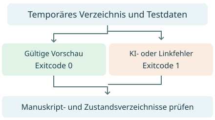

---
{
  "state": "draft",
  "language": "de",
  "translationKey": "2026-11-26-news-dry-run-guide",
  "title": "Nachrichtenentwürfe in GitHub Actions ohne Veröffentlichung prüfen",
  "description": "Zwei Prüfungen zeigen, ob der Entwurf gültig ist und ob Manuskripte, Veröffentlichungswarteschlange und gespeicherter Zustand nach dem Lauf unverändert sind.",
  "sourcePath": "src/content/posts/en/2026-11-26-news-dry-run-guide.md",
  "sourceSha256": "bbd2b23eadacc9df77585d34bf7ba6243a6a849fbbfcba51c6f2272b35553659"
}
---

Ein Entwurf kann die Schemaprüfung bestehen und trotzdem einen Eintrag in der Veröffentlichungswarteschlange hinterlassen. Ein Test für den Probelauf prüft deshalb beides. Liefert die Eingabe den erwarteten Exitcode? Stimmen die Dateien für Manuskripte, Warteschlange und Zustand mit denen vor dem Lauf überein?

## Erfolgreiche Vorschau und Fehlerfälle testen

Den folgenden Befehl mit Python 3 im Stammverzeichnis des Repositorys ausführen. Beide Tests arbeiten in temporären Verzeichnissen und verwenden Testdaten für den Feed, die Entwurfserstellung und die Linkprüfung. Sie benötigen weder Netzwerkzugriff noch einen API-Schlüssel für das Modell.

```sh
PYTHONPATH=scripts python3 -B -m unittest \
  test_bilingual_digest.PublicationTests.test_preview_validates_without_writing_content_or_state \
  test_bilingual_digest.PublicationTests.test_ai_or_link_failures_do_not_write
```



Der erste Test setzt `--dry-run --force` und erwartet den Exitcode 0 sowie `generated=false`. Der zweite setzt `--check-links`, simuliert in getrennten Fällen einen KI- und einen Linkfehler und erwartet jeweils den Exitcode 1. Beide Tests schlagen fehl, wenn unter dem temporären Stammverzeichnis `src` oder `.pipeline` entsteht. Der Aufruf oben meldete `Ran 2 tests` und `OK`.

## Was der lokale Lauf mit dem Spring-Artikel geprüft hat

Ein separater lokaler Lauf verwendete einen [Artikel des Spring-AI-Teams](https://spring.io/blog/2026/11/24/spring-ai-tool-call-confirmation-park-resume). Die isolierte Testumgebung übergab `--dry-run --force --max-items 1 --check-links` und spielte vorbereitete Antworten nur für die Generierung und die Prüfung durch Gemini ein. Ein direkter CLI-Aufruf mit diesen Argumenten spielt die Testdaten nicht ein.

Der Abruf des Originals ergab HTTP 200. Der Lauf prüfte die Links, glich insgesamt 4 Zitate aus dem koreanischen und dem englischen Entwurf mit dem Original ab und validierte die Inhalte gegen die Schemas in Python und Astro. Die Ausgabe war `generated=false`. Ein separater Vergleich ergab für alle 3.333 Dateien der Manuskripte, der Warteschlange und des Zustands identische Pfade und Inhalte vor und nach dem Lauf. Verfügbarkeit und Ausgabequalität des echten Gemini-Dienstes blieben ungeprüft. [Protokoll des lokalen Laufs](https://github.com/youdozi/youdozi.github.io/pull/198)

## Berechtigungen des Prüfjobs für Pull Requests begrenzen

In der regulären CI des PR bestand der vorgeschriebene Check `build / build`. Der Job `deploy` wurde übersprungen. Der Abgleich mit dem Spring-Original ist im Protokoll des lokalen Laufs dokumentiert. [Prüfergebnisse des PR](https://github.com/youdozi/youdozi.github.io/actions/runs/45734945701) · [Warum die Astro-Prüfung im frischen Checkout scheiterte (auf Koreanisch)](https://youdozi.github.io/ko/posts/2026-11-26-astro-clean-checkout/)

Für einen separaten Prüfjob genügt zum Auschecken `contents: read`. Zugangsdaten für die Veröffentlichung gehören nicht in diesen Job. Auch mit einem schreibgeschützten Repository-Token kann der Prozess lokale Dateien ändern. Deshalb lohnt sich der Vergleich der Manuskript-, Warteschlangen- und Zustandsdateien vor und nach dem Lauf. [GitHub-Dokumentation zum Job-Token](https://docs.github.com/en/actions/concepts/security/github_token)
