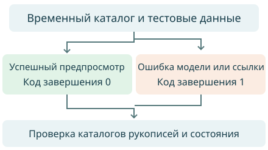

---
{
  "state": "draft",
  "language": "ru",
  "translationKey": "2026-11-26-news-dry-run-guide",
  "title": "Как проверить черновики новостей в GitHub Actions без публикации",
  "description": "Проверяем, прошёл ли черновик валидацию и совпадают ли файлы рукописей, очереди публикации и состояния до и после запуска.",
  "sourcePath": "src/content/posts/en/2026-11-26-news-dry-run-guide.md",
  "sourceSha256": "bbd2b23eadacc9df77585d34bf7ba6243a6a849fbbfcba51c6f2272b35553659"
}
---

Черновик может пройти проверку по схеме и при этом оставить запись в очереди публикации. Поэтому тест проверяет два условия. Вернула ли программа ожидаемый для этих входных данных код завершения? Совпадают ли файлы рукописей, очереди и состояния с теми, что были до запуска?

## Проверка успешного предпросмотра и обработки ошибок

Выполните команду в корне репозитория с помощью Python 3. Оба теста работают во временных каталогах и используют заранее заданные данные для ленты, генерации черновика и проверки ссылок. Доступ к сети и ключ API модели не требуются.

```sh
PYTHONPATH=scripts python3 -B -m unittest \
  test_bilingual_digest.PublicationTests.test_preview_validates_without_writing_content_or_state \
  test_bilingual_digest.PublicationTests.test_ai_or_link_failures_do_not_write
```



Первый тест передаёт `--dry-run --force` и проверяет код завершения 0 и значение `generated=false`. Второй передаёт `--check-links`, по отдельности имитирует ошибку модели и ошибку ссылки и каждый раз проверяет код завершения 1. Оба теста завершаются неудачей, если во временном корневом каталоге появляется `src` или `.pipeline`. При запуске приведённой команды получен результат `Ran 2 tests` и `OK`.

## Что проверили локально на статье Spring

Для отдельного локального запуска взяли одну [статью команды Spring AI](https://spring.io/blog/2026/11/24/spring-ai-tool-call-confirmation-park-resume). В изолированной тестовой среде передали `--dry-run --force --max-items 1 --check-links` и подставили заготовленные ответы только для генерации и рецензирования в Gemini. При обычном запуске CLI с этими флагами такая подстановка не выполняется.

При загрузке оригинала сервер вернул HTTP 200. Проверили ссылки, сверили с опубликованным текстом все 4 цитаты из корейского и английского черновиков и проверили данные по схемам Python и Astro. Программа вывела `generated=false`. При отдельном сравнении пути и содержимое всех 3 333 файлов рукописей, очереди и состояния совпали до и после запуска. Доступность реального сервиса Gemini и качество его ответов в этом опыте не проверяли. [Отчёт о локальном запуске](https://github.com/youdozi/youdozi.github.io/pull/198)

## Ограничение прав задания проверки в PR

В обычном запуске CI для этого PR обязательная проверка `build / build` прошла успешно, а задание `deploy` было пропущено. Результаты сверки с оригиналом Spring приведены в отчёте о локальном запуске. [Результаты проверок PR](https://github.com/youdozi/youdozi.github.io/actions/runs/45734945701) · [Почему проверка Astro завершалась ошибкой в чистой рабочей копии (на корейском)](https://youdozi.github.io/ko/posts/2026-11-26-astro-clean-checkout/)

Для отдельного задания проверки достаточно дать на получение кода право `contents: read` и не передавать учётные данные для публикации. Даже с токеном, предоставляющим доступ к репозиторию только на чтение, процесс может менять локальные файлы. Поэтому сравнивайте файлы рукописей, очереди и состояния до и после запуска. [Документация GitHub о токене задания](https://docs.github.com/en/actions/concepts/security/github_token)
