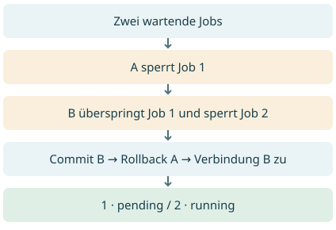

---
{
  "state": "draft",
  "language": "de",
  "translationKey": "2026-11-26-postgres-skip-locked-queue",
  "title": "Eine Jobwarteschlange mit PostgreSQL SKIP LOCKED: Was passiert beim Ausfall eines Workers?",
  "description": "Zwei Sitzungen übernehmen je einen Job. Welche Zeile ist nach einem Rollback wieder verfügbar, und was bleibt nach einem Commit mit anschließendem Verbindungsabbruch zurück?",
  "sourcePath": "src/content/posts/en/2026-11-26-postgres-skip-locked-queue.md",
  "sourceSha256": "47e798b84fdcc29b4f58d8c6e35bed1ea56c2145f4c9767e14b18888eee939d8"
}
---

Solange A den ersten Job sperrt, kann B mit `SKIP LOCKED` den nächsten übernehmen. Fällt B unmittelbar nach dem Commit aus, bleibt der Job auf `running`. Zeilensperren verteilen die Arbeit. Die Warteschlange muss zusätzlich festhalten, wann ein anderer Worker übernehmen darf.

## In jeder Sitzung einen Job übernehmen

Sitzung A mit einer leeren Übungsdatenbank verbinden und die folgenden Anweisungen mit Autocommit ausführen. Sitzung B mit derselben Datenbank verbinden. Beide verwenden die voreingestellte Isolationsstufe `READ COMMITTED`.

```sql
CREATE TABLE queue_demo (
  id bigint GENERATED ALWAYS AS IDENTITY PRIMARY KEY,
  status text NOT NULL DEFAULT 'pending'
);
INSERT INTO queue_demo (status) VALUES ('pending'), ('pending');
```

Den nächsten Block zuerst in A ausführen und die Transaktion offen lassen. Dann denselben Block in B ausführen. Beide Transaktionen offen halten, bis die zurückgegebenen Zeilen vorliegen.

```sql
BEGIN;
WITH next_job AS (
  SELECT id FROM queue_demo
  WHERE status = 'pending'
  ORDER BY id
  LIMIT 1
  FOR UPDATE SKIP LOCKED
)
UPDATE queue_demo AS job
SET status = 'running'
FROM next_job
WHERE job.id = next_job.id
RETURNING job.id, job.status;
```



`ORDER BY id` legt fest, in welcher Reihenfolge die Kandidaten geprüft werden. B kann zuerst committen, die Jobs können also in anderer Reihenfolge fertig werden. PostgreSQL beschreibt diesen Einsatz von Zeilensperren für mehrere Verbraucher, die auf eine Warteschlangentabelle zugreifen. [Sperrklausel von SELECT in PostgreSQL](https://www.postgresql.org/docs/current/sql-select.html#SQL-FOR-UPDATE-SHARE)

## Nach dem Commit die Verbindung schließen

In B `COMMIT;` ausführen, anschließend in A `ROLLBACK;`. Die Verbindung von B schließen und in A den Zustand abfragen.

```sql
SELECT id, status FROM queue_demo ORDER BY id;
```

Für diesen Versuch habe ich zwei Verbindungen zu einer isolierten lokalen Instanz von PostgreSQL 17.12 geöffnet. Bei der Übernahme lieferte A `(1, running)` und B `(2, running)`. Die abschließende Abfrage ergab diese Zeilen.

```text
id | status
1  | pending
2  | running
```

Das Rollback in A nahm die Statusänderung zurück. Das Commit in B gab die Sperre frei und schrieb die Änderung fest. Der nächste Worker sucht nach `pending` und überspringt daher weiterhin Job 2.

## Einen Job nach Ablauf der Frist neu vergeben

In einer produktiven Warteschlange hält die kurze Transaktion bei der Übernahme eine Frist und eine neue Versuchs-ID fest und erhöht den Versuchszähler. Die Arbeit beginnt nach dem Commit. Ein Worker zur Wiederherstellung sperrt einen laufenden Job mit abgelaufener Frist und prüft den Zustand erneut. Sind Versuche übrig, vergibt er eine neue Versuchs-ID und eine neue Frist. Ist das Limit erreicht, wird der Job zur Untersuchung als fehlgeschlagen markiert.

Ein verspäteter Worker darf den Abschluss nur eintragen, wenn Job-ID, laufender Status und eigene Versuchs-ID übereinstimmen. Nach einer Neuvergabe aktualisiert er damit keine Zeile. Er kann jedoch eine E-Mail versenden und ausfallen, bevor er den Abschluss einträgt. Bei jedem erneuten Versand derselben Nachricht muss der Maildienst denselben Idempotenzschlüssel erhalten und doppelte Sendungen anhand dieses Schlüssels unterdrücken. Bei der Neuvergabe ändert sich die Versuchs-ID, der Versandschlüssel bleibt gleich.
