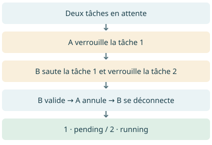

---
{
  "state": "draft",
  "language": "fr",
  "translationKey": "2026-11-26-postgres-skip-locked-queue",
  "title": "Une file de tâches avec PostgreSQL SKIP LOCKED : que se passe-t-il si un worker s’arrête ?",
  "description": "Deux sessions prennent chacune une tâche. Laquelle redevient disponible après une annulation et que reste-t-il après une validation suivie d’une déconnexion ?",
  "sourcePath": "src/content/posts/en/2026-11-26-postgres-skip-locked-queue.md",
  "sourceSha256": "47e798b84fdcc29b4f58d8c6e35bed1ea56c2145f4c9767e14b18888eee939d8"
}
---

Tant que A verrouille la première tâche, B peut prendre la suivante avec `SKIP LOCKED`. Si B s’arrête juste après avoir validé sa prise en charge, la tâche reste à l’état `running`. Les verrous de ligne permettent de répartir les tâches. La file doit aussi garder la trace du moment où un autre worker pourra prendre le relais.

## Prendre une tâche par session

Connectez la session A à une base d’exercice vide et exécutez ces instructions en mode autocommit. Connectez B à la même base. Utilisez le niveau d’isolation par défaut, `READ COMMITTED`, dans les deux sessions.

```sql
CREATE TABLE queue_demo (
  id bigint GENERATED ALWAYS AS IDENTITY PRIMARY KEY,
  status text NOT NULL DEFAULT 'pending'
);
INSERT INTO queue_demo (status) VALUES ('pending'), ('pending');
```

Exécutez le bloc suivant dans A et laissez la transaction ouverte. Exécutez ensuite le même bloc dans B. Gardez les deux transactions ouvertes jusqu’à ce que vous ayez vu les lignes renvoyées.

```sql
BEGIN;
WITH next_job AS (
  SELECT id FROM queue_demo
  WHERE status = 'pending'
  ORDER BY id
  LIMIT 1
  FOR UPDATE SKIP LOCKED
)
UPDATE queue_demo AS job
SET status = 'running'
FROM next_job
WHERE job.id = next_job.id
RETURNING job.id, job.status;
```



`ORDER BY id` fixe l’ordre d’examen des tâches candidates. B peut valider en premier, donc les tâches peuvent se terminer dans un autre ordre. PostgreSQL décrit cet usage des verrous de ligne lorsque plusieurs consommateurs se disputent les lignes d’une file. [Clause de verrouillage de SELECT dans PostgreSQL](https://www.postgresql.org/docs/current/sql-select.html#SQL-FOR-UPDATE-SHARE)

## Fermer la connexion après la validation

Exécutez `COMMIT;` dans B, puis `ROLLBACK;` dans A. Fermez la connexion de B et interrogez la table depuis A.

```sql
SELECT id, status FROM queue_demo ORDER BY id;
```

J’ai fait cet essai avec deux connexions à une instance locale isolée de PostgreSQL 17.12. Lors de la prise en charge, A a renvoyé `(1, running)` et B a renvoyé `(2, running)`. La dernière requête a donné les lignes suivantes.

```text
id | status
1  | pending
2  | running
```

L’annulation dans A a défait le changement d’état. La validation dans B a libéré le verrou et enregistré le changement. Le prochain worker cherche les lignes à l’état `pending` et passera donc encore sur la tâche 2 sans la prendre.

## Réattribuer une tâche dont le délai a expiré

En production, enregistrez une échéance et un nouvel identifiant de tentative, puis incrémentez le compteur de tentatives dans la courte transaction de prise en charge. Effectuez le travail après la validation. Un worker de reprise verrouille la tâche en cours dont le délai a expiré et revérifie son état. S’il reste des tentatives, il lui attribue un nouvel identifiant de tentative et une nouvelle échéance. Si la limite est atteinte, marquez la tâche en échec pour examen.

Pour enregistrer la fin d’une tâche, un worker qui revient tard vérifie dans la mise à jour l’identifiant de tâche, l’état en cours et son propre identifiant de tentative. Après réattribution, aucune ligne ne sera modifiée. Mais le worker peut envoyer un courriel et s’arrêter avant d’enregistrer la fin de la tâche. Réutilisez la même clé d’idempotence à chaque tentative d’envoi de ce courriel et faites dédupliquer les envois par le service de messagerie à partir de cette clé. L’identifiant de tentative change lors de la réattribution, la clé d’envoi reste la même.
