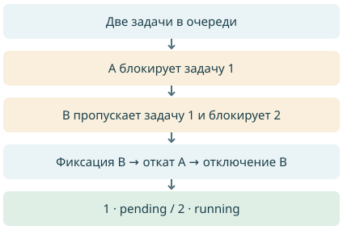

---
{
  "state": "draft",
  "language": "ru",
  "translationKey": "2026-11-26-postgres-skip-locked-queue",
  "title": "Очередь задач в PostgreSQL с SKIP LOCKED: что будет, если обработчик остановится?",
  "description": "Два сеанса берут по задаче. Какая задача снова станет доступна после отката и что произойдёт, если закрыть соединение после фиксации транзакции?",
  "sourcePath": "src/content/posts/en/2026-11-26-postgres-skip-locked-queue.md",
  "sourceSha256": "47e798b84fdcc29b4f58d8c6e35bed1ea56c2145f4c9767e14b18888eee939d8"
}
---

Пока сеанс A удерживает блокировку первой задачи, B может взять следующую с помощью `SKIP LOCKED`. Если обработчик B остановится сразу после фиксации транзакции, задача останется в состоянии `running`. Блокировки строк позволяют распределить работу. Очереди также нужно хранить срок, после которого задачу может взять другой обработчик.

## Взять по одной задаче в каждом сеансе

Подключите сеанс A к пустой учебной базе и выполните следующие команды в режиме автофиксации. Подключите B к той же базе. В обоих сеансах используйте уровень изоляции по умолчанию — `READ COMMITTED`.

```sql
CREATE TABLE queue_demo (
  id bigint GENERATED ALWAYS AS IDENTITY PRIMARY KEY,
  status text NOT NULL DEFAULT 'pending'
);
INSERT INTO queue_demo (status) VALUES ('pending'), ('pending');
```

Сначала выполните следующий блок в A и оставьте транзакцию открытой. Затем выполните тот же блок в B. Оставьте обе транзакции открытыми, пока не увидите обе возвращённые строки.

```sql
BEGIN;
WITH next_job AS (
  SELECT id FROM queue_demo
  WHERE status = 'pending'
  ORDER BY id
  LIMIT 1
  FOR UPDATE SKIP LOCKED
)
UPDATE queue_demo AS job
SET status = 'running'
FROM next_job
WHERE job.id = next_job.id
RETURNING job.id, job.status;
```



`ORDER BY id` задаёт порядок просмотра кандидатов. Сеанс B может зафиксировать транзакцию первым, поэтому порядок завершения задач может отличаться. В документации PostgreSQL такой способ блокировки строк описан для очереди, из которой задачи забирают несколько потребителей. [Блокирующее предложение SELECT в PostgreSQL](https://www.postgresql.org/docs/current/sql-select.html#SQL-FOR-UPDATE-SHARE)

## Закрыть соединение после фиксации транзакции

Выполните `COMMIT;` в B, а затем `ROLLBACK;` в A. Закройте соединение B и проверьте состояние задач из A.

```sql
SELECT id, status FROM queue_demo ORDER BY id;
```

Я выполнил пример с двумя соединениями в изолированном локальном экземпляре PostgreSQL 17.12. При получении задач A вернул `(1, running)`, а B — `(2, running)`. Последний запрос вернул следующие строки.

```text
id | status
1  | pending
2  | running
```

Откат в A отменил изменение состояния. Фиксация в B освободила блокировку и сохранила изменение. Следующий обработчик ищет строки в состоянии `pending` и снова пропустит задачу 2.

## Передать задачу после истечения срока

В рабочей очереди при получении задачи запишите срок обработки и новый идентификатор попытки, а также увеличьте счётчик попыток в той же короткой транзакции. Выполняйте работу после фиксации. Обработчик восстановления блокирует просроченную задачу в работе и повторно проверяет её состояние. Если попытки ещё остались, он назначает новый идентификатор попытки и новый срок. По достижении лимита пометьте задачу как неуспешную для дальнейшего разбора.

Опоздавший обработчик записывает результат только при совпадении идентификатора задачи, состояния «в работе» и собственного идентификатора попытки. После передачи задачи такое обновление не затронет ни одной строки. Но обработчик может отправить письмо и остановиться до записи результата. При каждой повторной отправке этого письма используйте тот же ключ идемпотентности, по которому почтовый сервис отсекает дубликаты. При передаче задачи идентификатор попытки меняется, а ключ отправки сохраняется.
