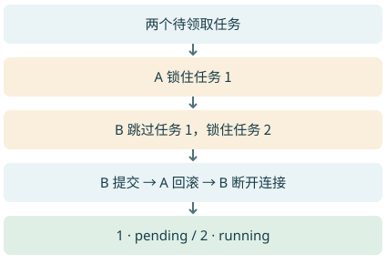

---
{
  "state": "draft",
  "language": "zh-CN",
  "translationKey": "2026-11-26-postgres-skip-locked-queue",
  "title": "用 PostgreSQL SKIP LOCKED 构建任务队列：工作进程中途退出会怎样？",
  "description": "用两个会话领取任务，观察回滚和提交后断开连接分别会让任务停在哪个状态。",
  "sourcePath": "src/content/posts/en/2026-11-26-postgres-skip-locked-queue.md",
  "sourceSha256": "47e798b84fdcc29b4f58d8c6e35bed1ea56c2145f4c9767e14b18888eee939d8"
}
---

A 锁住队首任务时，B 可以用 `SKIP LOCKED` 领取下一个任务。如果 B 提交领取结果后立即退出，任务就会停在 `running` 状态。行锁可以让工作进程分头处理任务，队列还需要记录何时允许其他进程接手。

## 让两个会话各领一个任务

将会话 A 连接到空的练习数据库，在自动提交模式下执行以下初始化语句。让 B 连接到同一个数据库。两个会话都使用默认隔离级别 `READ COMMITTED`。

```sql
CREATE TABLE queue_demo (
  id bigint GENERATED ALWAYS AS IDENTITY PRIMARY KEY,
  status text NOT NULL DEFAULT 'pending'
);
INSERT INTO queue_demo (status) VALUES ('pending'), ('pending');
```

先在 A 中执行下面整段 SQL，保持事务打开。再在 B 中执行相同的语句。看到两个会话各自返回的行后再提交。

```sql
BEGIN;
WITH next_job AS (
  SELECT id FROM queue_demo
  WHERE status = 'pending'
  ORDER BY id
  LIMIT 1
  FOR UPDATE SKIP LOCKED
)
UPDATE queue_demo AS job
SET status = 'running'
FROM next_job
WHERE job.id = next_job.id
RETURNING job.id, job.status;
```



`ORDER BY id` 决定检查候选行的顺序。B 可以先提交，所以任务的完成顺序可能不同。PostgreSQL 文档指出，多个消费者争用队列表中的行锁时可以采用这种方式。 [PostgreSQL SELECT 锁定子句](https://www.postgresql.org/docs/current/sql-select.html#SQL-FOR-UPDATE-SHARE)

## 提交后断开连接

先在 B 中执行 `COMMIT;`，再在 A 中执行 `ROLLBACK;`。关闭 B 的连接，然后从 A 查询任务状态。

```sql
SELECT id, status FROM queue_demo ORDER BY id;
```

我在隔离的本地 PostgreSQL 17.12 实例上用两个连接运行了示例。领取时，A 返回 `(1, running)`，B 返回 `(2, running)`。最后一次查询返回以下两行。

```text
id | status
1  | pending
2  | running
```

A 的回滚撤销了状态变更。B 的提交释放了锁，也保存了状态变更。下一个工作进程只查找 `pending` 行，因此仍会跳过任务 2。

## 让其他工作进程接手过期任务

在生产队列中，用一个短事务领取任务，同时记录截止时间和新的尝试 ID，并增加尝试次数。提交后再处理任务。恢复进程锁住已过期且仍在运行的任务，重新检查其状态。如果还有尝试次数，就分配新的尝试 ID 和截止时间。达到上限则标记为失败，留待排查。

迟到的进程只有在任务 ID、运行状态和自己的尝试 ID 都匹配时才能写入完成状态。交接后，这个更新影响的行数为零。不过，进程也可能刚发完邮件就退出，来不及记录完成状态。每次重试发送同一封邮件时，都要复用同一个幂等键，由邮件服务据此去重。交接时尝试 ID 会变，发送邮件的键保持不变。
