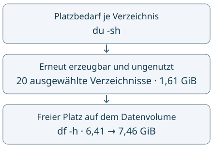

---
{
  "state": "draft",
  "language": "de",
  "translationKey": "2026-11-27-mac-disk-cleanup-du-df",
  "title": "Wenn der Mac-Build am Speicherplatz scheitert: Aufräumen mit du und df",
  "description": "Nach dem manuellen Aufräumen habe ich die Verzeichnisgrößen mit dem Zuwachs an freiem Speicherplatz auf dem Datenvolume verglichen.",
  "sourcePath": "src/content/posts/en/2026-11-27-mac-disk-cleanup-du-df.md",
  "sourceSha256": "2114224ef5dde962e3cfc28f12de1aa1dbba58c0343db9c3e8e6277ce204cc19"
}
---

Beim vollständigen lokalen Build des Artikels zur PostgreSQL-Jobwarteschlange ging dem Mac der Speicherplatz aus. Die Prüfungen auf GitHub waren erfolgreich, ebenso die Bereitstellung auf GitHub Pages. Ob der zuvor bei einem anderen Worker gemeldete `hostFault` zum selben Vorfall gehörte, ist ungeklärt. [PR zur Veröffentlichung #202](https://github.com/youdozi/youdozi.github.io/pull/202)

## Welche Verzeichnisse kamen infrage?

Bei einer separaten manuellen Aufräumaktion wählte ich 20 Verzeichnisse abgeschlossener Jobs aus. Dazu gehörten die erneut erzeugbaren Build-Ausgaben `dist` und `.astro` sowie Abhängigkeits- und Build-Verzeichnisse aus einmaligen Prüfungen. Noch genutzte Pfade blieben erhalten.

Die folgenden Lesebefehle lassen sich unter macOS im Stammverzeichnis eines Git-Repositorys mit beiden Build-Verzeichnissen ausführen. `du` zeigt den belegten Platz je Pfad an. `git ls-files` listet die dort von Git erfassten Dateien auf, `git check-ignore` die Pfade, für die eine Ausschlussregel greift.

```sh
du -sh ./dist ./.astro
git ls-files -- dist .astro
git check-ignore -- dist .astro
```

Auch ein von Git ignoriertes Verzeichnis kann noch in Gebrauch sein. Vor der Auswahl prüfte ich für jeden Kandidaten, ob er sich wiederherstellen ließ und kein laufender Job ihn mehr nutzte.

## Wie viel Speicherplatz wurde frei?



Die ausgewählten Verzeichnisse belegten zusammen 1,61 GiB. Auf demselben Datenvolume stieg der freie Platz von 6,41 GiB vor dem Aufräumen auf 7,46 GiB danach, also um rund 1,05 GiB.

Mit dem folgenden Befehl lässt sich die Spalte `Avail` vor und nach dem Aufräumen vergleichen. `df` meldet den freien Platz auf dem Dateisystem, zu dem der angegebene Pfad gehört. APFS-Volumes im selben Container können dessen freien Platz gemeinsam nutzen. Weshalb die Summe der Verzeichnisgrößen hier vom gemessenen Zuwachs abwich, konnte ich nicht feststellen. [Apple zur Speicherplatzfreigabe in APFS](https://support.apple.com/ko-kr/guide/security/seca6147599e/web)

```sh
df -h /System/Volumes/Data
```
