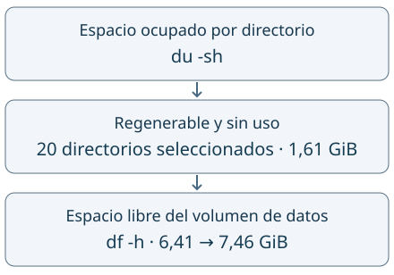

---
{
  "state": "draft",
  "language": "es",
  "translationKey": "2026-11-27-mac-disk-cleanup-du-df",
  "title": "La compilación se detuvo en el Mac: cómo medí la limpieza con du y df",
  "description": "Medí el espacio ocupado por los directorios y el aumento de espacio disponible en el volumen de datos tras una limpieza manual.",
  "sourcePath": "src/content/posts/en/2026-11-27-mac-disk-cleanup-du-df.md",
  "sourceSha256": "2114224ef5dde962e3cfc28f12de1aa1dbba58c0343db9c3e8e6277ce204cc19"
}
---

El Mac se quedó sin espacio en disco durante la compilación local completa del artículo sobre la cola de tareas de PostgreSQL. Las comprobaciones remotas y el despliegue en GitHub Pages finalizaron correctamente. No se ha determinado si el `hostFault` que registró antes otro proceso de trabajo correspondía al mismo incidente. [PR de publicación n.º 202](https://github.com/youdozi/youdozi.github.io/pull/202)

## ¿Qué directorios se podían eliminar?

En una limpieza manual posterior seleccioné 20 directorios de tareas que ya habían terminado. Incluían las salidas de compilación regenerables `dist` y `.astro`, además de directorios de dependencias y de compilación usados en verificaciones puntuales. Excluí las rutas que seguían en uso.

Estos comandos de solo lectura se ejecutan en macOS desde la raíz de un repositorio Git que contenga ambos directorios de compilación. `du` indica cuánto ocupa cada ruta. `git ls-files` enumera los archivos bajo control de versiones en esas rutas y `git check-ignore` muestra las rutas que coinciden con una regla de exclusión.

```sh
du -sh ./dist ./.astro
git ls-files -- dist .astro
git check-ignore -- dist .astro
```

Un directorio que Git ignora puede contener archivos en uso. Antes de incluir cada directorio en la limpieza, comprobé que podía regenerarlo y que ninguna tarea en ejecución lo estaba utilizando.

## ¿Cuánto espacio quedó disponible?



Los directorios seleccionados ocupaban en total 1,61 GiB. En el mismo volumen de datos, el espacio disponible pasó de 6,41 GiB antes de la limpieza a 7,46 GiB después, un aumento de unos 1,05 GiB.

El siguiente comando permite comparar la columna `Avail` antes y después de la limpieza. `df` indica el espacio disponible en el sistema de archivos que contiene la ruta indicada. Los volúmenes APFS de un mismo contenedor pueden compartir el espacio libre. No pude determinar la causa de la diferencia entre el tamaño total de los directorios y el aumento observado. [Guía de Apple sobre el espacio compartido en APFS](https://support.apple.com/ko-kr/guide/security/seca6147599e/web)

```sh
df -h /System/Volumes/Data
```
