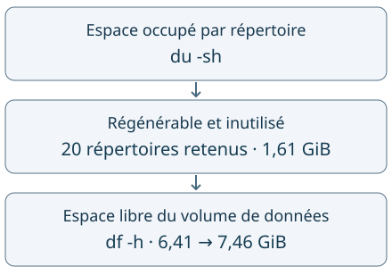

---
{
  "state": "draft",
  "language": "fr",
  "translationKey": "2026-11-27-mac-disk-cleanup-du-df",
  "title": "Compilation interrompue sur Mac : mesurer l’espace libéré avec du et df",
  "description": "Après un nettoyage manuel, j’ai comparé la taille des répertoires retenus au gain d’espace libre sur le volume de données.",
  "sourcePath": "src/content/posts/en/2026-11-27-mac-disk-cleanup-du-df.md",
  "sourceSha256": "2114224ef5dde962e3cfc28f12de1aa1dbba58c0343db9c3e8e6277ce204cc19"
}
---

Le Mac a manqué d’espace disque pendant la compilation locale complète de l’article sur la file de tâches PostgreSQL. Les contrôles à distance et le déploiement sur GitHub Pages ont abouti. Le lien éventuel avec le `hostFault` signalé auparavant par un autre worker reste inconnu. [PR de publication nº 202](https://github.com/youdozi/youdozi.github.io/pull/202)

## Quels répertoires supprimer ?

Lors d’un nettoyage manuel distinct, j’ai retenu 20 répertoires de tâches terminées. Il s’agissait des sorties de compilation régénérables `dist` et `.astro`, ainsi que de répertoires de dépendances et de compilation utilisés pour des vérifications ponctuelles. J’ai écarté les chemins encore utilisés.

Ces commandes en lecture seule s’exécutent sous macOS à la racine d’un dépôt Git contenant les deux répertoires de compilation. `du` indique l’espace occupé par chaque chemin. `git ls-files` liste les fichiers suivis sous ces chemins et `git check-ignore` indique les chemins visés par une règle d’exclusion.

```sh
du -sh ./dist ./.astro
git ls-files -- dist .astro
git check-ignore -- dist .astro
```

Un répertoire ignoré par Git peut contenir des fichiers en cours d’utilisation. Avant de retenir un répertoire, j’ai vérifié que je pouvais le recréer et qu’aucune tâche en cours ne s’en servait.

## Combien d’espace le volume a-t-il gagné ?



Les répertoires retenus occupaient au total 1,61 GiB. Sur le même volume de données, l’espace disponible est passé de 6,41 GiB avant le nettoyage à 7,46 GiB après, soit un gain d’environ 1,05 GiB.

La commande ci-dessous permet de comparer la colonne `Avail` avant et après le nettoyage. `df` indique l’espace disponible sur le système de fichiers qui contient le chemin fourni. Les volumes APFS d’un même conteneur peuvent partager son espace libre. La cause de l’écart entre la taille cumulée des répertoires et le gain observé reste indéterminée. [Le partage d’espace APFS selon Apple](https://support.apple.com/ko-kr/guide/security/seca6147599e/web)

```sh
df -h /System/Volumes/Data
```
