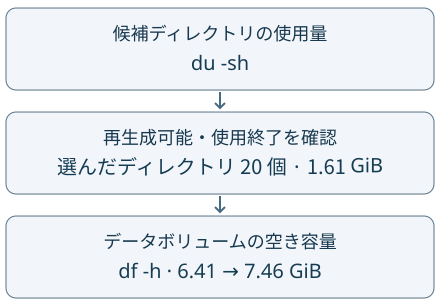

---
{
  "state": "draft",
  "language": "ja",
  "translationKey": "2026-11-27-mac-disk-cleanup-du-df",
  "title": "Mac のビルドが容量不足で停止したとき、du と df で何を測るか",
  "description": "手動で整理したディレクトリの使用量と、データボリュームで実際に増えた空き容量をそれぞれ測りました。",
  "sourcePath": "src/content/posts/en/2026-11-27-mac-disk-cleanup-du-df.md",
  "sourceSha256": "2114224ef5dde962e3cfc28f12de1aa1dbba58c0343db9c3e8e6277ce204cc19"
}
---

Mac のディスク容量が不足し、PostgreSQL のジョブキューの記事をローカルでフルビルドできませんでした。リモートのチェックは通り、GitHub Pages へのデプロイも成功しました。以前、別のワーカーで発生した `hostFault` が同じ障害だったかどうかは分かっていません。[公開用 PR #202](https://github.com/youdozi/youdozi.github.io/pull/202)

## 整理するディレクトリをどう選んだか

別途手動で整理した際、終了済みのジョブから 20 個のディレクトリを選びました。再生成できる `dist` と `.astro` のほか、一度限りの検証で使った依存関係用とビルド用のディレクトリです。使用中のパスは除外しました。

以下は、両方のビルドディレクトリがある macOS 上の Git リポジトリのルートで使える読み取り専用の例です。`du` は指定したパスごとの使用量を示します。`git ls-files` はその配下の追跡対象ファイルを、`git check-ignore` は無視ルールに一致するパスを表示します。

```sh
du -sh ./dist ./.astro
git ls-files -- dist .astro
git check-ignore -- dist .astro
```

Git が無視するディレクトリにも作業中のファイルが入ることがあります。候補ごとに、再生成できることと実行中のジョブが使っていないことを確かめてから整理対象にしました。

## 空き容量はどれだけ増えたか



選んだディレクトリの使用量は合計 1.61 GiB でした。同じデータボリュームの空き容量は整理前の 6.41 GiB から整理後の 7.46 GiB へと、約 1.05 GiB 増えました。

以下のコマンドで整理前後の `Avail` 列を比較できます。`df` は指定したパスを含むファイルシステムの空き容量を示します。APFS では同じコンテナ内の複数のボリュームが空き容量を共有できます。今回、ディレクトリの合計と空き容量の増加分が異なった理由は特定できませんでした。[Apple による APFS の空き容量共有の解説](https://support.apple.com/ko-kr/guide/security/seca6147599e/web)

```sh
df -h /System/Volumes/Data
```
