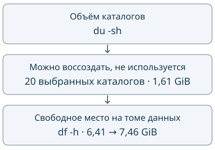

---
{
  "state": "draft",
  "language": "ru",
  "translationKey": "2026-11-27-mac-disk-cleanup-du-df",
  "title": "Сборка на Mac прервалась: как измерить результат очистки с помощью du и df",
  "description": "После ручной очистки я сравнил объём выбранных каталогов с приростом свободного места на томе данных.",
  "sourcePath": "src/content/posts/en/2026-11-27-mac-disk-cleanup-du-df.md",
  "sourceSha256": "2114224ef5dde962e3cfc28f12de1aa1dbba58c0343db9c3e8e6277ce204cc19"
}
---

На Mac закончилось место, и полная локальная сборка статьи об очереди задач PostgreSQL прервалась. Удалённые проверки прошли успешно, как и публикация на GitHub Pages. Неизвестно, относится ли ошибка `hostFault`, которую ранее сообщил другой рабочий процесс, к тому же инциденту. [PR публикации № 202](https://github.com/youdozi/youdozi.github.io/pull/202)

## Какие каталоги можно было удалить?

Во время отдельной ручной очистки я выбрал 20 каталогов завершённых задач. В их число вошли каталоги сборки `dist` и `.astro`, которые можно создать заново, а также каталоги зависимостей и сборки для разовых проверок. Пути, которые ещё использовались, я исключил.

Эти команды только читают данные. Их можно выполнить в macOS из корня репозитория Git, в котором есть оба каталога сборки. Команда `du` показывает место, занятое по каждому пути. Команда `git ls-files` перечисляет отслеживаемые файлы по этим путям, а `git check-ignore` показывает пути, к которым применяется правило игнорирования.

```sh
du -sh ./dist ./.astro
git ls-files -- dist .astro
git check-ignore -- dist .astro
```

Даже если Git игнорирует каталог, его файлы могут использоваться. Перед очисткой я проверил для каждого каталога, что его можно создать заново и он не нужен ни одной выполняющейся задаче.

## Сколько места освободилось?



Суммарный объём выбранных каталогов составил 1,61 GiB. На том же томе данных до очистки было свободно 6,41 GiB, а после — 7,46 GiB. Прирост составил около 1,05 GiB.

С помощью команды ниже можно сравнить значения в столбце `Avail` до и после очистки. Команда `df` показывает свободное место в файловой системе, которой принадлежит указанный путь. Тома APFS внутри одного контейнера могут совместно использовать свободное место. Причину расхождения между суммарным объёмом каталогов и измеренным приростом установить не удалось. [Руководство Apple по совместному использованию пространства APFS](https://support.apple.com/ko-kr/guide/security/seca6147599e/web)

```sh
df -h /System/Volumes/Data
```
