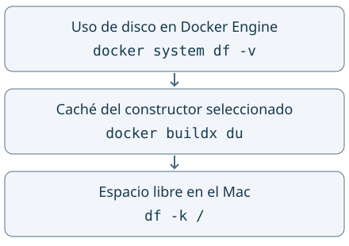

---
{
  "state": "draft",
  "language": "es",
  "translationKey": "2026-11-27-docker-desktop-mac-disk-space",
  "title": "¿Por qué no aumenta el espacio libre en mi Mac tras borrar la caché de Docker?",
  "description": "Cómo medir por separado la caché de compilación recuperable, los bloques asignados a Docker.raw y el espacio disponible en el volumen del Mac.",
  "sourcePath": "src/content/posts/en/2026-11-27-docker-desktop-mac-disk-space.md",
  "sourceSha256": "22ef396043237437e56056391cb42357c8f9bc5784eef9279e396ccf768d1ecd"
}
---

Docker calcula el espacio recuperable a partir de las imágenes y las cachés que guarda en su máquina virtual. macOS mide el espacio libre en el sistema de archivos del equipo y cuenta como ocupados los bloques asignados a la imagen de disco `Docker.raw` de la máquina virtual. Una capa compartida con una imagen puede seguir en disco después de borrar su entrada de caché. [Docker Desktop FAQ](https://docs.docker.com/desktop/troubleshoot-and-support/faqs/macfaqs/) · [Buildx du](https://docs.docker.com/reference/cli/docker/buildx/du/)

## ¿Dónde se mide cada valor?

Con Docker Desktop en ejecución en el Mac, comprueba el contexto local y el constructor. Un asterisco identifica en la lista el constructor seleccionado.

```sh
docker context show
docker buildx ls
docker system df -v
docker buildx du
df -k /
```



El primer informe abarca imágenes, contenedores, volúmenes y caché de compilación. En el segundo, `Reclaimable` indica la caché recuperable del constructor seleccionado. En el último comando, `Available` muestra el espacio libre en el sistema de archivos raíz del Mac, en KiB. [Docker system df](https://docs.docker.com/reference/cli/docker/system/df/)

## ¿Cuánto espacio ocupa realmente Docker.raw?

Busca la ubicación de la imagen de disco en Settings → Resources → Advanced de Docker Desktop y ajusta la ruta del ejemplo para que apunte al archivo. En la salida de `ls -klsh`, la primera columna indica el espacio asignado en KiB y la columna de tamaño muestra el tamaño lógico. El último comando comprueba el sistema de archivos que contiene la imagen, aunque esté en otro volumen.

```sh
image="$HOME/Library/Containers/com.docker.docker/Data/vms/0/data/Docker.raw"
ls -klsh "$image"
stat -f 'bytes=%z blocks=%b' "$image"
df -k "$image"
```

En una consulta de solo lectura en un Mac local, `desktop-linux` indicó que había 61,76 MB de caché de compilación recuperable. El tamaño lógico de la imagen de disco era de 63 999 836 160 bytes. Ocupaba 12 272 488 bloques de 512 bytes cada uno, unos 6,28 GB.

Si quieres borrar solo la caché de compilación, comprueba primero qué constructor está seleccionado. Compara las lecturas de los mismos comandos justo antes de la limpieza y unos minutos después. En esta consulta no se borró la caché ni se midió cuánto espacio recuperó el Mac. [Buildx prune](https://docs.docker.com/reference/cli/docker/buildx/prune/)

[Artículo relacionado · Medir la limpieza del disco de un Mac con du y df](../2026-11-27-mac-disk-cleanup-du-df/)
