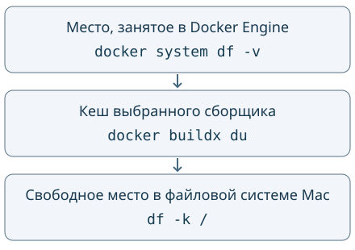

---
{
  "state": "draft",
  "language": "ru",
  "translationKey": "2026-11-27-docker-desktop-mac-disk-space",
  "title": "Почему после очистки кеша Docker на Mac не прибавилось свободного места?",
  "description": "Как отдельно измерить объём кеша сборки, доступного для очистки, размер выделенных для Docker.raw блоков и свободное место на томе Mac.",
  "sourcePath": "src/content/posts/en/2026-11-27-docker-desktop-mac-disk-space.md",
  "sourceSha256": "22ef396043237437e56056391cb42357c8f9bc5784eef9279e396ccf768d1ecd"
}
---

Docker учитывает образы и кеши внутри виртуальной машины и сообщает, сколько места можно освободить. macOS измеряет свободное место в файловой системе хоста, где блоки, выделенные под образ диска `Docker.raw`, считаются занятыми. Если слой используется и кешем сборки, и образом контейнера, то после удаления записи кеша слой может остаться на диске. [Docker Desktop FAQ](https://docs.docker.com/desktop/troubleshoot-and-support/faqs/macfaqs/) · [Buildx du](https://docs.docker.com/reference/cli/docker/buildx/du/)

## Что измеряет каждая команда?

При запущенном Docker Desktop на Mac проверьте локальный контекст и сборщик. Выбранный сборщик отмечен звёздочкой в списке.

```sh
docker context show
docker buildx ls
docker system df -v
docker buildx du
df -k /
```



Первый отчёт охватывает образы, контейнеры, тома и кеш сборки. Во втором отчёте `Reclaimable` показывает объём кеша выбранного сборщика, доступного для очистки. В выводе последней команды `Available` указывает свободное место в корневой файловой системе Mac в КиБ. [Docker system df](https://docs.docker.com/reference/cli/docker/system/df/)

## Сколько места на самом деле занимает Docker.raw?

В Docker Desktop откройте Settings → Resources → Advanced, найдите расположение образа диска и укажите в примере путь к файлу. В выводе `ls -klsh` первый столбец показывает выделенное место в КиБ, а столбец размера — логический размер файла. Последняя команда проверяет файловую систему с образом, даже если он находится на другом томе.

```sh
image="$HOME/Library/Containers/com.docker.docker/Data/vms/0/data/Docker.raw"
ls -klsh "$image"
stat -f 'bytes=%z blocks=%b' "$image"
df -k "$image"
```

При проверке в режиме чтения на локальном Mac сборщик `desktop-linux` показал 61,76 МБ кеша сборки, доступного для очистки. Логический размер образа диска составил 63 999 836 160 байт. Файлу было выделено 12 272 488 блоков по 512 байт, то есть около 6,28 ГБ.

Если вы собираетесь очистить только кеш сборки, сначала проверьте выбранный сборщик. Сравните показания тех же команд непосредственно перед очисткой и спустя несколько минут. В ходе этой проверки кеш не удаляли и не измеряли, сколько места освободилось на Mac. [Buildx prune](https://docs.docker.com/reference/cli/docker/buildx/prune/)

[По теме · Как измерить результат очистки диска на Mac с помощью du и df](../2026-11-27-mac-disk-cleanup-du-df/)
