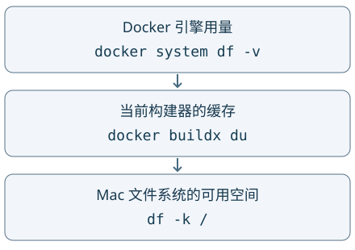

---
{
  "state": "draft",
  "language": "zh-CN",
  "translationKey": "2026-11-27-docker-desktop-mac-disk-space",
  "title": "为什么清理 Docker 缓存后，Mac 的可用空间没变？",
  "description": "分别查看可回收的构建缓存、Docker.raw 实际占用的磁盘块和 Mac 卷上的可用空间。",
  "sourcePath": "src/content/posts/en/2026-11-27-docker-desktop-mac-disk-space.md",
  "sourceSha256": "22ef396043237437e56056391cb42357c8f9bc5784eef9279e396ccf768d1ecd"
}
---

Docker 统计的是虚拟机内的镜像和缓存，并据此报告可回收空间。macOS 统计的是主机文件系统的可用空间，其中要扣除分配给虚拟机磁盘映像 `Docker.raw` 的块。删除构建缓存条目后，与镜像共享的层仍可能占用磁盘空间。 [Docker Desktop FAQ](https://docs.docker.com/desktop/troubleshoot-and-support/faqs/macfaqs/) · [Buildx du](https://docs.docker.com/reference/cli/docker/buildx/du/)

## 这些数字分别在哪里测量？

在 Mac 上运行 Docker Desktop，检查本地上下文和构建器。构建器列表中带星号的是当前选中的构建器。

```sh
docker context show
docker buildx ls
docker system df -v
docker buildx du
df -k /
```



第一份用量报告涵盖镜像、容器、卷和构建缓存。第二份报告的 `Reclaimable` 指当前构建器可回收的缓存。最后一条命令的 `Available` 表示 Mac 根文件系统的可用空间，单位为 KiB。 [Docker system df](https://docs.docker.com/reference/cli/docker/system/df/)

## Docker.raw 实际占用多少空间？

在 Docker Desktop 的 Settings → Resources → Advanced 中找到磁盘映像的位置，将示例路径改为实际文件路径。`ls -klsh` 的第一列是实际分配的空间（KiB），文件大小列是逻辑大小。即使映像位于其他卷，最后一条命令也会检查映像所在的文件系统。

```sh
image="$HOME/Library/Containers/com.docker.docker/Data/vms/0/data/Docker.raw"
ls -klsh "$image"
stat -f 'bytes=%z blocks=%b' "$image"
df -k "$image"
```

在本地 Mac 上进行只读检查时，`desktop-linux` 报告了 61.76 MB 可回收构建缓存。磁盘映像的逻辑大小为 63,999,836,160 字节，实际分配了 12,272,488 个块，每块 512 字节，约合 6.28 GB。

如果只打算清理构建缓存，请先确认当前构建器。在清理前和清理几分钟后用相同的命令比较读数。本次检查没有删除缓存，也没有测量 Mac 实际收回的空间。 [Buildx prune](https://docs.docker.com/reference/cli/docker/buildx/prune/)

[相关文章 · 用 du 和 df 测量 Mac 磁盘清理效果](../2026-11-27-mac-disk-cleanup-du-df/)
