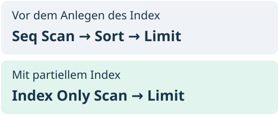

---
{
  "state": "draft",
  "language": "de",
  "translationKey": "2026-11-27-postgres-queue-partial-index",
  "title": "Was bringt ein partieller Index, wenn sich erledigte Jobs in PostgreSQL ansammeln?",
  "description": "Ausführungspläne und Pufferzugriffe beim Abruf der ältesten wartenden Jobs vor und nach dem Anlegen eines partiellen Index.",
  "sourcePath": "src/content/posts/en/2026-11-27-postgres-queue-partial-index.md",
  "sourceSha256": "c12611eba6e452bb96b402836ce6045313c18b44afdbb87a83463f72acf52e81"
}
---

Von 300.000 Jobs waren 297.000 erledigt und nur 3.000 warteten noch. Für die Suche nach den ältesten 20 wartenden Jobs entfiel der Sortierschritt, sobald ein partieller Index die wartenden Zeilen nach Erstellungszeit und ID geordnet bereitstellte.

## Dieselbe Abfrage zweimal ausführen

Die folgenden SQL-Anweisungen der Reihe nach in einer leeren Datenbank ausführen. `ANALYZE` aktualisiert die Tabellenstatistik. Der zwischen den Abfragen angelegte Index enthält nur Zeilen, die `status = 'pending'` erfüllen. [Partielle Indexe](https://www.postgresql.org/docs/19/indexes-partial.html)

```sql
CREATE TABLE jobs (id bigserial PRIMARY KEY, status text NOT NULL, created_at timestamptz NOT NULL);
INSERT INTO jobs (status, created_at)
SELECT CASE WHEN n % 100 = 0 THEN 'pending' ELSE 'done' END,
       timestamptz '2026-01-01 00:00:00+00' + n * interval '1 second'
FROM generate_series(1, 300000) AS g(n);
ANALYZE jobs;

EXPLAIN (ANALYZE, BUFFERS) SELECT id FROM jobs WHERE status = 'pending' ORDER BY created_at, id LIMIT 20;

CREATE INDEX jobs_pending_created_idx ON jobs (created_at, id) WHERE status = 'pending';

EXPLAIN (ANALYZE, BUFFERS) SELECT id FROM jobs WHERE status = 'pending' ORDER BY created_at, id LIMIT 20;
```

## Was ändert sich im Plan?



Der erste Plan liest die gesamte Tabelle, filtert erledigte Jobs aus und sortiert die übrigen Kandidaten. Der Index liefert die wartenden Jobs in der Reihenfolge `(created_at, id)`. Damit kann der zweite Plan bei Erreichen von `LIMIT 20` abbrechen.

| Ausführungsplan | Vor dem Anlegen des Index | Mit partiellem Index |
| --- | --- | --- |
| Gemeinsame Puffer am obersten Knoten | `shared hit=1911` | `shared hit=1 read=2` |
| Messwert am Scan-Knoten | `Rows Removed by Filter=297000` | `Heap Fetches=0` |
| Ergebniszeilen | 20 | 20 |

Jede Abfrage lief einmal in einer isolierten PGlite-Instanz im Arbeitsspeicher mit `@electric-sql/pglite 0.6.0`. `SHOW server_version` ergab `19.0`. Der Wert `read` zählt die in die gemeinsamen PostgreSQL-Puffer eingelesenen Blöcke. Daraus lässt sich bei diesem Versuch kein physischer Plattenzugriff ableiten. [EXPLAIN](https://www.postgresql.org/docs/19/sql-explain.html) · [PGlite](https://pglite.dev/docs/about)

Gemessen wurde die Leseabfrage. Das Reservieren von Jobs mit `FOR UPDATE SKIP LOCKED`, Statusänderungen und der gleichzeitige Betrieb mehrerer Worker erfordern eigene Messungen. [Jobs in zwei Sitzungen mit SKIP LOCKED reservieren](/en/posts/2026-11-26-postgres-skip-locked-queue/)
