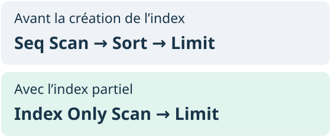

---
{
  "state": "draft",
  "language": "fr",
  "translationKey": "2026-11-27-postgres-queue-partial-index",
  "title": "Que gagne une file de tâches PostgreSQL à utiliser un index partiel quand les tâches terminées s’accumulent ?",
  "description": "Comparaison des plans et des accès aux tampons pour lire les plus anciennes tâches en attente avant et après la création d’un index partiel.",
  "sourcePath": "src/content/posts/en/2026-11-27-postgres-queue-partial-index.md",
  "sourceSha256": "c12611eba6e452bb96b402836ce6045313c18b44afdbb87a83463f72acf52e81"
}
---

Sur 300 000 tâches, 297 000 étaient terminées et seules 3 000 étaient en attente. Pour retrouver les 20 tâches en attente les plus anciennes, le tri a disparu du plan dès qu’un index partiel a fourni ces seules lignes dans l’ordre de création, puis d’identifiant.

## Exécuter deux fois la même requête

Exécutez les instructions SQL ci-dessous dans l’ordre, dans une base vide. `ANALYZE` met à jour les statistiques de la table. L’index créé entre les deux requêtes contient uniquement les lignes qui vérifient `status = 'pending'`. [Index partiels](https://www.postgresql.org/docs/19/indexes-partial.html)

```sql
CREATE TABLE jobs (id bigserial PRIMARY KEY, status text NOT NULL, created_at timestamptz NOT NULL);
INSERT INTO jobs (status, created_at)
SELECT CASE WHEN n % 100 = 0 THEN 'pending' ELSE 'done' END,
       timestamptz '2026-01-01 00:00:00+00' + n * interval '1 second'
FROM generate_series(1, 300000) AS g(n);
ANALYZE jobs;

EXPLAIN (ANALYZE, BUFFERS) SELECT id FROM jobs WHERE status = 'pending' ORDER BY created_at, id LIMIT 20;

CREATE INDEX jobs_pending_created_idx ON jobs (created_at, id) WHERE status = 'pending';

EXPLAIN (ANALYZE, BUFFERS) SELECT id FROM jobs WHERE status = 'pending' ORDER BY created_at, id LIMIT 20;
```

## Comment le plan change-t-il ?



Le premier plan parcourt la table entière, écarte les tâches terminées et trie les candidates restantes. L’index fournit les tâches en attente dans l’ordre `(created_at, id)`. Le second plan peut donc s’arrêter dès que `LIMIT 20` est atteint.

| Plan d’exécution | Avant la création de l’index | Avec l’index partiel |
| --- | --- | --- |
| Tampons partagés au nœud racine | `shared hit=1911` | `shared hit=1 read=2` |
| Détail du nœud de parcours | `Rows Removed by Filter=297000` | `Heap Fetches=0` |
| Lignes renvoyées | 20 | 20 |

Chaque requête a été exécutée une fois dans une instance PGlite isolée, en mémoire, avec `@electric-sql/pglite 0.6.0`. `SHOW server_version` a renvoyé `19.0`. Le compteur `read` indique combien de blocs PostgreSQL a lus dans ses tampons partagés. Cette mesure en mémoire ne permet pas de quantifier les entrées-sorties physiques sur disque. [EXPLAIN](https://www.postgresql.org/docs/19/sql-explain.html) · [PGlite](https://pglite.dev/docs/about)

L’expérience porte sur une requête en lecture. La réservation avec `FOR UPDATE SKIP LOCKED`, les mises à jour de statut et l’exécution simultanée de plusieurs workers demandent des mesures distinctes. [Réserver des tâches avec SKIP LOCKED dans deux sessions](/en/posts/2026-11-26-postgres-skip-locked-queue/)
