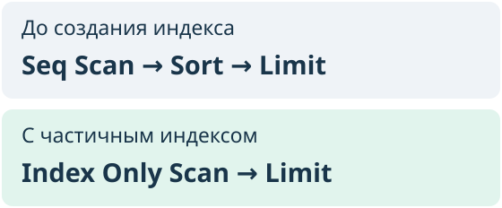

---
{
  "state": "draft",
  "language": "ru",
  "translationKey": "2026-11-27-postgres-queue-partial-index",
  "title": "Что даёт частичный индекс, когда в очереди PostgreSQL накапливаются завершённые задания?",
  "description": "Сравним планы и обращения к буферам при поиске старейших ожидающих заданий до и после создания частичного индекса.",
  "sourcePath": "src/content/posts/en/2026-11-27-postgres-queue-partial-index.md",
  "sourceSha256": "c12611eba6e452bb96b402836ce6045313c18b44afdbb87a83463f72acf52e81"
}
---

Из 300 000 заданий 297 000 завершены, а 3 000 ещё ждут. Для выборки 20 старейших ожидающих заданий сортировка исчезла из плана, когда появился частичный индекс, в котором только ожидающие строки упорядочены по времени создания и идентификатору.

## Дважды выполните один запрос

Выполните SQL ниже по порядку в пустой базе. Команда `ANALYZE` обновляет статистику таблицы. Индекс, созданный между двумя запросами, содержит только строки, удовлетворяющие условию `status = 'pending'`. [Частичные индексы](https://www.postgresql.org/docs/19/indexes-partial.html)

```sql
CREATE TABLE jobs (id bigserial PRIMARY KEY, status text NOT NULL, created_at timestamptz NOT NULL);
INSERT INTO jobs (status, created_at)
SELECT CASE WHEN n % 100 = 0 THEN 'pending' ELSE 'done' END,
       timestamptz '2026-01-01 00:00:00+00' + n * interval '1 second'
FROM generate_series(1, 300000) AS g(n);
ANALYZE jobs;

EXPLAIN (ANALYZE, BUFFERS) SELECT id FROM jobs WHERE status = 'pending' ORDER BY created_at, id LIMIT 20;

CREATE INDEX jobs_pending_created_idx ON jobs (created_at, id) WHERE status = 'pending';

EXPLAIN (ANALYZE, BUFFERS) SELECT id FROM jobs WHERE status = 'pending' ORDER BY created_at, id LIMIT 20;
```

## Как изменился план?



В первом плане PostgreSQL просматривает всю таблицу, отбрасывает завершённые задания и сортирует оставшиеся строки. Индекс выдаёт ожидающие задания в порядке `(created_at, id)`, поэтому во втором плане чтение можно остановить, как только выполнено условие `LIMIT 20`.

| План выполнения | До создания индекса | С частичным индексом |
| --- | --- | --- |
| Общие буферы корневого узла | `shared hit=1911` | `shared hit=1 read=2` |
| Статистика узла сканирования | `Rows Removed by Filter=297000` | `Heap Fetches=0` |
| Строк в результате | 20 | 20 |

Каждый запрос выполнили один раз в изолированной базе PGlite в памяти с пакетом `@electric-sql/pglite 0.6.0`. Команда `SHOW server_version` вернула `19.0`. Счётчик `read` показывает, сколько блоков было прочитано в общие буферы PostgreSQL. По этому опыту в памяти нельзя судить о физических обращениях к диску. [EXPLAIN](https://www.postgresql.org/docs/19/sql-explain.html) · [PGlite](https://pglite.dev/docs/about)

Измерялся запрос на чтение. Получение заданий с `FOR UPDATE SKIP LOCKED`, обновление статуса и одновременная работа нескольких обработчиков требуют отдельных измерений. [Получение заданий с SKIP LOCKED в двух сеансах](/en/posts/2026-11-26-postgres-skip-locked-queue/)
