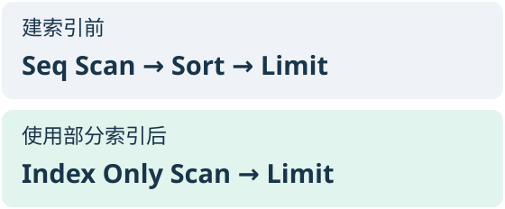

---
{
  "state": "draft",
  "language": "zh-CN",
  "translationKey": "2026-11-27-postgres-queue-partial-index",
  "title": "PostgreSQL 任务队列积累了大量已完成任务，部分索引能帮多大忙？",
  "description": "只为待处理任务建立索引，比较建索引前后查找最早一批任务时的执行计划和缓冲区计数。",
  "sourcePath": "src/content/posts/en/2026-11-27-postgres-queue-partial-index.md",
  "sourceSha256": "c12611eba6e452bb96b402836ce6045313c18b44afdbb87a83463f72acf52e81"
}
---

队列共有 300,000 个任务，其中 297,000 个已完成，只有 3,000 个待处理。查找最早的 20 个待处理任务时，部分索引只收录待处理行，并按创建时间和 ID 排列，执行计划因此省去了排序。

## 执行两次相同的查询

在空数据库中依次执行下面的 SQL。`ANALYZE` 会更新表的统计信息。两次查询之间创建的索引只收录满足 `status = 'pending'` 的行。 [部分索引](https://www.postgresql.org/docs/19/indexes-partial.html)

```sql
CREATE TABLE jobs (id bigserial PRIMARY KEY, status text NOT NULL, created_at timestamptz NOT NULL);
INSERT INTO jobs (status, created_at)
SELECT CASE WHEN n % 100 = 0 THEN 'pending' ELSE 'done' END,
       timestamptz '2026-01-01 00:00:00+00' + n * interval '1 second'
FROM generate_series(1, 300000) AS g(n);
ANALYZE jobs;

EXPLAIN (ANALYZE, BUFFERS) SELECT id FROM jobs WHERE status = 'pending' ORDER BY created_at, id LIMIT 20;

CREATE INDEX jobs_pending_created_idx ON jobs (created_at, id) WHERE status = 'pending';

EXPLAIN (ANALYZE, BUFFERS) SELECT id FROM jobs WHERE status = 'pending' ORDER BY created_at, id LIMIT 20;
```

## 执行计划发生了什么变化？



第一个计划扫描全表，滤除已完成的任务，再对剩余候选行排序。索引按 `(created_at, id)` 顺序提供待处理任务，因此第二个计划一旦满足 `LIMIT 20` 就能停止。

| 执行计划 | 建索引前 | 使用部分索引后 |
| --- | --- | --- |
| 顶层节点的共享缓冲区 | `shared hit=1911` | `shared hit=1 read=2` |
| 扫描节点的统计 | `Rows Removed by Filter=297000` | `Heap Fetches=0` |
| 返回行数 | 20 | 20 |

两次查询分别在隔离的内存 PGlite 实例中执行了一次，使用的软件包为 `@electric-sql/pglite 0.6.0`。`SHOW server_version` 返回 `19.0`。这里的 `read` 统计读入 PostgreSQL 共享缓冲区的块数。此次内存实验无法据此确定物理磁盘 I/O。 [EXPLAIN](https://www.postgresql.org/docs/19/sql-explain.html) · [PGlite](https://pglite.dev/docs/about)

本实验只测量读取操作。使用 `FOR UPDATE SKIP LOCKED` 领取任务、更新任务状态以及多个工作进程并发执行，都需要另外测量。 [在两个会话中使用 SKIP LOCKED 领取任务](/en/posts/2026-11-26-postgres-skip-locked-queue/)
