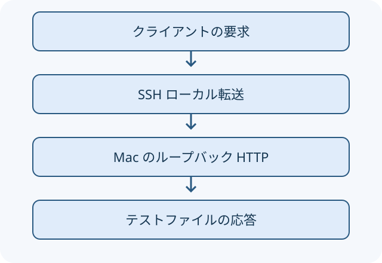

---
{
  "state": "draft",
  "language": "ja",
  "translationKey": "2026-11-23-macbook-personal-server",
  "title": "MacBook をプライベートネットワークの個人サーバーとして使う",
  "description": "SSH トンネルでローカル HTTP を試し、Mac の可用性の限界を確認します。",
  "sourcePath": "src/content/posts/en/2026-11-23-macbook-personal-server.md",
  "sourceSha256": "bd4c8683623163f5f31589a1e1e1414c0c8947ff5622aef14a2544139945a193"
}
---

MacBook は、信頼できるプライベートネットワーク上の別のコンピュータに、ネットワーク上で HTTP ポートを公開せず短い開発デモを提供できます。Mac のループバックに一時 HTTP サーバーを起動し、SSH のローカル転送で接続します。これはテストであり、常時利用できる公開サービスの構成ではありません。



図は要求と応答の概要です。認証と後片付けは以下で説明します。

## 接続の準備

自分で管理するプライベートネットワークで、2 台のコンピュータを使用します。共有または公共のネットワークには信頼できない機器が存在する可能性があり、プライベートアドレスだけではアクセスを制限できません。ルーターのポート転送は行いません。この作業用に別の macOS 標準アカウントを用意し、必要なファイルだけにアクセスを許可します。Mac の「システム設定」→「一般」→「共有」→「リモートログイン」を開いて有効にし、「これらのユーザのみ」でそのアカウントを許可します。別途必要な場合を除き、リモートユーザへのフルディスクアクセスはオフのままにします。リモートログインのパネルには Mac の SSH アドレスが表示されます。macOS のバージョンやデバイス管理によって設定画面は異なる場合があります。[Apple: リモートログイン](https://support.apple.com/guide/mac-help/allow-a-remote-computer-to-access-your-mac-mchlp1066/mac)

クライアントで専用の鍵を作り、求められたらパスフレーズと新しいファイル名を選びます。

```sh
ssh-keygen -t ed25519 -f ~/.ssh/macbook_demo
```

信頼できる経路で `~/.ssh/macbook_demo.pub` の公開鍵 1 行を Mac にコピーします。Mac の許可されたアカウントにローカルログインし、以下のコマンドを実行して公開鍵の行を貼り付け、改行後に Ctrl-D を押します。既存の項目を残して `~/.ssh/authorized_keys` に追記します。秘密鍵は決してコピーしません。

```sh
umask 077
mkdir -p ~/.ssh
chmod 700 ~/.ssh
cat >> ~/.ssh/authorized_keys
chmod 600 ~/.ssh/authorized_keys
```

[OpenSSH の公開鍵ファイル](https://man.openbsd.org/sshd#AUTHORIZED_KEYS_FILE_FORMAT)と [ssh-keygen](https://man.openbsd.org/ssh-keygen) を参照してください。

Mac のローカルターミナルでホスト鍵のフィンガープリントを確認します。

```sh
ssh-keygen -lf /etc/ssh/ssh_host_ed25519_key.pub
```

クライアントから、許可されたアカウントとリモートログインに表示されたアドレスを使って接続します。以下の `demo` と `192.168.1.20` は例なので実際の値に置き換えます。初回接続を受け入れる前に、表示された ED25519 フィンガープリントを Mac で確認した値と比較します。異なる場合は中止して原因を調べます。ホスト鍵が変更された警告も自動的に受け入れず確認します。[OpenSSH ホスト検証](https://man.openbsd.org/ssh#VERIFYING_HOST_KEYS)

```sh
ssh -i ~/.ssh/macbook_demo -o HostKeyAlgorithms=ssh-ed25519 demo@192.168.1.20
```

ログインできたことを確認し、`exit` と入力します。鍵の追加だけではパスワード認証は無効にならず、アカウントのパスワードも使える場合があります。

## テストを起動して転送する

Mac で許可されたアカウントのターミナルから、空の一時ディレクトリを作って無害なファイルを 1 つ追加し、Python 3 を起動します。サーバーは Mac の IPv4 ループバックアドレスにのみバインドします。このターミナルは開いたままにします。

```sh
sample_dir=$(mktemp -d)
printf 'home server test\n' > "$sample_dir/index.html"
python3 -m http.server 8000 --bind 127.0.0.1 --directory "$sample_dir"
```

ポート 8000 が使用中なら中止し、サーバーと転送の両方のコマンドで未使用のポートを選びます。Python の簡易 HTTP サーバーはテスト用で本番用ではありません。シンボリックリンクをたどるため、空のテストディレクトリと無害なファイルだけを使用します。[Python http.server](https://docs.python.org/3/library/http.server.html)

クライアントの 2 つ目のターミナルでトンネルを開き、そのままにします。

```sh
ssh -N -o ExitOnForwardFailure=yes -i ~/.ssh/macbook_demo -L 127.0.0.1:18000:127.0.0.1:8000 demo@192.168.1.20
```

クライアントの別のターミナルで実行します。

```sh
curl http://127.0.0.1:18000/
```

期待される出力は `home server test` です。クライアントは自身のポート 18000 に接続し、SSH が要求を Mac に運んで Mac のループバックポート 8000 に接続します。トンネルが失敗した場合は、再試行前にアドレス、許可リスト、フィンガープリント、鍵を確認します。トンネルが開始しても curl が失敗する場合は、Python プロセスの動作と両方のポートの一致を確認します。`ExitOnForwardFailure` が確認するのはローカルリスナーの作成であり、接続先 HTTP サーバーへの到達性ではありません。[OpenSSH 転送](https://man.openbsd.org/ssh#L)

SSH トンネルのターミナルで Ctrl-C を押して終了します。Mac のターミナルで Ctrl-C を押して Python を終了し、上で作成したテストディレクトリだけを削除します。

```sh
rm "$sample_dir/index.html"
rmdir "$sample_dir"
```

この練習のためだけに追加した場合は、公開鍵の行を削除し、リモートログインを無効にします。既存の鍵とアクセス設定は保持します。

## 可用性と次の選択

ディスプレイが消えた状態と Mac がスリープした状態は異なります。ノートパソコンのディスプレイを閉じると通常はスリープするため、蓋を閉じた状態、ネットワークによるスリープ解除、電源設定の変更によってテストが動き続けるとは限りません。FileVault を使う Mac の再起動後は、必要に応じて人がロック解除できるように準備します。Apple は macOS 26 以降の Apple Silicon で特定の条件下における SSH 経由の FileVault ロック解除を説明していますが、条件が当てはまると決めつけないでください。[Apple: スリープ](https://support.apple.com/guide/mac-help/put-your-mac-to-sleep-or-wake-it-mh10330/mac) · [Apple: FileVault](https://support.apple.com/guide/security/managing-filevault-sec8447f5049/web)

一度きりのデモは、終わったらプロセスを停止します。ファイルには macOS のファイル共有とそのアクセス制御を検討できます。長期間動かすサービスには別途 launchd の設定、更新、バックアップ、復旧計画が必要で、専用ハードウェアが適する場合もあります。外出先からのアクセスにはプライベート VPN を別途検討できますが、Mac とサービスの保護は引き続き必要です。

ループバック HTTP の応答は一時ファイルとプロセスを使ってローカルで確認しました。SSH 接続とトンネルは読者向けの文書上の手順であり、この Mac への接続はテストしていません。
