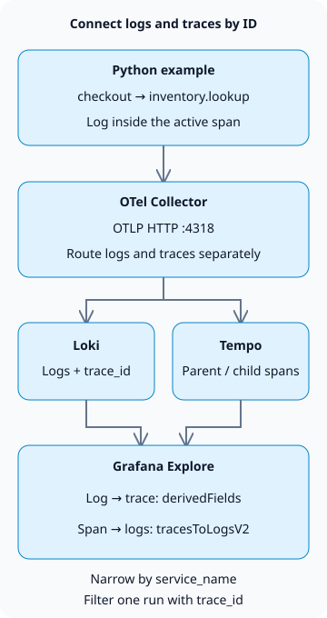

**To correlate logs and traces in Grafana LGTM, emit logs and spans with the same `trace_id`, then configure both Loki and Tempo data sources in Grafana.** This lets you open the execution path behind an error log and return from a span to its related logs.

LGTM stands for Loki (logs), Grafana (queries and visualization), Tempo (traces), and Mimir (metrics). This tutorial focuses on log–trace correlation. For the wider operational workflow, see [AI agent operations](/en/posts/2026-10-31-ai-agent-operations/).

## Which identifiers should match?

A trace represents one execution; spans represent its individual operations. The example's parent `checkout` span and child `inventory.lookup` span share a trace ID but have different span IDs. Logging inside an active span allows the log record to carry that span's context. Correlating separate services also requires context propagation, such as the HTTP `traceparent` header. [OpenTelemetry context propagation](https://opentelemetry.io/docs/concepts/context-propagation/)



The connection between the stores is a Grafana query feature. Loki does not forward logs to Tempo, and Grafana does not create missing traces. This example creates manual spans in one process. It does not implement an HTTP server, cross-service calls, or an inventory database.

## Build a local collection environment

Create the following four files in an empty directory with Docker and Python virtual environment support. The tested combination is **Python 3.13.0, OpenTelemetry Python 1.45.2, and `grafana/otel-lgtm` 0.39.0**. The image contains Grafana 13.3.0, Loki 3.7.9, Tempo 3.1.1, and Collector 0.164.0.

The [official Docker LGTM image](https://grafana.com/docs/opentelemetry/docker-lgtm/) is for development, demonstrations, and testing. Its metrics backend is Prometheus; this tutorial does not provision a production Mimir cluster. We use the bundled Collector, Loki, Tempo, and Grafana for logs and traces.

### `compose.yaml`

```yaml
services:
  lgtm:
    image: grafana/otel-lgtm:0.39.0@sha256:4c8056c9c05fcb3c8fd93800e85334bfd79b4d0271b47a54a121a64af41fe1fe
    ports:
      - '127.0.0.1:13000:3000'
      - '127.0.0.1:14318:4318'
    environment:
      GF_AUTH_ANONYMOUS_ENABLED: 'true'
      GF_AUTH_ANONYMOUS_ORG_ROLE: Editor
    volumes:
      - ./datasources.yaml:/otel-lgtm/grafana/conf/provisioning/datasources/grafana-datasources.yaml:ro
```

This is a local lab. Anonymous users receive Editor permissions for Explore, and Grafana and OTLP bind to the host's `127.0.0.1`. Production requires authentication, TLS, and access restrictions. Host Python uses port `14318`; the container's Collector uses `4318`. The data source URLs use loopback inside Grafana's container. Use service DNS names instead when Loki and Tempo run in separate containers.

### `datasources.yaml`

```yaml
apiVersion: 1
datasources:
  - name: Tempo
    type: tempo
    uid: tempo
    url: http://127.0.0.1:3200
    jsonData:
      tracesToLogsV2:
        datasourceUid: loki
        spanStartTimeShift: '-2s'
        spanEndTimeShift: '2s'
        tags:
          - key: service.name
            value: service_name
        customQuery: true
        query: '{$${__tags}} | trace_id = "$${__trace.traceId}"'
  - name: Loki
    type: loki
    uid: loki
    url: http://127.0.0.1:3100
    jsonData:
      derivedFields:
        - name: trace_id
          matcherType: label
          matcherRegex: '^trace_id$'
          datasourceUid: tempo
          url: '$${__value.raw}'
          urlDisplayLabel: View trace
```

`tracesToLogsV2` builds the span-to-logs query; `derivedFields` builds the log-to-Tempo link. Map `service.name` to Loki's `service_name`, then filter by trace ID. With `customQuery` enabled, the query includes that filter explicitly. See the [Grafana correlation settings](https://grafana.com/docs/grafana/latest/datasources/tempo/configure-tempo-data-source/configure-trace-to-logs/) for both directions.

`$${...}` preserves variables in a **Grafana provisioning file**. This separately mounted file is not subject to Compose string interpolation. Use `${...}` when entering the values directly in Grafana's UI. This configuration narrows the [official image's data source settings](https://github.com/grafana/docker-otel-lgtm/blob/v0.39.0/docker/grafana-datasources.yaml) to log–trace correlation.

For OTLP ingestion, `trace_id` is queried as Loki structured metadata rather than a JSON field in the log body, so this example does not need `| json`. Grafana's `matcherType: label` selects how the field is found; it does not promote the trace ID to a Loki index label. [Loki OTLP storage rules](https://grafana.com/docs/loki/latest/send-data/otel/)

### `requirements.txt`

```text
opentelemetry-sdk==1.45.2
opentelemetry-exporter-otlp-proto-http==1.45.2
```

### `demo.py`

```python
import logging

from opentelemetry import trace
from opentelemetry.exporter.otlp.proto.http._log_exporter import OTLPLogExporter
from opentelemetry.exporter.otlp.proto.http.trace_exporter import OTLPSpanExporter
from opentelemetry.sdk._logs import LoggerProvider, LoggingHandler
from opentelemetry.sdk._logs.export import BatchLogRecordProcessor
from opentelemetry.sdk.resources import Resource
from opentelemetry.sdk.trace import TracerProvider
from opentelemetry.sdk.trace.export import BatchSpanProcessor
from opentelemetry.sdk.trace.sampling import ALWAYS_ON
from opentelemetry.trace import Status, StatusCode

resource = Resource.create({"service.name": "checkout-demo"})
traces = TracerProvider(resource=resource, sampler=ALWAYS_ON)
traces.add_span_processor(BatchSpanProcessor(OTLPSpanExporter(
    endpoint="http://127.0.0.1:14318/v1/traces")))
trace.set_tracer_provider(traces)
logs = LoggerProvider(resource=resource)
logs.add_log_record_processor(BatchLogRecordProcessor(OTLPLogExporter(
    endpoint="http://127.0.0.1:14318/v1/logs")))
handler = LoggingHandler(logger_provider=logs)
logger = logging.getLogger("checkout-demo")
logger.setLevel(logging.INFO)
logger.propagate = False
logger.addHandler(handler)
tracer = trace.get_tracer("checkout-demo")

try:
    with tracer.start_as_current_span("checkout") as checkout:
        trace_id = f"{checkout.get_span_context().trace_id:032x}"
        logger.info("checkout_started")
        with tracer.start_as_current_span("inventory.lookup") as inventory:
            logger.error("inventory_unavailable")
            inventory.set_status(Status(StatusCode.ERROR, "demo failure"))
        checkout.set_status(Status(StatusCode.ERROR, "inventory unavailable"))
    assert logs.force_flush(timeout_millis=10000), "log flush timed out"
    assert traces.force_flush(timeout_millis=10000), "trace flush timed out"
    print(f"trace_id={trace_id}")
finally:
    logger.removeHandler(handler)
    logs.shutdown()
    traces.shutdown()
```

`inventory_unavailable` is a deliberate error message. It does not reproduce a real inventory outage or measure service performance. Both spans are marked as errors explicitly by the example. `LoggingHandler` and the OTLP exporter carry the active span's identifiers into logs. [Python instrumentation](https://opentelemetry.io/docs/languages/python/instrumentation/)

The example pins the tested SDK version. Logs are classified as Development in the [Python support status](https://opentelemetry.io/docs/languages/python/), so recheck log API and exporter compatibility on upgrades. `ALWAYS_ON` records every example span for learning; it is not a recommended production sampling policy.

## Query both stores using the emitted trace ID

Run these commands in the directory containing the four files. The first run downloads from Docker Hub and PyPI. Commands use a Unix-style shell.

```sh
docker compose -p blog-lgtm-lab up -d --wait --wait-timeout 180
python3 -m venv .venv
.venv/bin/python -m pip install -r requirements.txt
.venv/bin/python demo.py
```

Run Python after the container becomes healthy. Image downloads and Grafana initialization can take time. Exporting before readiness can fail. `force_flush()` waits for export processing; it is not final proof that data exists in the stores.

This is the trace ID emitted during the lab. Each run generates a new ID, so substitute **your own output** in the query below.

```text
trace_id=b95b8ec2e8c6fa5a608f197d1cfe3691
```

1. Open `http://127.0.0.1:13000`, select **Explore → Loki**, and set the range to the last hour.
2. Query the two logs with this LogQL expression.

```text
{service_name="checkout-demo"} | trace_id = "b95b8ec2e8c6fa5a608f197d1cfe3691"
```

3. Expand `inventory_unavailable` and follow **View trace** for `trace_id`. In Tempo, locate `inventory.lookup` beneath `checkout`.
4. Use **Related logs** in the Tempo panel to return to Loki. Depending on the version, this is exposed as a span's **Logs for this span** link. This query does not filter by `span_id`, so both logs in the trace may appear when the time range and service match.

Local queries returned **two logs and two spans**, with matching parent–child relationships and log span IDs. The Loki series API contained neither `trace_id` nor `span_id` as index labels, and a nonexistent trace ID returned no logs. Browser checks also followed the error log to Tempo and back to the related Loki logs. These results cover a single-process collection and correlation example, not production load or recovery.

## When a link returns no data

| Symptom | First check | Next action |
| --- | --- | --- |
| Logs have no trace ID | Was logging inside an active span? | Check propagation across thread, coroutine, and async boundaries |
| Loki query works but no Tempo link appears | `derivedFields` field name and Tempo UID | Match the matcher to the actual `trace_id` field |
| A span has no logs link | `service.name` and data source tag mapping | Align with Loki's `service_name` value |
| The linked log query returns zero entries | Time range, service, and trace ID | Run LogQL directly; check ingestion lag and clock skew |
| Logs exist but the trace cannot be queried | Trace exporter, sampling, and Tempo retention | Inspect Collector export errors and retention policies |

Keep `trace_id`, `user_id`, and order numbers out of production index labels. Distinct values multiply Loki streams. Narrow by bounded values such as service and environment, then filter IDs from the body or structured metadata. [Loki cardinality](https://grafana.com/docs/loki/latest/get-started/labels/cardinality/)

Failure to find logs or a trace does not establish health. Sampling may have removed a trace, retention periods may differ, or Collector exports may be delayed. Keep tokens and personal data out of log bodies and baggage, and establish collection-failure alerts, retention, and redaction before production use.

After the lab, remove its container and attached anonymous volumes. This example does not preserve its data.

```sh
docker compose -p blog-lgtm-lab down -v
```
