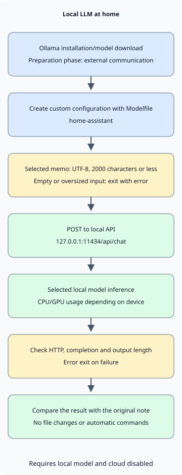

To use a personal LLM at home, start by **installing Ollama, downloading a model to run on your PC, and connecting it to one small task**. This article focuses on Korean conversation and summarizing short notes; the sample instructions and note are in Korean. It adapts an existing model’s execution and instructions to your needs; it does not train a model from scratch.

First, try a conversation with a local model in Ollama. Then call the same model from Python to summarize a note. The installation and API explanations are based on official documentation checked on November 5, 2026. [Ollama quickstart](https://docs.ollama.com/quickstart)

## Is memory equal to the model file size enough?

The example model is `qwen3:4b-instruct-2507-q4_K_M`. Ollama lists it as a Q4_K_M model of about 2.5GB. Q4_K_M is a quantization format that represents weights with fewer bits. The file size is not the total memory needed to run the model. [Model files and license](https://ollama.com/library/qwen3:4b-instruct-2507-q4_K_M)

At runtime, the model needs a KV cache for conversation context and other runtime resources in addition to its weights. The operating system and other apps also use memory. A larger context increases memory use, so this example sets `num_ctx` to 4096. That does not mean a home PC can use the model’s maximum supported context. [Ollama context length and memory](https://docs.ollama.com/context-length)

| Resource | What to consider |
| --- | --- |
| GPU or unified memory | Distinguish an external GPU’s VRAM from system RAM. Apple Silicon shares unified memory with other apps. |
| Memory available at runtime | If memory is insufficient, start with a smaller model or shorter context. Do not treat file size as the minimum RAM requirement. |
| Free disk space | Allow space for model files and additional downloads. Storing several models increases usage. |
| GPU and driver support | Before choosing a model, check whether the current OS and device are supported. |

Ollama’s macOS documentation specifies macOS 14 or later and supports CPU/GPU execution on Apple M-series devices and CPU execution on Intel Macs. Windows requires Windows 10 22H2 or later, with driver requirements depending on the GPU. Before buying hardware, check the response speed and memory use of a small task on your current PC. [macOS requirements](https://docs.ollama.com/macos), [Windows requirements](https://docs.ollama.com/windows), [GPU support](https://docs.ollama.com/gpu)

## Install and configure local-only operation

On macOS or Windows, download the installer from the [official download page](https://ollama.com/download) and run the app. On Linux, use the command in the official documentation. The Linux command below installs software and a service, so run it on the PC where Ollama should be installed. [Linux installation](https://docs.ollama.com/linux)

```sh
curl -fsSL https://ollama.com/install.sh | sh
```

After installation, check the version in a new terminal. If the app or service is already running the server, there is no need to start `ollama serve` again.

```sh
ollama --version
```

To process personal data locally, check both model selection and server settings. Ollama can call cloud models through its local API too. **A localhost address alone does not establish where inference runs.** [Local API and cloud models](https://docs.ollama.com/api/authentication)

For the macOS or Windows user app, put the following setting in `~/.ollama/server.json` for the account running the server. On Windows, `~` means the user’s home directory. If the file already exists, add the entry while retaining the other settings, then restart the app. This disables cloud models and web search; check the server log for `Ollama cloud disabled: true` to confirm it is applied. Installing and downloading the model requires internet access. [Local-only settings](https://docs.ollama.com/faq#how-do-i-disable-ollamas-cloud-features)

```json
{
  "disable_ollama_cloud": true
}
```

On Linux, the systemd service may run under a different account from the logged-in user. In that case, set the service environment variables with `sudo systemctl edit ollama.service`. Save the following configuration and restart the service. [Linux service configuration](https://docs.ollama.com/linux#customizing)

```ini
[Service]
Environment="OLLAMA_NO_CLOUD=1"
Environment="OLLAMA_HOST=127.0.0.1:11434"
```

```sh
sudo systemctl daemon-reload
sudo systemctl restart ollama.service
```

If you run the server directly instead of using a service, keep the POSIX shell running `OLLAMA_NO_CLOUD=1 OLLAMA_HOST=127.0.0.1:11434 ollama serve` open. Do not start another server if one is already running. In either case, confirm cloud features are disabled before entering personal data.

Download the example model and start a conversation with the following command. This is a non-thinking variant, so no separate thinking option is used. Short tags can refer to other variants, so use the full tag. [Qwen model card](https://huggingface.co/Qwen/Qwen3-4B-Instruct-2507)

```sh
ollama pull qwen3:4b-instruct-2507-q4_K_M
ollama run qwen3:4b-instruct-2507-q4_K_M
```

A first question could be: “Answer in Korean. Give me three criteria to check when summarizing a note I wrote.” Check whether the answer is in Korean and stays within the requested scope, then end the conversation with `/bye`. In another terminal, check the model ID with `ollama list` and CPU/GPU placement and memory status with `ollama ps`. Record the installed Ollama version and model ID along with the model tag to make later differences easier to compare. [Check model execution status](https://docs.ollama.com/faq#how-can-i-tell-if-my-model-was-loaded-onto-the-gpu)

## Set default instructions for your own use

Save the following file in an empty working directory. `FROM` selects the base model, and `SYSTEM` sets its default instructions. `num_predict` caps the number of generated tokens, while `temperature` affects randomness. The values below are examples for short note summaries. A low temperature does not guarantee factual accuracy. [Modelfile syntax](https://docs.ollama.com/modelfile)

### `Modelfile`

```text
FROM qwen3:4b-instruct-2507-q4_K_M
PARAMETER num_ctx 4096
PARAMETER num_predict 512
PARAMETER temperature 0.2
SYSTEM """
한국어로 간결하게 답하세요.
제공된 자료에서 확인할 수 없는 내용은 추측하지 말고 모른다고 말하세요.
원문에 있는 사실과 제안을 구분하세요.
"""
```
Create a custom model configuration named `home-assistant` with the following command:

```sh
ollama create home-assistant -f Modelfile
ollama run home-assistant
```

Changing instructions alone does not teach the model new knowledge or let it read files from your disk. Include the relevant material in the request, as in the next example. For many documents, you can separately design retrieval-augmented generation (RAG) to find and supply relevant passages. First, check the summary quality on one short file.

## Summarize one selected note in Python

This example uses only Python 3’s standard library. It reads one saved file, sends it to `127.0.0.1:11434/api/chat`, and prints the result. It does not use the environment’s HTTP proxy settings or give the model tools to browse files or execute commands.



In the diagram, installation and model download are preparation steps involving external communication. Subsequent inference assumes a local model is selected and cloud features are disabled. If input or response validation fails, the program exits with an error without emitting a summary.

### `notes.txt`

```text
2026-11-05 집 서버 정리
결정: 사진 백업용 디스크 상태를 주말에 점검한다.
후속 작업: 작업 전 복구 테스트 방법을 찾아본다.
담당자와 정확한 시각은 정하지 않았다.
```
### `summarize.py`

```python
import json
from pathlib import Path
import sys
from urllib.request import ProxyHandler, Request, build_opener

ENDPOINT = "http://127.0.0.1:11434/api/chat"
MODEL = "home-assistant"
MAX_CHARS = 2000


def summarize(path):
    text = path.read_text(encoding="utf-8")
    if not text.strip() or len(text) > MAX_CHARS:
        raise ValueError(f"메모는 비어 있지 않은 {MAX_CHARS}자 이하의 UTF-8 텍스트여야 합니다.")
    prompt = (
        "다음 메모의 결정 사항과 후속 작업을 나누어 한국어로 요약하세요. "
        "원문에 없는 담당자나 기한을 추가하지 마세요.\n\n<자료>\n"
        + text + "\n</자료>"
    )
    payload = {
        "model": MODEL,
        "messages": [{"role": "user", "content": prompt}],
        "stream": False,
        "options": {"num_ctx": 4096, "num_predict": 512},
        "keep_alive": 0,
    }
    request = Request(
        ENDPOINT,
        data=json.dumps(payload, ensure_ascii=False).encode("utf-8"),
        headers={"Content-Type": "application/json"},
        method="POST",
    )
    opener = build_opener(ProxyHandler({}))
    with opener.open(request, timeout=120) as response:
        result = json.load(response)
    message = result.get("message") if isinstance(result, dict) else None
    answer = message.get("content") if isinstance(message, dict) else None
    if not isinstance(answer, str) or not answer.strip() or result.get("done") is not True:
        raise RuntimeError("완료된 텍스트 응답을 받지 못했습니다.")
    if result.get("done_reason") == "length":
        raise RuntimeError("출력 길이 제한에 도달했습니다. 메모나 요청 범위를 줄이세요.")
    return answer


if __name__ == "__main__":
    if len(sys.argv) != 2:
        raise SystemExit("사용법: python3 summarize.py notes.txt")
    try:
        print(summarize(Path(sys.argv[1])))
    except (OSError, ValueError, RuntimeError) as error:
        print(f"요약 실패: {error}", file=sys.stderr)
        raise SystemExit(1)
```
Save both files in the same folder and run them. On Windows, use `py -3` instead of `python3`, depending on your Python installation.

```sh
python3 summarize.py notes.txt
```

`stream: false` requests a single JSON response. The example rejects empty input and input over 2000 characters, and treats HTTP errors, invalid responses and output length limits as errors. A character limit is not an exact token count, so also check that both input and answer fit in the context window. `keep_alive: 0` requests unloading the model after processing, so repeated runs may need to reload it. [Chat API and response fields](https://docs.ollama.com/api/chat)

The client’s normal and error handling was checked with a local mock HTTP server on Python 3.13.0. Ollama installation, Modelfile build, model download, inference speed and summary quality were not run or verified in the environment used to prepare this article. After installation, compare the result with the note above. The 120-second network timeout does not confirm that the server has stopped the model task.

Check three things: whether the disk status check remains a decision, whether finding a recovery-test method is separated as a follow-up, and whether the model avoided inventing an owner or exact time. Smooth sentences and faithfulness to the original text are evaluated separately.

## Choose everyday tasks and stopping criteria

| Task | Small starting input | Check before use |
| --- | --- | --- |
| Organize personal notes | One short meeting or study note | Are decisions, proposals and undecided items distinguished? |
| Refine a draft | A paragraph you wrote and the desired style | Are meaning, numbers and sources preserved? |
| Understand code | A public example or a small function that can be shared | Does the explanation match the code and execution results? |

This client only prints responses; it does not modify files or execute shell commands. If you extend it into an agent that automatically executes generated commands, design execution permissions and approvals separately, as discussed in [AI agent permission boundaries](/ko/posts/2026-11-01-ai-agent-permission-boundaries/). A local model can also be affected by malicious instructions in a document and can produce incorrect answers.

The API binds to a local address by default, and the local API requires no authentication. Start on one PC and do not expose port 11434 with router port forwarding. Access from family members or other devices requires a separate configuration with defined authentication and access scope. Also check whether connected apps, plugins, logs or backups store or transmit data externally; local inference alone does not answer that question. [Default binding](https://docs.ollama.com/faq#how-can-i-expose-ollama-on-my-network), [Authentication scope](https://docs.ollama.com/api/authentication)

If answers are slow, first check CPU/GPU placement with `ollama ps` and memory used by other apps. Reduce long inputs and large contexts, then compare the same task again. If a connection is refused, check whether the app or service is running. If a model is not found, check `ollama list` and whether `home-assistant` was created. Rather than piling up timed-out requests, first check the work already running.

Keep a few notes fixed and compare omissions, guesses and wait times as you change the model or settings.
