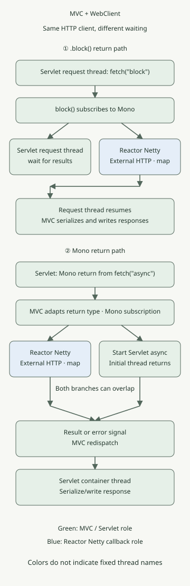

**WebClient can use non-blocking HTTP communication in Spring MVC, but calling `.block()` in a controller makes the MVC request thread wait for the result.** Returning the `Mono` lets MVC adapt it to Servlet asynchronous processing and release the initial request thread. Client communication and server request handling are separate concerns.

This article covers **Spring MVC on Tomcat and WebClient with Reactor Netty**. A different HTTP connector may use different thread names and resources. The example is reproduced with Spring Boot 3.5.16, JDK 21 and Gradle 8.14.3; it does not verify every current Boot release.

## Does adding WebClient make the server use WebFlux?

Server-side MVC and WebClient for outbound calls have different roles. Here, Tomcat and `DispatcherServlet` handle incoming requests, while WebClient’s Reactor Netty connector handles outbound HTTP.

With Boot 3.5, adding both `spring-boot-starter-web` and `spring-boot-starter-webflux` selects MVC by default. This supports applications that add the WebFlux starter to use WebClient. Check separately if the application type is explicitly changed or a different server configuration is used. [Boot’s MVC and WebFlux selection](https://docs.spring.io/spring-boot/3.5/reference/web/reactive.html#web.reactive.webflux)

## Where do `.block()` and returning `Mono` diverge?



Green shows Servlet and MVC responsibilities; blue shows Reactor Netty. The two branches of the asynchronous path may overlap, and the external response does not necessarily arrive after the initial request thread returns. The diagram focuses on success signals; error signals in the code are mapped to HTTP status codes before MVC error handling.

| Stage | Return a value after `.block()` | Return `Mono` |
| --- | --- | --- |
| Subscription | Performed by `.block()` | MVC subscribes to the returned type |
| Waiting for outbound HTTP | Request thread waits | Servlet async processing may release the initial request thread |
| After receiving the response body | Client callback supplies the result and releases the wait | Result signal is passed to MVC async processing |
| Final HTTP response | MVC serializes and writes the returned value | MVC redispatches, then serializes and writes |

`retrieve().bodyToMono(...)` assembles the request pipeline. The newly created WebClient pipeline below must be subscribed to before it starts an HTTP request. Subscribing twice can cause another request, so be careful with code that reads once using `.block()` and then returns the pipeline again.

MVC adapts a single-value `Mono` similarly to `DeferredResult`. When the result is ready, it redispatches to the Servlet container to finish the response. The pool may reuse the same thread, so do not assume the redispatch thread must differ from the original. The connection and asynchronous request resources also remain while the response is open. Returning `Mono` does not make the entire Servlet response write non-blocking. This example returns single-value JSON; streaming and SSE are different cases. [MVC async processing and reactive return types](https://docs.spring.io/spring-framework/reference/6.2/web/webmvc/mvc-ann-async.html)

## Call the same external API in two ways

Save the files below in one project. It uses the `application` plugin, not the Boot Gradle plugin, and pins the Java toolchain to 21. Local checks used Azul JDK 21.0.1; this historical patch version is not a recommendation for new production environments.

### `settings.gradle`

```groovy
rootProject.name = 'mvc-webclient-execution'
```

### `build.gradle`

```groovy
plugins {
    id 'java'
    id 'application'
}
repositories { mavenCentral() }
java { toolchain { languageVersion = JavaLanguageVersion.of(21) } }
dependencies {
    implementation platform('org.springframework.boot:spring-boot-dependencies:3.5.16')
    implementation 'org.springframework.boot:spring-boot-starter-web'
    implementation 'org.springframework.boot:spring-boot-starter-webflux'
    testImplementation 'org.springframework.boot:spring-boot-starter-test'
    testRuntimeOnly 'org.junit.platform:junit-platform-launcher'
}
application { mainClass = 'example.DemoApplication' }
test {
    useJUnitPlatform()
    systemProperty 'demo.virtual', providers.gradleProperty('virtual').getOrElse('false')
}
```

### `src/main/resources/application.yml`

```yaml
upstream:
  base-url: http://127.0.0.1:9091
  timeout: 3s
spring:
  mvc:
    async:
      request-timeout: 5s
```

`WebClient` is reused as a bean and explicitly uses the Reactor Netty connector. This example’s `HttpClient.create()` uses the default shared event loop and connection pool; it does not create a dedicated Netty thread for each outbound request. `callbackThread` is the thread running `map` after the response body is produced, not necessarily the thread writing the final Servlet response. No scheduler switch such as `publishOn` is added here. [WebClient connectors and shared resources](https://docs.spring.io/spring-framework/reference/6.2/web/webflux-webclient/client-builder.html)

### `src/main/java/example/DemoApplication.java`

```java
package example;

import java.time.Duration;
import java.util.concurrent.TimeoutException;

import org.springframework.beans.factory.annotation.Value;
import org.springframework.boot.SpringApplication;
import org.springframework.boot.autoconfigure.SpringBootApplication;
import org.springframework.context.annotation.Bean;
import org.springframework.http.HttpStatus;
import org.springframework.http.client.reactive.ReactorClientHttpConnector;
import org.springframework.web.bind.annotation.GetMapping;
import org.springframework.web.bind.annotation.RestController;
import org.springframework.web.reactive.function.client.WebClient;
import org.springframework.web.reactive.function.client.WebClientResponseException;
import org.springframework.web.server.ResponseStatusException;

import reactor.core.publisher.Mono;
import reactor.core.scheduler.Schedulers;
import reactor.netty.http.client.HttpClient;

@SpringBootApplication
public class DemoApplication {
    public static void main(String[] args) {
        SpringApplication.run(DemoApplication.class, args);
    }

    @Bean
    WebClient upstreamClient(WebClient.Builder builder,
                             @Value("${upstream.base-url}") String baseUrl) {
        return builder.baseUrl(baseUrl)
                .clientConnector(new ReactorClientHttpConnector(HttpClient.create()))
                .build();
    }

    public record Observation(String mode, String requestThread, boolean requestVirtual,
                              String callbackThread, boolean callbackVirtual, boolean callbackNonBlocking,
                              String value) {}

    @RestController
    static class DemoController {
        private final WebClient client;
        private final Duration deadline;

        DemoController(WebClient client, @Value("${upstream.timeout}") Duration deadline) {
            this.client = client;
            this.deadline = deadline;
        }

        private Mono<Observation> fetch(String mode) {
            Thread request = Thread.currentThread();
            String name = request.getName();
            boolean virtual = request.isVirtual();
            return client.get().uri("/value").retrieve().bodyToMono(String.class)
                    .timeout(deadline)
                    .map(value -> new Observation(mode, name, virtual,
                            Thread.currentThread().getName(), Thread.currentThread().isVirtual(),
                            Schedulers.isInNonBlockingThread(), value))
                    .onErrorMap(WebClientResponseException.class, error ->
                            new ResponseStatusException(HttpStatus.BAD_GATEWAY,
                                    "upstream HTTP error", error))
                    .onErrorMap(TimeoutException.class, error ->
                            new ResponseStatusException(HttpStatus.GATEWAY_TIMEOUT,
                                    "upstream deadline", error));
        }

        @GetMapping("/block")
        Observation blocking() {
            return fetch("block").block();
        }

        @GetMapping("/async")
        Mono<Observation> asynchronous() {
            return fetch("async");
        }
    }
}
```

`/block` is a comparison path. A controller that can finish with an asynchronous return can return the resulting `Mono`, as `/async` does, for MVC to subscribe to. Calling `.subscribe()` directly and responding first separates the outbound result and error from the original HTTP request. [Synchronous WebClient use and controller returns](https://docs.spring.io/spring-framework/reference/web/webflux-webclient/client-synchronous.html)

The example’s three-second `timeout` limits the interval from subscription until a value is delivered. It does not separately configure connection-pool acquisition, connection or individual response-read timeouts. HTTP errors are mapped to 502, and a pipeline timeout to 504. Define separate contracts for connection failures, empty response bodies and business errors. `retrieve()` treats HTTP 4xx and 5xx as errors by default. [Error handling in retrieve](https://docs.spring.io/spring-framework/reference/6.2/web/webflux-webclient/client-retrieve.html)

### Running locally

Start a local Python 3 HTTP server instead of an external service. `/value` returns `hello` after 0.2 seconds. This delay is an input for observing behavior, not a performance measurement.

### `upstream.py`

```python
from http.server import BaseHTTPRequestHandler, ThreadingHTTPServer
from time import sleep


class Handler(BaseHTTPRequestHandler):
    def do_GET(self):
        if self.path != '/value':
            self.send_error(404)
            return
        sleep(0.2)
        body = b'hello'
        self.send_response(200)
        self.send_header('Content-Type', 'text/plain; charset=utf-8')
        self.send_header('Content-Length', str(len(body)))
        self.end_headers()
        self.wfile.write(body)


ThreadingHTTPServer(('127.0.0.1', 9091), Handler).serve_forever()
```

Run it in the first terminal.

```sh
python3 upstream.py
```

In the second terminal, select JDK 21 and run it with Gradle 8.14.3.

```sh
gradle run
```

In the third terminal, call both paths:

```sh
curl --fail --show-error --silent http://127.0.0.1:8080/block
curl --fail --show-error --silent http://127.0.0.1:8080/async
```

Both return JSON containing `hello`. With ordinary request threads, we observed `requestVirtual=false`; this example’s Netty callback had `callbackVirtual=false` and `callbackNonBlocking=true`. Exact thread names and numbers vary between runs. The response JSON’s `mode` alone does not prove that the request thread was released while waiting.

## What changes if you turn on virtual threads?

After quitting the previous application, run the same code again with virtual thread settings.

```sh
gradle run --args='--spring.threads.virtual.enabled=true'
```

With this setting, `requestVirtual` became `true` on both paths. On the `.block()` path the calling virtual thread still waits for the result, but an ordinarily parkable wait is different from continuously occupying a carrier platform thread. Check pinning and differences in the JDK being run separately. [JDK 21 virtual-thread scheduling and pinning](https://docs.oracle.com/en/java/javase/21/core/virtual-threads.html) **Enabling virtual threads did not make this example’s Reactor Netty callback a virtual thread.** [Boot virtual-thread configuration](https://docs.spring.io/spring-boot/3.5/reference/features/spring-application.html#features.spring-application.virtual-threads)

Virtual threads do not increase an external service’s processing capacity, HTTP connection count or DB connection count. Design a separate bound on accumulated requests, as in [DB semaphores and admission control](/ko/posts/2026-11-03-virtual-threads-db-semaphore/).

## Is it okay to call JDBC inside a callback?

Calling WebClient from MVC does not mean the following `map` also runs on the MVC request thread. Putting a JDBC query or a long file read inside this example’s `map` can block the Netty event loop. Conversely, not every `Mono` runs on a dedicated thread. Operator execution depends on subscription, signals and scheduler switches. [Reactor threading and schedulers](https://projectreactor.io/docs/core/release/reference/coreFeatures/schedulers.html)

For a service with many synchronous operations, compare bounding resources in MVC’s synchronous call flow with isolating blocking work on a separate executor while keeping an asynchronous chain. For simple synchronous HTTP calls, also see [choosing RestClient or WebClient](/ko/posts/2026-10-31-webclient-restclient-comparison/). A scheduler switch alone does not solve DB or downstream service overload.

## What was actually verified

The [verification tests](https://github.com/youdozi/youdozi.github.io/blob/main/.pipeline/drafts/2026-11-09-spring-mvc-webclient-execution/src/test/java/example/ExecutionTest.java) ran with **real Tomcat and a local HTTP server** on random ports. Sixteen checks passed: eight each with ordinary request threads and virtual threads.

- Servlet context, Tomcat and DispatcherServlet selection with both starters present
- No request on pipeline assembly; requests on subscription and resubscription
- Request-thread waiting for `.block()` and entry into Servlet async processing for `Mono` while the external response is withheld
- Whether request threads are virtual and whether response callbacks are non-blocking or virtual
- Mapping HTTP errors to 502 and pipeline timeouts to 504 for both paths

To run the tests yourself, save the verification code above as `src/test/java/example/ExecutionTest.java` and run it.

```sh
gradle clean test
gradle test -Pvirtual=true --rerun-tasks
```

The tests observe state using a latch that withholds the response; they do not infer asynchrony from a short runtime. They do not verify throughput comparisons, real external services, DB or TLS, client disconnects, or cancellation of remote side effects. In particular, pipeline cancellation does not guarantee cancellation of a remote server’s work or transaction rollback.
