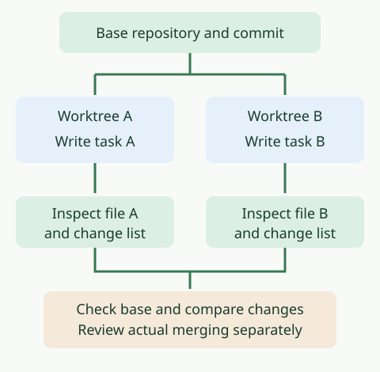

**Orca is convenient when you want worktree-specific code changes, a browser, diffs, and PRs in one place. Herdr is worth exploring if you want to customize a terminal-centered setup and the app's screens.** Both tools run multiple coding agents and can use Git worktrees. The more useful distinction is how you manage work and its results, rather than whether parallel execution is possible.

This comparison covers [Orca](https://orca.dev/) and [Herdr](https://herdr.dev/). Herdr consists of a desktop app, the terminal-based **Herdr TUI**, and the separate **herdr-core** terminal runtime. The descriptions below follow official documentation checked on November 15, 2026; this is not a performance test that ran the same task in both apps. Distinguish vendor-described features from selection criteria inferred from them.

## Differences at a glance

| Criterion | Orca | Herdr |
| --- | --- | --- |
| Main interface | Desktop development environment combining agents, editor, diffs, and browser | Desktop app and separate TUI; herdr-core runs terminals without drawing an interface |
| Work separation | Creates a Git worktree per task and connects branches, terminals, and browser | App guide and TUI settings include worktree creation. An ordinary terminal pane does not necessarily have its own worktree |
| Code review | Worktree diffs, line comments sent to the agent, Git and PR screens | Terminal tools or configured app screens. Check the installed configuration for equivalent diff capabilities and scope |
| Session persistence | Processes survive app exit while the daemon is alive; a host reboot ends them | App uses herdr-core and TUI uses a separate server to retain terminals; restarting the server or host ends the original processes |
| Extensions | CLI, skills, schedules, and app work surfaces | App layouts and mods, TUI plugins, herdr-core CLI and API |
| License | MIT | Apache 2.0 |

This table follows Orca's [worktree documentation](https://orca.dev/docs/model/worktrees) and [diff guide](https://orca.dev/docs/review/diff-viewer), and Herdr's [app guide](https://herdr.dev/guide/) and [TUI configuration reference](https://herdr.dev/tui/docs/config-reference/). It is not a measurement of every feature in particular versions of both products.

## How the same task changes the workflow

Suppose you delegate an API change and test improvements in the same repository at the same time. If the tasks might touch the same files, separate them into worktrees first. Set the read and write scope for each agent, then review each change before integrating the results.

Orca provides a flow for opening a worktree per task and attaching agents and diffs to that workspace. The [first-session guide](https://orca.dev/docs/first-session) describes running agents in multiple independent worktrees and reviewing their individual diffs.

Herdr's desktop app guide gives examples of requesting a worktree per task and starting an agent. The TUI manages workspaces, tabs, and panes and also offers dedicated worktree features. Do not assume multiple panes have different working directories; check the paths and branches before starting. [App guide](https://herdr.dev/guide/) · [TUI worktree commands](https://herdr.dev/tui/docs/cli-reference/)



The diagram shows the file flow in the Git example below. It does not include running agents or automatically merging results.

## Verify worktree separation yourself

Run this example in a macOS or Linux shell with Git installed. It creates a temporary repository and two worktrees, so it does not modify an existing project. It does not replace Orca or Herdr installation and setup instructions.

```sh
#!/bin/sh
set -eu
case_dir=$(mktemp -d)
git init -q "$case_dir/repo"
git -C "$case_dir/repo" config user.name 'Example Author'
git -C "$case_dir/repo" config user.email 'example@example.invalid'
printf 'base\n' > "$case_dir/repo/app.txt"
git -C "$case_dir/repo" add app.txt
git -C "$case_dir/repo" commit -qm 'Initial commit'
git -C "$case_dir/repo" worktree add -qb task-a "$case_dir/task-a" HEAD
git -C "$case_dir/repo" worktree add -qb task-b "$case_dir/task-b" HEAD
printf 'task A\n' > "$case_dir/task-a/app.txt"
printf 'task B\n' > "$case_dir/task-b/app.txt"
printf 'A: '; cat "$case_dir/task-a/app.txt"
printf 'B: '; cat "$case_dir/task-b/app.txt"
printf 'base: '; cat "$case_dir/repo/app.txt"
printf 'A 변경 파일: '; git -C "$case_dir/task-a" diff --name-only
printf 'B 변경 파일: '; git -C "$case_dir/task-b" diff --name-only
```

The output observed in a local shell was:

```text
A: task A
B: task B
base: base
A 변경 파일: app.txt
B 변경 파일: app.txt
```

Each worktree preserves independent file content, but both tasks modified `app.txt`. Integrating the results in a real project can therefore produce conflicts or semantic contradictions. Worktrees separate file changes; they do not automatically isolate databases, ports, external services, or credentials, or resolve code conflicts. The example does not automatically delete its temporary directory.

When cleaning up actual worktrees, also check each tool's deletion scope. Orca can remove the worktree and branch after confirmation, while Herdr TUI's removal command is documented to remove the checkout without deleting the branch. Check uncommitted changes and unmerged commits before cleanup. [Orca worktrees](https://orca.dev/docs/model/worktrees) · [Herdr TUI CLI](https://herdr.dev/tui/docs/cli-reference/)

## Orca's strengths and tradeoffs

Orca's strength is **an interface connecting work with result review**. The [diff viewer](https://orca.dev/docs/review/diff-viewer) displays changed files and lines and offers conflict resolution and partial staging. Keeping a browser and editor in the same workspace makes it useful for changing a web UI and checking it directly.

The [remote execution guide](https://orca.dev/docs/ways-to-run) also explains selecting SSH hosts or servers you manage. Remote execution does not mean every environment is safely isolated with the same permissions by default. Manage accounts, secrets, and network access on remote machines separately.

According to the [session restoration guide](https://orca.dev/docs/model/session-restore), agents continue after app exit while the background daemon remains alive. A host reboot or daemon termination ends running processes; restart the agent in the restored workspace.

The tradeoff is learning the desktop environment and its features. For a single terminal task, multiple screens and workspaces may be unnecessary. Running several agents can increase model usage, and each independent result needs review. Orca does not guarantee model response accuracy.

## Herdr's strengths and tradeoffs

Herdr's strength is **the flexibility to configure workspaces while retaining running terminals and agents**. The [herdr-core guide](https://herdr.dev/core/) describes retaining terminals after a window closes and interfaces for starting other tasks and reading results. The [official guide](https://herdr.dev/guide/) also introduces modifying app layouts and mods.

Distinguish Herdr's app from its TUI. According to the official site, the desktop app uses herdr-core, but **Herdr TUI uses a separate server and the two environments do not share agent lists.** Closing the app also differs from restarting the computer or runtime. Desktop processes remain alive after closing or updating the app while core is alive, but rebooting the machine or stopping core ends them. The site says panes return in that case, but agents are not automatically restarted. [Herdr FAQ](https://herdr.dev/)

The TUI has its own restoration rules. Detaching and reconnecting retain the original processes while the server is alive. A server restart ends them; layout restoration and resuming supported agent sessions are separate features. [TUI session restoration](https://herdr.dev/tui/docs/session-state/)

More customization also means more responsibility for checking which permissions and external connections each mod uses. Herdr app status indicators depend on programs reporting [OSC 7501](https://herdr.dev/core/). Unsupported programs can still run but may not display status. Do not assume TUI agent detection and app status reporting are the same feature.

## Which should you choose?

- **For change review and web UI checks:** Start with Orca's worktree-specific diff, browser, and PR workflow.
- **For terminal persistence and screen customization:** Explore Herdr app and core; compare the separate TUI if you prefer terminal-based management.
- **For multiple servers and agents:** Both offer remote features, so verify your actual SSH environment, authentication, and session recovery conditions.
- **For one short change:** Your existing terminal and Git may be enough. Compare the added complexity with the convenience of another management tool.

Try both tools with the same repository, task, model, and permissions. Follow task creation, recovery after interruption, change inspection, and integration, and record elapsed time and errors to find the better fit for your workflow. This article did not perform those comparative measurements.
