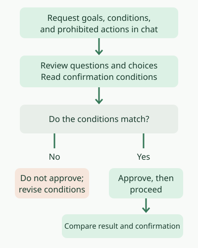

Pickle AI is a personal AI agent for requesting tasks such as research or reservations through chat and following their progress. Start with research that needs no payment or account connection, and check the results yourself. When you move on to reservations or purchases, include the date, budget, and approval conditions.

This guide is based on [Pickle's official help](https://www.pickle.com/help). It is not a record of operating the app with a real account or executing the examples below. Screens and available features may vary by app version, account, and region.

## Before you start

Prepare the Pickle app and an account, then check the plans and limits available in the app. The Korean [plan guide](https://www.pickle.com/help/credits/plans) describes free use in Korea with a usage limit that resets daily. Scheduled tasks may be skipped when you reach the limit, so check the remaining allowance and reset time in the app's **My Pickle** tab. Plans and limits can vary by region and over time.

According to the [official introduction](https://www.pickle.com/help/start/what-is-pickle), Pickle accepts requests through chat, works on websites in a separate browser, and can make calls for tasks that cannot be handled online. You do not need to interpret this as directly tapping other apps installed on your iPhone. Check the actual screens for regional and service support and calling availability.



The diagram simplifies the flow when a user receives a confirmation card. It does not mean every request produces a card or every external action succeeds. The pseudocode below describes a decision process for the reader, not Pickle's internal implementation.

```text
Request = goal, date and place, budget, permitted and prohibited actions
Send the request to Pickle
Answer follow-up questions or choices within your conditions
If a confirmation card appears:
    Review its content and conditions
    If the conditions do not match, revise without approving
    If the conditions match, approve
When the result arrives, compare it with the request and external confirmation
```

## First task: research candidates without paying

For example, enter the following in Chat when choosing a restaurant. The date, time, and area are examples; replace them with your actual conditions.

```text
Find restaurants near Gangnam Station in Seoul for 2 people on Saturday at 6 PM.
The budget is no more than 30,000 won per person; prioritize vegetarian options.
Give each candidate's name, location, opening hours, and menu source link.
Do not reserve, call, or pay. Mark any uncertain information.
```

Answer any questions about the date or other conditions, then open the candidate links to check the opening hours and menu for that date. If links are missing or conditions were not verified, follow up with: “Tell me which sources you checked. Do not guess items you cannot verify.” This is an example; the prompt's actual execution in the service was not verified.

According to the [task delegation guide](https://www.pickle.com/help/tasks/delegate), you can state your goal in Chat, receive questions about necessary details, and review a card showing the proposed action and conditions. Task cards appear in chat, and work can continue after the app is closed. Do not treat closing the app as cancellation; if you need to stop, check the current task status and whether cancellation is possible.

## Delegating reservations or purchases

After checking the research results, narrow the permitted actions in a separate request.

```text
Check available reservation times at the restaurant I select from the candidates.
The conditions are 2 people on Saturday at 6 PM. If a paid deposit or payment is
required, do not proceed; first show the amount and cancellation conditions.
Ask me before reserving if the time or party size must change.
```

When a confirmation card appears, read the venue, date and time, party size, amount, and cancellation conditions, and approve only if you agree. Official guidance describes confirming conditions before actions that are difficult to undo, such as reservations and payments. Still, a prompt cannot prevent every mistake: after approval, check the actual reservation and payment status on the restaurant's or seller's confirmation screen or email. Do not assume a cancellation request automatically reverses an action already completed externally.

## Connect accounts and sign in only as needed

For tasks involving email or calendars, the [official guide](https://www.pickle.com/help/start/what-is-pickle) describes connecting the required account through **My Pickle → Apps and services connected to (Pickle name)**. Read the permissions shown during connection, and avoid connecting an account if the task does not require it. For example, finding possible meeting times does not necessarily require calendar access.

If a website requires sign-in, do not type passwords or card numbers into chat. Use the secure input screen and Vault described in the official documentation, and recheck the requested site and information. The [saved-login guide](https://www.pickle.com/help/connect/save-login) says Pickle's browser is separate from the logins saved on your phone.

Credential protection also has boundaries. The official explanation says passwords and card numbers are not passed to the model, but the path that handles values needed for real web forms needs separate consideration. [How Pickle AI works and protects passwords](/ko/posts/2026-11-13-pickle-ai-security/) covers the protection and limitations visible in public code. Policies for access to conversations and memories differ from credential storage policies, so also read the [privacy information](https://pickle.com/privacy).

## Check recurring tasks and access records

For recurring alerts or summaries, specify both the task and frequency in Chat. For example: “Every Monday at 9 AM, find public technology events and summarize them with links. Do not register or pay.” Check the time zone and actual execution conditions in the created task's details.

According to the [scheduled-task guide](https://www.pickle.com/help/tasks/scheduled), tap the Pickle image at the top of the screen to open the profile, then open **Scheduled** to pause, resume, edit, delete, and view execution history. Runs may be skipped when usage limits are reached, so check the recorded status and do not assume missed runs were automatically retried.

To inspect account or card use, follow the path in the [Access log guide](https://pickle.com/help/privacy/activity): **My Pickle → Connected apps and services or Payment methods → Encryption banner**. Records are written just before a request is made; they are not evidence that a reservation or payment actually succeeded. Compare the task result with confirmation from the external service as well.
