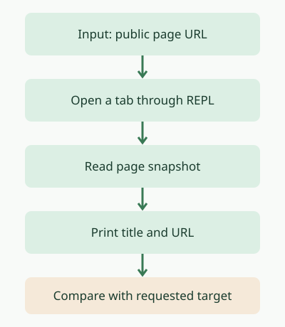

**Aside is an AI browser that uses websites you are signed in to and browser context to carry out multistep work.** It can start by summarizing open pages or gathering information, and handle forms and files within the scope you permit. Check not only the wording of the answer but also which pages it used and what it actually did.

This introduction follows the [official help](https://docs.aside.com/) and developer guidance as of November 16, 2026. The public-page reading example was executed with the local CLI. The business prompts below were not run against signed-in accounts, and success rates across services were not measured.

## What changes compared with a regular browser?

In a regular browser, people move between sites, copy information, and decide what to do next. With Aside, requesting an outcome and a scope lets an agent read multiple pages and continue the workflow. It is convenient to request website work without implementing separate service APIs yourself. That does not mean automation always succeeds on every site.

The [task guide](https://docs.aside.com/help/tasks) describes choosing a mode, permissions, folder, and model and responding to questions or approval requests during execution. It also distinguishes normal-profile tasks from Incognito tasks that do not use normal sign-in state.

| Use case | Requested result | What to check |
| --- | --- | --- |
| Public research | Comparison by criteria with source links | Original dates, units, and what sources actually claim |
| Signed-in dashboard inspection | Figures for a specified period | Account, period, filters, and omissions |
| Document and file organization | Extracted items and drafts | Original values and storage location |
| Reply preparation | Draft tailored to an inquiry | Recipient, context, and whether it was actually sent |

“Prepare a draft” and “send it” in the last row are different requests. Start with inspection and drafts to learn the workflow.

## Start a task from an open page

According to the [side-panel guide](https://docs.aside.com/help/side-panel), open a page and make a request in Aside's panel while retaining the page attachment. Check its title and host to understand which page anchors the task.

Try the following on public product documentation. This is an authored example prompt.

```text
Summarize supported environments, installation requirements, and limitations
from the attached official document. Add a source link for each item and mark
anything not stated as unverified. Do not create an account, download, or install
anything; show the result in this conversation.
```

When results arrive, open the links to check their conditions. If another product or outdated documentation is mixed in, narrow the target URL and date in a follow-up request. Specify the material to read rather than allowing instructions inside a document to replace your original request.

## Convenience from memory and password management

Aside offers features that use browsing context and memory. However, signing in to the same account on another computer does not continue all work there. The [device guide](https://docs.aside.com/help/devices) distinguishes browser sync, including bookmarks and history, from conversations, memory, and working folders that remain on each device. It says moving a local task intact to another computer or the cloud is not currently generally available.

[Aside Vault](https://docs.aside.com/help/password-manager) is described as autofilling saved credentials into sites without passing raw passwords to the agent. Set agent access through `Settings > Passwords > Access policy for AI agents`. Some sites still require additional authentication or human confirmation.

Hiding passwords from the model differs from processing page content after sign-in. A request to summarize email can include email content in task context. Rather than allowing the same access to every account merely for convenient login, specify the sites and work actually needed.

## What local-first means

The [privacy policy](https://aside.com/policy/privacy) describes storing task conversations and artifacts locally while explicitly stating that hosted AI model providers receive context needed for tasks. That context can include prompts, tool results, and selected browser snapshots, screenshots, and files. **Local storage does not mean all processing is offline or that no data leaves the device.**

Also distinguish file access permissions from actions on websites. Do not assume `Read only` blocks every website mutation simply because of its name; check task instructions and actual approval requests. Check the folder scope of `Guard` and `Full access` in the [task guide](https://docs.aside.com/help/tasks) and installed-version settings as well.

## CLI, MCP, and REPL for developers

The [developer documentation](https://aside.com/developers) provides a CLI for natural-language tasks, MCP for connecting existing agents, and a REPL for direct browser control. These can help when development requires web documentation or page checks. The public installer-download HTTP API is separate from an API for running agent tasks.



Run this command where the CLI is installed, authenticated, and able to connect to Aside. First read `aside guide` for basic usage and `aside guide repl` for direct browser control.

```sh
aside repl 'await openTab("https://example.com"); console.log((await snapshot(page)).tree)'
```

Running it with Aside CLI **1.26.1115.1556** on macOS returned exit code 0. The title and URL excerpt was as follows; the remaining body and link entries are omitted.

```text
- title: "Example Domain" [url=https://example.com/]
```

The diagram follows this example's input → open tab → snapshot → compare results sequence. It does not validate natural-language research success rates, authentication, or payment features. CLI guidance says REPL sessions are incognito, so distinguish them from tasks using normal-profile login state.

## What should you delegate first?

Aside is worth trying for work that organizes information across websites and documents. Clear outcomes and source scope make completion easier to assess. For fixed bulk processing, also consider whether an official API or dedicated script is more appropriate.

Recurring work can be scheduled with [Routines](https://docs.aside.com/help/automation), but do not assume it continues after the local computer sleeps or shuts down. Device guidance says local work needs the computer running and online. Check usage limits and connected-model costs in the [plan guide](https://docs.aside.com/help/subscription) and the app.

A sourced summary of one public documentation page is enough for a first task. Compare it with the original before expanding to signed-in account inspection or recurring work, so you can identify what Aside saves you and what still needs direct checking.

For concrete research prompts, CSV validation, and recurring-task examples, continue with the [Aside browser guide](/ko/posts/2026-11-17-aside-browser-guide/).
