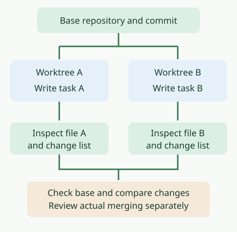

**T3 Code suits following tasks, approvals, and changes in a conversation thread; Orca emphasizes managing terminals, editors, browsers, and diffs per worktree. Herdr is worth exploring when you want to retain terminal execution and customize your work screens and automation.** Their features overlap, so compare how you start work, review it, and return after interruption rather than ranking them by a single feature.

The tools compared are [T3 Code](https://github.com/pingdotgg/t3code/tree/v0.1.9), [Orca](https://orca.dev/), and [Herdr](https://herdr.dev/). They are separate from T3 Stack and other similarly named Hydra projects. Documentation was checked on November 16, 2026, with specific T3 Code behavior scoped to **v0.1.9 documentation**. Orca and Herdr use their current official documentation. The strengths and tradeoffs below are document-based selection criteria, not performance measurements from running the three apps under identical conditions.

## What organizes the work?

| Criterion | T3 Code | Orca | Herdr |
| --- | --- | --- | --- |
| Main workflow | Requests, approvals, and changes in projects and threads | Agents, files, browsers, and diffs per worktree | Terminal and agent management in app or TUI, with customizable screens |
| Work separation | Offers worktrees; verify the task's actual path | Branches and layouts centered on worktrees per task | Worktrees in app and TUI; a pane is not itself a worktree |
| Change review | Distinguishes turn changes from branch comparison scope | Worktree diffs, line comments, partial staging | Check the review workflow of the selected app configuration and terminal tools |
| Permission decisions | Check thread modes and provider-specific behavior together | Check agent permissions and actual execution scope | Check permissions of launched agents, commands, and extensions |
| Remote use | Connect other devices to a server | SSH hosts and remote Orca runtimes | Separate remote features in app/core and TUI |
| Cost assessment | Check app and model-provider costs and connection-service terms separately | Check app, model-provider, and remote-compute costs separately | Check app/core/TUI, model-provider, and server costs separately |

The workflows are grounded in T3 Code's [source-control documentation](https://github.com/pingdotgg/t3code/blob/v0.1.9/docs/user/source-control.md), Orca's [worktree documentation](https://orca.dev/docs/model/worktrees), and Herdr's [app guide](https://herdr.dev/guide/). Features not verified in the table are not treated as unsupported. In particular, T3 Code has worktrees and review screens, and Herdr has a desktop app.

## T3 Code: follow conversations and execution results together

T3 Code connects installed providers to projects and threads. The [v0.1.9 README](https://github.com/pingdotgg/t3code/blob/v0.1.9/README.md) describes mobile, web, and desktop clients and connections to existing providers such as Codex and Claude Code. Treating it as a model provider itself can make installation and authentication confusing.

Its strength is following requests, execution, approvals, and changes in one thread. The source-control documentation distinguishes a turn's own changes from the complete comparison against a base branch. If an agent fetches current code and then edits it, for example, reading only the turn's change list does not complete review of the whole branch.

One tradeoff is that permission modes do not mean exactly the same thing across providers. Choose a mode using the [permission documentation](https://github.com/pingdotgg/t3code/blob/v0.1.9/docs/user/permission-modes.md) and inspect actual approval requests. An approval interface does not itself isolate operating-system file and network access.

Server lifetime also matters remotely. The [remote-access guide](https://github.com/pingdotgg/t3code/blob/v0.1.9/docs/user/remote-access.md) says closing the desktop app's last window stops its local server. Persistent operation requires a separate background service where supported. That service is unavailable on Windows in this version, so distinguish execution setups. Prepare provider authentication and the repository on the server as well.

## Orca: combine task-specific development screens and review

Orca is a development environment for creating a worktree per task and managing agents, editor, browser, and diffs within it. The [diff documentation](https://orca.dev/docs/review/diff-viewer) describes changed lines, partial staging, and conflict resolution. It suits workflows that change a UI, inspect it in a browser, and review code changes.

Its strength is keeping task files and review screens in the same worktree context. Even with multiple agents, the interface helps connect changes to their branches. CLI and skills also provide ways to control workspaces and terminals. [CLI guide](https://orca.dev/docs/cli/overview)

The tradeoff is learning environment configuration and Git workflows. For one short change, managing worktrees and multiple screens may cost more effort than it saves. More agents can mean more results to review and more resource usage. Parallel execution does not guarantee a proportional time saving.

According to the [session-restoration guide](https://orca.dev/docs/model/session-restore), agents keep running after app closure while the daemon remains alive. A host reboot or daemon termination stops processes; restoring workspace layout and scrollback differs from restoring running processes. [Remote execution](https://orca.dev/docs/ways-to-run) is also supported, but tools and credentials must be prepared separately on the executing host.

## Herdr: configure terminals and work screens yourself

Distinguish Herdr's **desktop app, herdr-core, and Herdr TUI**. The app runs on herdr-core, while TUI uses a separate server. The official FAQ explicitly says the app and TUI do not share agent lists. [Herdr official site](https://herdr.dev/)

Its strength is separating terminal execution from screen configuration for extension. The [core guide](https://herdr.dev/core/) describes running programs, starting other tasks, reading results, and connecting remote machines. The [app guide](https://herdr.dev/guide/) also presents asking an agent to change layouts or features. It is worth considering if you want a custom dashboard while retaining your terminal-centered development setup.

The tradeoff is more responsibility for understanding components and extensions. App status depends on OSC 7501 reports from programs; a program can run without displaying status if it does not report it. Do not confuse that with TUI agent-detection rules. Also check which commands and external connections custom mods or plugins use.

Terminals survive app closure while core is alive. The FAQ says rebooting the device or stopping core ends processes, and the app does not automatically restart agents. TUI separately supports restoring layouts and resuming supported agent sessions after a server restart. [TUI restoration guide](https://herdr.dev/tui/docs/session-state/)

## Worktree boundaries shared by all three

When multiple agents change the same files concurrently, task-specific worktrees make changes easier to track. Separate file directories do not automatically separate databases, development-server ports, external accounts, or credentials. This limitation applies to all three tools.



The code below checks the file separation shown in the diagram. It creates a temporary repository in a macOS or Linux shell with Git installed and leaves existing projects untouched. It does not run agents or compare product performance.

```sh
#!/bin/sh
set -eu
case_dir=$(mktemp -d)
git init -q "$case_dir/repo"
git -C "$case_dir/repo" config user.name 'Example Author'
git -C "$case_dir/repo" config user.email 'example@example.invalid'
printf 'base\n' > "$case_dir/repo/app.txt"
git -C "$case_dir/repo" add app.txt
git -C "$case_dir/repo" commit -qm 'Initial commit'
git -C "$case_dir/repo" worktree add -qb task-a "$case_dir/task-a" HEAD
git -C "$case_dir/repo" worktree add -qb task-b "$case_dir/task-b" HEAD
printf 'task A\n' > "$case_dir/task-a/app.txt"
printf 'task B\n' > "$case_dir/task-b/app.txt"
printf 'A: '; cat "$case_dir/task-a/app.txt"
printf 'B: '; cat "$case_dir/task-b/app.txt"
printf 'base: '; cat "$case_dir/repo/app.txt"
printf 'A 변경 파일: '; git -C "$case_dir/task-a" diff --name-only
printf 'B 변경 파일: '; git -C "$case_dir/task-b" diff --name-only
```

The following output was observed in a local shell.

```text
A: task A
B: task B
base: base
A 변경 파일: app.txt
B 변경 파일: app.txt
```

A and B preserve different content but modify the same file. Review the intent of both changes when integrating them. The example does not automatically delete its temporary directory.

## Which tool should you try first?

Try **T3 Code** if you prefer following requests, approvals, and changes in conversations; **Orca** if you prefer task-specific browsers, editors, and diffs; or **Herdr** if you prefer configuring terminals and dashboards. These suggestions are inferred from the features described in official documentation.

To validate your choice, use the same repository, task, model, permissions, and test conditions in all three. Establish a reproducible failing test before editing files, then inspect execution results, diffs, and remaining changes afterward. Treat closing the app window, disconnecting a client, stopping the server, and rebooting the host as separate tests. Compare recovery and review effort as well as elapsed time to find what fits your development workflow.

Continue with the [T3 Code example](/ko/posts/2026-11-12-t3-code-workflow/), [Orca guide](/ko/posts/2026-11-12-orca-worktree-guide/), or [detailed Orca and Herdr comparison](/ko/posts/2026-11-15-orca-herdr-comparison/).
