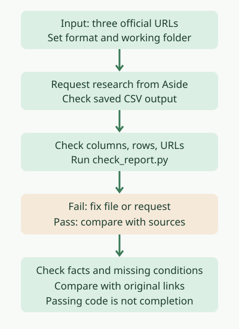

**Give Aside the pages to use, the output format, and completion criteria instead of only asking it to “research this.”** Start with a small task that organizes a few public documents, compare its output with the originals, then expand to signed-in pages or recurring work.

This article follows official help checked on November 17, 2026. The prompts below are usage examples, not results of executing the research, login, or scheduled tasks in Aside. The CSV validation code was run with separate synthetic inputs.

## Set the scope before starting

Install Aside and check the model and working folder. To start from the current page, open the side panel and check the attachment's title and host. Keeping the attachment lets the task use that page as context. [Side-panel guide](https://docs.aside.com/help/side-panel)

You can choose Incognito for research that needs no sign-in. For signed-in account inspection, use the normal profile containing that account. The browser state differs between these modes. A file-saving task also needs write access to the designated folder. [Task-mode guide](https://docs.aside.com/help/tasks)

Check file, tool, and sandbox permissions in `Settings > Agents` along with task-specific settings. Official guidance describes `Guard` as working in approved folders and asking before accessing others. `Read only` is described as disallowing file changes, so it may not suit the CSV-saving example. Do not infer that every website mutation is automatically blocked from a mode's name alone. [Permission guide](https://docs.aside.com/help/security)

## Example 1: organize three official pages as CSV

Choose an empty working folder and send the following request. Replace the save location with the actual folder. If a file already has the same name, specify a new one.

```text
Read only these three official pages and organize them as report.csv.
https://docs.aside.com/help/tasks
https://docs.aside.com/help/automation
https://docs.aside.com/help/devices

Use UTF-8 CSV with columns in this order: topic,summary,source_url.
Set topic to tasks,automation,devices respectively, with one row per page.
Write summary as one Korean sentence describing each page's key usage condition.
Quote fields containing commas according to CSV rules.
Use the corresponding page address above unchanged for source_url.

Save in the selected working folder without overwriting any existing file.
If a document cannot be read, do not guess; report its failed address.
Do not access accounts on other sites or send messages.
When done, report the file path and the three pages checked.
```

If a page does not open, resolve the access failure first. When an item is missing from the results, check the target URL before retrying. Filling unread documents with guessed summaries does not count as completion.



The diagram's code check verifies that the output follows the required structure and source scope. Save the following as `check_report.py`. It uses only the Python 3 standard library and makes no network requests.

```python
import csv
import sys

expected = {
    "tasks": "https://docs.aside.com/help/tasks",
    "automation": "https://docs.aside.com/help/automation",
    "devices": "https://docs.aside.com/help/devices",
}

with open(sys.argv[1], newline="", encoding="utf-8-sig") as stream:
    reader = csv.DictReader(stream)
    if reader.fieldnames != ["topic", "summary", "source_url"]:
        raise SystemExit("FAIL: columns")
    rows = list(reader)

if len(rows) != len(expected) or {r["topic"] for r in rows} != set(expected):
    raise SystemExit("FAIL: topics")
for row in rows:
    if (None in row or any(value is None for value in row.values())
            or not row["summary"].strip()
            or row["source_url"] != expected[row["topic"]]):
        raise SystemExit("FAIL: row")
print("PASS: 3 topics and allowed source URLs")
```

Pass the actual generated CSV path as the argument.

```sh
python3 check_report.py report.csv
```

Synthetic input containing three rows and allowed URLs returned exit code 0 and the following output. This input was not generated by Aside.

```text
PASS: 3 topics and allowed source URLs
```

Synthetic input with one row removed returned `FAIL: topics` and exit code 1. The code checks columns, topics, URLs, and empty summaries, but **cannot determine whether a summary is factual or a page was actually read.** After it passes, check the original passages supporting each summary. Rather than weakening checks to make failures disappear, first look for mismatches between the file and prompt.

## Example 2: read figures from a signed-in dashboard

Narrow account inspection to the site, account, period, and filters needed. The following assumes a work dashboard you are authorized to access.

```text
Read view counts for 2026-11-01~2026-11-07 for the account I specified
in the currently attached dashboard. Include the displayed time zone and filters.
Show dates, values, and units in a table; do not assume blanks mean 0.
Do not change settings, export, or inspect other accounts.
Mark values you cannot verify on screen as unverified.
```

When figures arrive, first compare the displayed total, period, time zone, and filters. An overall total can differ from the sum of selected top rows, so do not immediately treat the difference as an error. If export is needed, specify its scope and destination in a separate request.

Do not paste passwords into prompts. Follow the [Password Manager guide](https://docs.aside.com/help/password-manager) to check saved-login access policy and complete additional authentication required by the site. Keeping raw passwords away from the model differs from processing page content after sign-in. The [privacy policy](https://aside.com/policy/privacy) explains that selected context required for a task may be sent to hosted model providers.

## Correct a request while it runs

If research targets are wrong or scope needs narrowing, you need not wait for completion to say so. The [task guide](https://docs.aside.com/help/tasks) distinguishes `Queue` from `Steer` for follow-ups. `Queue` applies the follow-up after the current run finishes; `Steer` delivers a new message during the run to change direction.

State the change specifically, such as “Use only the original three documents; do not research other sites.” Sending a correction does not itself undo external actions already taken. Check the actual state before deciding the next request.

## Example 3: turn verified research into a routine

Once a one-off result is useful, consider recurring research. According to the [Routines guide](https://docs.aside.com/help/automation), a cron routine starts a new task on a schedule, while a heartbeat routine resumes an existing conversation. For an independent weekly summary, start by considering the new-task approach.

Create a routine in `Settings > Routines` and enter instructions such as these. Set its frequency and time zone separately in the actual settings screen.

```text
Read the three specified official pages and compare them with the previous run.
Report changed usage instructions or limitations with source links.
If no previous results exist, record this run as the baseline.
If a document cannot be read, report access failure instead of no change.
Do not change account settings, send messages, or perform paid actions.
```

Decide where previous results are stored and how later runs will read them. Do not assume a prior conversation becomes comparison input just because a routine creates a new task. Specify input such as a prior report in the working folder, or initially collect reports and compare them yourself instead of automating the comparison.

Run the routine immediately from the list to check inputs, outputs, and failure handling before enabling its schedule. Official guidance describes skipping overlapping runs. The [device guide](https://docs.aside.com/help/devices) says local work requires the computer awake, online, and running Aside. Signing in on another computer or buying a paid plan does not mean a sleeping device's work continues in the cloud.

Learning one complete inspect–organize–verify workflow is enough at first. Repeated execution becomes useful once you have defined the necessary input and a way to check its output.
