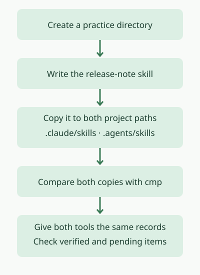

---
{
  "kind": "post",
  "publishedAt": "2026-11-20T14:30:22.276435+00:00",
  "updatedAt": "2026-11-20T14:30:22.276435+00:00",
  "reviewedAt": "2026-11-18",
  "reviewStatus": "source-audited",
  "reviewScope": "Translated from the published Korean edition. Source structure, code, commands, recorded output, and diagram flow checked.",
  "reviewSources": [
    "https://code.claude.com/docs/en/skills",
    "https://learn.chatgpt.com/docs/build-skills",
    "https://github.com/anthropics/skills",
    "https://developers.openai.com/learn/developers-codex-plugin",
    "https://github.com/openai/plugins",
    "https://github.com/openai/skills"
  ],
  "language": "en",
  "translationKey": "2026-11-18-claude-code-codex-skills-top-10",
  "routeSlug": "2026-11-18-claude-code-codex-skills-top-10",
  "title": "Ten recommended Claude Code and Codex skills and how to use them",
  "description": "Compare ten practical skills for Claude Code and Codex CLI, learn how to install and invoke them, and try the same release-note skill in both tools.",
  "categories": [
    "ai"
  ],
  "tags": [
    "claude-code",
    "codex",
    "agent-skills",
    "ai-agent",
    "developer-tools"
  ]
}
---

Turn repeated requests into skills. Instead of retyping the scope of your change summary and the criteria for verifying it, save the expected inputs and output format in a skill. Then change the target files for each task. Development teams can start with `skill-creator` and `webapp-testing`. Teams that do a lot of document work can start with the skill for the file format they use.

This guide covers **Claude Code** in the terminal and **Codex CLI**. On November 18, 2026, I checked the candidates against official sources and ranked them by **frequency of reuse, ease of verification, and setup and integration effort**. The ranking is a practical recommendation and uses those criteria in place of installation counts or performance statistics. OpenAI recommends moving away from its old skills catalog, so the installation sources for Codex refer to its current docs and plugins. [Claude Code skill documentation](https://code.claude.com/docs/en/skills) · [Codex skill documentation](https://learn.chatgpt.com/docs/build-skills) · [Previous catalog notice](https://github.com/openai/skills) · [OpenAI plugin repository](https://github.com/openai/plugins)

## 10 skills for everyday work

The source and environment column lists where each skill is officially provided or distributed. When moving a Claude Code example to Codex, you can reuse the shared `SKILL.md` format. Check the bundled scripts, tool names, and host-specific settings separately.

| Rank | Skill | Source and environment | Example request and what to check |
| --- | --- | --- | --- |
| 1 | `skill-creator` | Built into Codex / [Claude Code example](https://github.com/anthropics/skills/tree/main/skills/skill-creator) | “Create a skill for writing PR descriptions. Give it one input example for a code fix PR and one for a documentation PR.” Check the scope with one request that should invoke it and one that should pass it by. |
| 2 | `webapp-testing` | [Claude Code example](https://github.com/anthropics/skills/tree/main/skills/webapp-testing) | “Use Playwright to check successful submission and a missing required field on the local order page.” Record the actual page state and run logs. You need a browser and an environment that can run the app. |
| 3 | `frontend-design` | [Claude Code example](https://github.com/anthropics/skills/tree/main/skills/frontend-design) | “Design a mobile view for an incident response dashboard. Put status and the next action first.” Check empty states, long text, and keyboard navigation. |
| 4 | `openai-docs` | Built into Codex / [OpenAI Developers guide](https://developers.openai.com/learn/developers-codex-plugin) | “Use official documentation to confirm where Codex CLI stores project skills and how to invoke them.” Check that the sources directly support what you see in the CLI and how the feature is described. |
| 5 | `xlsx` | [Claude Code document skill](https://github.com/anthropics/skills/tree/main/skills/xlsx) | “Turn the order CSV into a monthly summary workbook. Separate canceled orders and use formulas for totals.” Compare the source row count, aggregation range, and totals, and check for formula errors. |
| 6 | `pdf` | [Claude Code document skill](https://github.com/anthropics/skills/tree/main/skills/pdf) | “Extract delivery requirements and exceptions from this requirements PDF, with page numbers.” Compare row and column order and check for omissions against the original pages. Check the quality of OCR separately for scans. |
| 7 | `docx` | [Claude Code document skill](https://github.com/anthropics/skills/tree/main/skills/docx) | “Write a project handoff in the attached Word template and preserve its heading styles and tables.” Open the result in Word or a compatible editor to check page breaks and clipped tables. |
| 8 | `pptx` | [Claude Code document skill](https://github.com/anthropics/skills/tree/main/skills/pptx) | “Make a 6-slide operations retrospective. Show the measurement period and units next to the figures.” Render the slides and check the numbers, axes, and text clipping. |
| 9 | `openai-api-troubleshooting` | [OpenAI Developers plugin for Codex](https://github.com/openai/plugins/tree/main/plugins/openai-developers/skills/openai-api-troubleshooting) | “Narrow down the cause using this API error message with the key removed. I have attached the SDK version and request ID.” Keep hypotheses separate from the commands that test them, and omit live keys and tokens. |
| 10 | `imagegen` | Built into Codex / [Skill source](https://github.com/openai/codex/tree/main/codex-rs/skills/src/assets/samples/imagegen) | “Make a landscape cover concept for a blog post. Leave the article title out of the image.” Check whether generation is available and review image dimensions, the scope of edits, and text distortion. |

`skill-creator` comes first because it lets teams record repeatable procedures in their projects. `webapp-testing` requires a running app and browser, and its logs and observed UI state give you evidence to evaluate. Choose among the four document skills by file format. API diagnosis and image generation are useful when you have an error or need a visual.

For development work, use `frontend-design` to define what the screen should do and `webapp-testing` to check user behavior after implementation. Even with a draft design, test behavior such as whether input survives a failed submission. For documents, you can read a table with `pdf` and summarize it with `xlsx`. Compare the extracted data to the original before passing it to the next step.

## How to install and invoke the skills

In Claude Code, add Anthropic's official marketplace and choose the bundle you need. For PDF, Word, Excel, or PowerPoint, choose `document-skills`. For examples of skill authoring or web testing, choose `example-skills`. You can refer to an installed plugin skill by name in a natural-language request. [Anthropic installation instructions](https://github.com/anthropics/skills#claude-code)

```text
/plugin marketplace add anthropics/skills
/plugin install document-skills@anthropic-agent-skills
/plugin install example-skills@anthropic-agent-skills
```

In Codex CLI, find and explicitly select a skill using `/skills` or the `$` picker. Invoke the built-in `skill-creator` as `$skill-creator`. To add the OpenAI API troubleshooting skill, find **OpenAI Developers** in Codex CLI's `/plugins` menu and select `Install plugin`. Start a new session and confirm the troubleshooting skill appears in `/skills`. [How to invoke Codex skills](https://learn.chatgpt.com/docs/build-skills) · [OpenAI Developers plugin](https://developers.openai.com/learn/developers-codex-plugin)

Keep versioned project skills in `.claude/skills/<name>/SKILL.md` for Claude Code and `.agents/skills/<name>/SKILL.md` for Codex, substituting the skill name for the placeholder. When copying an official example, check the tools and files its `SKILL.md` refers to. If a skill needs an external connection, check the account and scope of access before running it. [Claude Code skill locations](https://code.claude.com/docs/en/skills#choose-where-skills-load) · [Codex skill locations](https://learn.chatgpt.com/docs/build-skills#where-to-save-skills)

## Exercise — use the same release-note skill in both tools

Run the commands below from a fresh practice directory. They write one `SKILL.md`, copy it to both project paths, and use `cmp` to verify the files match. You need a POSIX shell and `mkdir`, `cp`, and `cmp`.



```sh
set -eu
mkdir skills-demo
cd skills-demo

mkdir -p .claude/skills/release-note-draft .agents/skills/release-note-draft

cat > release-note-source.md <<'SKILL'
---
name: release-note-draft
description: Draft a release note from a provided change list and test evidence.
---
Write three sections in Korean: 사용자 변경, 검증, 미확인.
Describe user-facing changes using only the supplied change list.
Put a test in 검증 only when the input explicitly says it ran and gives the result.
If a test is mentioned without a result, put it in 미확인.
Return the draft in the chat.
SKILL

cp release-note-source.md .claude/skills/release-note-draft/SKILL.md
cp release-note-source.md .agents/skills/release-note-draft/SKILL.md
cmp .claude/skills/release-note-draft/SKILL.md .agents/skills/release-note-draft/SKILL.md
printf '%s\n' 'Skill copies match.'
```

In a temporary directory on macOS, the commands printed the output below and returned exit code `0`. A second run from the same parent directory stops at the first `mkdir` because `skills-demo` already exists.

```text
Skill copies match.
```

From `skills-demo`, run `claude` and `codex` in separate terminal sessions. In Claude Code, select `/release-note-draft`. In Codex CLI, select `$release-note-draft`. Send the skill name and the following change and test record in one message.

> Change: Clearing the email field on the settings page disables Save.\
> Verification: Ran 3 unit tests for the settings page. All passed.\
> Planned: Check the behavior in a mobile browser.\
> Draft a release note from this record.

The expected result lists the button behavior under user-facing changes, all 3 passing unit tests under verification, and the pending mobile browser check under unverified items.

## Comparing responses to the same input

Both CLIs used the same skill file and the same fictional change and verification record. The exercise checks whether they can distinguish **completed tests from planned tests** using the supplied record. It does not ask them to run new app tests.

After running Codex CLI 0.169.0 with GPT-6.2 Sol, I confirmed in the log that it read the project skill file. Here are the key statements from its response.

| Section | Codex response |
| --- | --- |
| User-facing change | Clearing the email entered on the settings page disables Save. |
| Verification | All 3 unit tests for the settings page ran and passed. |
| Unverified | The mobile browser behavior is scheduled for verification. |

The project skill also appeared in the list in Claude Code 2.0.76 and 2.1.327. The model call stopped with a sign-in error. This run established that Claude Code discovered the skill and that Codex produced one response.
