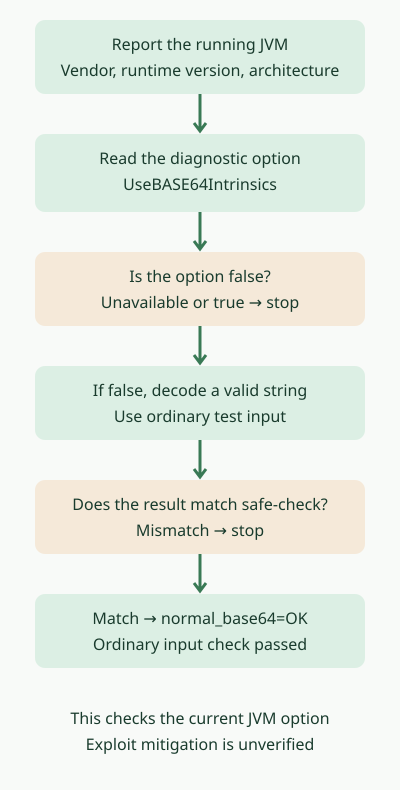

**Java4Shell is a memory corruption vulnerability in the path that OpenJDK uses on certain x86-64 CPUs to accelerate Base64 decoding. Under the right conditions, it can lead to memory disclosure or remote code execution. Check the runtime build, CPU capabilities, and whether external input reaches that path, then install your vendor's fixed JDK.** If the patch cannot be deployed immediately, consider the discoverer's temporary mitigation, `-XX:-UseBASE64Intrinsics`.

Java4Shell is the name given by the discoverer, Calif, to **CVE-2026-114938**. The issue appears in the [Oracle security advisory (2026-11)](https://www.oracle.com/security-alerts/cspunov2026.html) and the [OpenJDK security advisory](https://openjdk.org/groups/vulnerability/advisories/2026-11-17). The version information below reflects public material checked on November 18, 2026.

## Why memory can be corrupted in Java

HotSpot uses JIT compilation to optimize frequently executed operations and implements some operations with specialized CPU instructions called intrinsics. Calif found that the x86-64 Base64 intrinsic miscalculates the mask that selects which bytes to write during padding handling and writes beyond the output buffer. Memory can already be corrupted by the time Java rejects malformed input with `IllegalArgumentException`. Catching the exception alone does not fix the vulnerability.

Oracle lists the component as `Compiler`, and OpenJDK classifies it as `hotspot/compiler`. An application can reach this code during ordinary Base64 decoding, even if it never compiles external Java source.

Calif identifies **AVX-512 VBMI support on x86-64 CPUs** as a prerequisite and recommends checking for all of these flags on Linux: `avx512f`, `avx512bw`, `avx512vbmi`, and `bmi2`. ARM64 is outside the affected path described by Calif. CPU support alone cannot establish remote code execution. Input paths and exploitation conditions vary by application. A single malicious input does not compromise every product. For VMs and containers, check the CPU features exposed to the running JVM.

Read each severity score alongside its publisher and CVSS version.

| Publisher | Rating | Interpretation |
| --- | --- | --- |
| Oracle CNA | CVSS 3.1 **8.1, High** | Network attack with high complexity and no privileges or user interaction required |
| Calif | CVSS 4.0 **9.2, Critical** | Separate assessment from the discoverer |

Oracle's vector is `CVSS:3.1/AV:N/AC:H/PR:N/UI:N/S:U/C:H/I:H/A:H`. The scores use different CVSS versions and come from different assessments. [CVE record](https://www.cve.org/CVERecord?id=CVE-2026-114938)

## Which JDK builds need replacing?

The table lists the affected supported versions named by Oracle and the Oracle releases confirmed to include a fix. Consult the vendor's advisory for any other distribution.

| Product | Affected version listed by Oracle | Confirmed Oracle fix |
| --- | --- | --- |
| Oracle Java SE 17 | `17.0.21.0.3` | [17.0.21.1+4](https://www.oracle.com/java/technologies/javase/17-0-21-1-relnotes.html) |
| Oracle Java SE 21 | `21.0.13.0.3` | [21.0.13.1+4](https://www.oracle.com/java/technologies/javase/21-0-13-1-relnotes.html) |
| Oracle Java SE 25 | `25.0.5.0.3` | [25.0.5.1+4](https://www.oracle.com/java/technologies/javase/25-0-5-1-relnotes.html) |
| Oracle Java SE 27 | `27.0.1.0.3` | [27.0.1.1+4](https://www.oracle.com/java/technologies/javase/27-0-1-1-relnotes.html) |
| Oracle Java SE 8 Performance Pack | `8u511b33-perf` | Exact fixed build unconfirmed here |
| Oracle GraalVM for JDK | `17.0.21.0.3`, `21.0.13.0.3` | Check the product's security update |
| Oracle GraalVM Enterprise Edition | `21.3.20.0.3` | Check the product's security update |

Earlier releases may also be affected. Oracle recommends upgrading to supported versions. Distinguish the standard Java 8 build from Performance Pack. [Oracle risk matrix](https://www.oracle.com/security-alerts/cspunov2026.html#AppendixJAVA)

For OpenJDK distributions such as Temurin, Corretto, and Zulu, check the vendor's advisory and fixed build for this CVE. A version number that differs from the Oracle table is insufficient to establish safety. Calif's affected scope refers to the specific hardware and runtime path before the fix.

## How to patch and apply temporary mitigation

First identify **the JDK that actually runs the service**. Running `java -version` in a shell shows the executable on its PATH, which can differ from the runtime of an existing process. Record the service executable path, container image, JVM version, and vendor.

Replace the runtime with a fixed build from its vendor. For containers, rebuild and deploy from a patched base image, then verify the running versions after the rollout to ensure old processes have been replaced. Changing an application dependency or installing a new JDK on the host does not replace the runtime in use.

If deployment of the patch is delayed, consider this **JVM startup option** from Calif. Substitute your application JAR.

```sh
java -XX:-UseBASE64Intrinsics -jar app.jar
```

The option disables hardware-accelerated Base64 encoding and decoding as a temporary mitigation. Oracle's security advisory recommends applying the update. Add the option alongside existing JVM settings, restart the process, and verify its effective value. Monitor throughput, CPU usage, and latency for services that use Base64 heavily. This article provides no performance measurements.

Calif also suggests `-XX:UseAVX=2` **for x86-64 only**. OpenJDK on ARM can reject it at startup, so avoid applying it uniformly to deployments with mixed architectures. Nginx request buffering does not cover every exploitation path.

## Verify the temporary option with Java

On **HotSpot-based JDK 17 or later**, this example checks the current JVM option and ordinary Base64 decoding. Vulnerability detection and attack blocking require separate validation. If the diagnostic interface or option is unavailable, use the runtime's management tools to check the effective configuration.



If the diagnostic interface is unavailable or the option is enabled, the example throws an exception. When the configuration check passes, the example decodes a valid string and compares the result with the expected value.

Save the source as `Base64MitigationCheck.java`.

```java
import com.sun.management.HotSpotDiagnosticMXBean;
import java.lang.management.ManagementFactory;
import java.nio.charset.StandardCharsets;
import java.util.Base64;

public class Base64MitigationCheck {
    public static void main(String[] args) {
        System.out.println("java.vendor=" + System.getProperty("java.vendor"));
        System.out.println("java.runtime.version="
                + System.getProperty("java.runtime.version"));
        System.out.println("os.arch=" + System.getProperty("os.arch"));

        HotSpotDiagnosticMXBean diagnostic = ManagementFactory
                .getPlatformMXBean(HotSpotDiagnosticMXBean.class);
        if (diagnostic == null) {
            throw new IllegalStateException("HotSpot diagnostic interface unavailable");
        }
        String enabled = diagnostic.getVMOption("UseBASE64Intrinsics").getValue();
        System.out.println("UseBASE64Intrinsics=" + enabled);
        if (!"false".equals(enabled)) {
            throw new IllegalStateException("Base64 intrinsic is not disabled");
        }

        String decoded = new String(
                Base64.getDecoder().decode("c2FmZS1jaGVjaw=="),
                StandardCharsets.UTF_8);
        if (!"safe-check".equals(decoded)) {
            throw new IllegalStateException("Unexpected Base64 result");
        }
        System.out.println("normal_base64=OK");
    }
}
```

Run both commands with `javac` and `java` from the same target JDK.

```sh
javac --release 17 Base64MitigationCheck.java
java -XX:-UseBASE64Intrinsics Base64MitigationCheck
```

The output below was recorded on ARM64 macOS using Zulu `21.0.1+12-LTS`. This older build was used to exercise the example. Use a supported patched build in production. The disabled option and ordinary decoding were also checked on Corretto `17.0.8.1+8-LTS`.

```text
java.vendor=Azul Systems, Inc.
java.runtime.version=21.0.1+12-LTS
os.arch=aarch64
UseBASE64Intrinsics=false
normal_base64=OK
```

Running with `-XX:+UseBASE64Intrinsics` in those same environments produced the exception `Base64 intrinsic is not disabled` and exit code `1`. The ARM64 tests covered **option inspection, branching, and ordinary input handling**. Memory corruption on affected x86-64 hardware, the mitigation's effectiveness, and performance remain untested here.

The example checks its own process. For a running service, use a compatible diagnostic tool and access to that JVM. If inspection fails because of the JVM implementation, disabled Attach, permission limits, or the container PID namespace, record the status as unverified.

```sh
# JCMD는 대상 런타임과 호환되는 도구의 경로, PID는 서비스 JVM의 PID다.
"$JCMD" "$PID" VM.version
"$JCMD" "$PID" VM.flags -all | grep 'UseBASE64Intrinsics'
```

After deploying the fixed release, check the running build, confirm instances were replaced, and review key functions such as sign-in, uploads, and integrations alongside error rates. Before removing a temporary option, verify the vendor fix and normal behavior, then compare metrics before and after the change.
