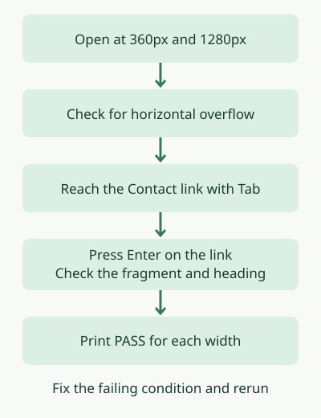

---
{
  "kind": "post",
  "publishedAt": "2026-11-20T14:30:22.276435+00:00",
  "updatedAt": "2026-11-20T14:30:22.276435+00:00",
  "reviewedAt": "2026-11-19",
  "reviewStatus": "source-audited",
  "reviewScope": "Translated from the published Korean edition. Source structure, code, commands, recorded output, and diagram flow checked.",
  "reviewSources": [
    "https://github.com/anthropics/skills",
    "https://github.com/openai/plugins/tree/main/plugins/build-web-apps",
    "https://github.com/vercel-labs/agent-skills",
    "https://playwright.dev/docs/api/class-browsertype#browser-type-launch",
    "https://developers.google.com/search/docs/fundamentals/seo-starter-guide"
  ],
  "language": "en",
  "translationKey": "2026-11-19-website-building-agent-skills",
  "routeSlug": "2026-11-19-website-building-agent-skills",
  "title": "Build a website with Claude Code and Codex — skills from planning to deployment",
  "description": "Compare skills for building an informational site or web app with Claude Code and Codex, from implementing the page to checking it with Playwright and verifying the deployment.",
  "categories": [
    "ai"
  ],
  "tags": [
    "claude-code",
    "codex",
    "agent-skills",
    "frontend",
    "playwright"
  ]
}
---

For a small company website, start by **writing the copy and organizing the page, building the interface, and checking the path to contact in a browser**. For a web app with login or payments, first design access control, data storage, and failure recovery. The type of site determines which skills you need and how to judge the results.

I selected these skills by stage from the official Anthropic, OpenAI, and Vercel sources on November 19, 2026. The examples assume you are assigning work to an agent in Claude Code or Codex CLI. [Anthropic skills](https://github.com/anthropics/skills) · [OpenAI Build Web Apps](https://github.com/openai/plugins/tree/main/plugins/build-web-apps) · [Vercel Agent Skills](https://github.com/vercel-labs/agent-skills)

## Choose skills based on the type of site

| What you are building | Decide first | Basic workflow |
| --- | --- | --- |
| Informational site, portfolio, or blog | Visitors, main action, public pages, and how content is edited | Page copy → implementation → browser tests → deployment verification |
| Booking, payment, or admin web app | Permissions by user, data to store, success and failure handling, and operational records | Screen and state design → frontend and server implementation → success and failure tests → preview → production verification |

If a repository already exists, check the project's framework and deployment process first. For example, you can add a post and a contact link to an Astro blog within its existing setup. Use React or Next.js performance skills and payment skills when the project actually uses those technologies or features.

| Step | Suggested skill or guideline | What to delegate and how to verify it |
| --- | --- | --- |
| Planning and copy | Project-specific `website-copywriting` guidelines | Identify the intended visitors and main action, then write the title, description, and contact copy. Read the first screen to see whether it explains who the service is for and what it offers. |
| Interface design | Project-specific `frontend-architecture-design` guidelines | Define page routes, ownership of components and state, and success and error screens. For a booking app, decide how to handle repeated clicks during submission and retries after a save failure. |
| Interface implementation | [Claude Code's `frontend-design`](https://github.com/anthropics/skills/tree/main/skills/frontend-design) or [Codex's `frontend-app-builder`](https://github.com/openai/plugins/tree/main/plugins/build-web-apps/skills/frontend-app-builder) | Turn the approved copy and structure into components in the existing project. Check that readers can follow the title, action button, and body in order on a narrow screen. |
| Browser verification | [Claude Code's `webapp-testing`](https://github.com/anthropics/skills/tree/main/skills/webapp-testing) and [Codex's `frontend-testing-debugging`](https://github.com/openai/plugins/tree/main/plugins/build-web-apps/skills/frontend-testing-debugging) | Check the contact link, form errors, and console on mobile. Record the tested URL, viewport, reproduction steps, and observed results. |
| Accessibility review | [Vercel's `web-design-guidelines`](https://github.com/vercel-labs/agent-skills/tree/main/skills/web-design-guidelines) | Review labels, contrast, and focus in the code. Check tab order and the focus indicator in the browser. Record the automated and manual checks. |
| React performance | [Build Web Apps' `react-best-practices`](https://github.com/openai/plugins/tree/main/plugins/build-web-apps/skills/react-best-practices) | Review sequential data requests and the initial bundle in React or Next.js projects. Measure before and after in the same environment to judge the impact. |
| Deployment | [Vercel's `deployments-cicd`](https://github.com/openai/plugins/tree/main/plugins/vercel/skills/deployments-cicd) or the project's deployment guide | Check the preview or staging URL on the host, then deploy the approved version. Record the final URL and the release to roll back to. |

The first two entries are examples of roles you define within a project. For published skills, follow the installation route offered by the maintainer. In Claude Code, Anthropic's official marketplace has the implementation and testing skills in `example-skills`. In Codex, the **Build Web Apps** plugin bundles implementation, testing, and React optimization skills. Use the Vercel deployment skill for sites hosted on Vercel. For GitHub Pages, follow the repository's Actions and preview process. [Claude Code installation instructions](https://github.com/anthropics/skills#claude-code) · [OpenAI Build Web Apps contents](https://github.com/openai/plugins/blob/main/plugins/build-web-apps/README.md)

## Chain skills together on a small site

The build request can be short. Include the service details, page structure, and behavior to verify so that planning, implementation, and testing share the same criteria.

> Build an informational page for a fictional photography studio.\
> Visitors want to find the studio location and learn how to arrange a consultation.\
> Put the introduction and consultation information on one page and link\
> the first screen's Contact link to the consultation section.\
> Keep the introduction, contact link, and consultation information in that order.\
> Account for a narrow 360px viewport and keyboard use.\
> After implementation, check for horizontal overflow at 360px and 1280px.\
> Use Tab to reach the Contact link and Enter to open the consultation section.\
> Record the result of each step and anything you could not verify.

Give the introduction and contact link to the implementation stage, then use viewport and keyboard requirements as test criteria. If a test fails, report the failing viewport and interaction to the implementation agent, and rerun the same conditions after the fix. Extend the accessibility review to contrast, the names read by screen readers, and where focus lands after navigation to another page.

## Exercise — check the path to contact with Playwright

The exercise puts a single page in the test file and checks it in a browser at two viewport widths. Prepare Node.js 22 and Chrome in a fresh directory. Run `npm init -y`, then install the dependency with `npm install --save-dev playwright-core@1.64.1`. Save the following as `website-check.mjs` and run `node website-check.mjs` on macOS. If Chrome is installed elsewhere, set `CHROME_PATH` to the executable path. [Playwright browser launch options](https://playwright.dev/docs/api/class-browsertype#browser-type-launch)



```js
import assert from 'node:assert/strict';
import { chromium } from 'playwright-core';

const html = `<!doctype html>
<html lang="ko">
<meta charset="utf-8">
<meta name="viewport" content="width=device-width, initial-scale=1">
<title>봄 사진 스튜디오</title>
<style>
  body { margin: 0; font: 1rem/1.6 system-ui; }
  main { max-width: 42rem; margin: auto; padding: 1rem; }
  section { min-height: 74vh; }
</style>
<main>
  <section>
    <h1>봄 사진 스튜디오</h1>
    <p>프로필 사진과 가족사진을 촬영합니다.</p>
    <a href="#contact">문의하기</a>
  </section>
  <section id="contact">
    <h2>상담 안내</h2>
    <p>촬영 목적과 희망 일정을 준비해 주세요.</p>
  </section>
</main>
</html>`;

const browser = await chromium.launch({
  executablePath: process.env.CHROME_PATH
    ?? '/Applications/Google Chrome.app/Contents/MacOS/Google Chrome',
});

try {
  for (const width of [360, 1280]) {
    const page = await browser.newPage({ viewport: { width, height: 700 } });
    try {
      await page.setContent(html);
      const overflow = await page.evaluate(
        () => document.documentElement.scrollWidth > window.innerWidth,
      );
      assert.equal(overflow, false, `가로 넘침: ${width}px`);

      await page.keyboard.press('Tab');
      const focused = await page.evaluate(
        () => document.activeElement?.getAttribute('href'),
      );
      assert.equal(focused, '#contact', `문의 링크 포커스: ${width}px`);
      await page.keyboard.press('Enter');
      await page.waitForURL(/#contact$/);
      const heading = await page.getByRole('heading', { name: '상담 안내' }).boundingBox();
      assert.ok(heading && heading.y >= 0 && heading.y + heading.height <= 700);
      console.log(`PASS ${width}px: no overflow, keyboard link reaches contact`);
    } finally {
      await page.close();
    }
  }
} finally {
  await browser.close();
}
```

The run produced the output below. Each `PASS` means there was no horizontal overflow, the keyboard could reach the contact link, and activating it brought the consultation heading into view.

```text
PASS 360px: no overflow, keyboard link reaches contact
PASS 1280px: no overflow, keyboard link reaches contact
```

For a real project, start the local server and open the implemented page with `page.goto()` instead of supplying an HTML string. For a contact form, add separate checks for missing required fields, input preservation after submission fails, and the success message. Changing the contact link to a different fragment caused the link check to fail at 360px. This exercise covers one practice HTML page and two viewport widths in Chrome.

## What to check after deployment

Reopen the key pages and the contact path on the preview and production URLs, then check server responses and static assets. For pages intended for search, check the title, description, canonical URL, internal links, and sitemap. To see whether search actually discovered and indexed the pages, check Search Console separately from loading the production URL. [Google SEO starter guide](https://developers.google.com/search/docs/fundamentals/seo-starter-guide)
