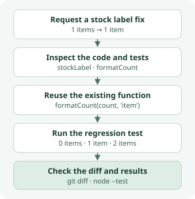

---
{
  "kind": "post",
  "publishedAt": "2026-11-20T14:30:22.276435+00:00",
  "updatedAt": "2026-11-20T14:30:22.276435+00:00",
  "reviewedAt": "2026-11-20",
  "reviewStatus": "source-audited",
  "reviewScope": "Translated from the published Korean edition. Source structure, code, commands, recorded output, and diagram flow checked.",
  "reviewSources": [
    "https://learn.chatgpt.com/docs/build-skills",
    "https://github.com/DietrichGebert/ponytail/blob/main/INSTALL.md",
    "https://github.com/DietrichGebert/ponytail#commands"
  ],
  "language": "en",
  "translationKey": "2026-11-20-ponytail-skill-guide",
  "routeSlug": "2026-11-20-ponytail-skill-guide",
  "title": "How to use the Ponytail skill — small fixes and regression tests with Codex",
  "description": "Learn how to invoke Ponytail in Codex and Claude Code, when to use Lite, Full, or Ultra, and how to reuse a function and run a Node.js regression test in Codex CLI.",
  "categories": [
    "ai"
  ],
  "tags": [
    "ponytail",
    "codex",
    "claude-code",
    "agent-skills",
    "refactoring",
    "nodejs"
  ]
}
---

**Ponytail is a skill that helps an AI coding agent deliver the requested behavior by reusing existing code.** If a stock label displays `1 items` when there is one item, first check whether the project already has a function for singular and plural labels. Reuse it to fix the display, then test that quantities of 0 and 2 still behave as before.

## Getting started in Codex and Claude Code

If the standalone Ponytail skill is already installed in Codex, enter `$ponytail-help` in the chat to see the skill names and modes. Follow `$ponytail full` with the behavior to change, the conditions to preserve, and the command to verify the change. The exercise below uses the standalone skill installed at `~/.agents/skills/ponytail/SKILL.md`. In this setup the mode sets a working preference for the current conversation. Use `$ponytail off` to turn it off. [Codex skill documentation](https://learn.chatgpt.com/docs/build-skills)

The Ponytail project also distributes a plugin. For Codex CLI, run the two commands below in your shell. Then open Codex and inspect what the two hooks run under `/hooks`. To use the hooks, trust them after reviewing them and start a new conversation. The hook environment needs `node` on its `PATH`. [Ponytail installation guide](https://github.com/DietrichGebert/ponytail/blob/main/INSTALL.md#codex)

```bash
codex plugin marketplace add DietrichGebert/ponytail
codex plugin add ponytail@ponytail
```

In Claude Code, enter the two commands below one line at a time, then select a mode with `/ponytail full`. The plugin includes the `/ponytail-review` command. In the Codex plugin the review skill appears with a plugin prefix, as in `$ponytail:ponytail-review`. Installation and hook behavior for both plugins follow the public documentation. [Claude Code installation guide](https://github.com/DietrichGebert/ponytail/blob/main/INSTALL.md#claude-code) · [Ponytail commands](https://github.com/DietrichGebert/ponytail#commands)

```text
/plugin marketplace add DietrichGebert/ponytail
/plugin install ponytail@ponytail
```

## When should you use Lite, Full, or Ultra?

In the standalone Codex skill, entering `$ponytail` by itself uses Full, the default mode.

| Invocation | How it works | Example |
| --- | --- | --- |
| `$ponytail lite` | Completes the request and briefly mentions a smaller approach when it would materially help. | Change UI copy that the team has already agreed on. |
| `$ponytail full` | Checks callers and existing tests, then delivers the requested behavior with the smallest complete change. Reports verified results and remaining risks. | Fix a singular label and check the existing inputs. |
| `$ponytail ultra` | Flags needless expansions in scope while carrying out the requested work. | Fix an error on one screen and assess separately whether a shared UI overhaul is warranted. |

To keep the change small, state **what to change, what to preserve, and how to verify it**. Include behavior that callers depend on, such as authorization checks, input validation, and data protection. The skill guides how the agent works. The agent's permissions determine where it can write files and which commands it can execute.

## Exercise — display `1 item` when one item is in stock

The exercise ran in an empty practice repository with Node.js 22.17.0 and Codex CLI 0.169.0. To recreate the starting state, replace the return line in `stockLabel` below with ``return `${count} items`;``. The first test in
`stock.test.mjs` was already present at the start. The second was added for this change.

> $ponytail full\
> Fix stockLabel(1) returning 1 items.\
> Keep items for 0 and 2. Reuse the existing formatCount function,\
> add a regression test for stockLabel, and run node --test.\
> Do not modify anything outside this practice repository or make a commit.



The only change to `stock.mjs` was the return expression in `stockLabel`. It calls `formatCount`, which already handles singular and plural labels.

```javascript
export function formatCount(count, noun) {
  return `${count} ${count === 1 ? noun : noun + 's'}`;
}

export function stockLabel(count) {
  return formatCount(count, 'item');
}
```

In `stock.test.mjs`, check the labels for quantities of 0, 1, and 2. Put the two files in the same directory and run `node --test`.

```javascript
import assert from 'node:assert/strict';
import test from 'node:test';
import { formatCount, stockLabel } from './stock.mjs';

test('formatCount handles singular and plural', () => {
  assert.equal(formatCount(1, 'item'), '1 item');
  assert.equal(formatCount(2, 'item'), '2 items');
});

test('stockLabel handles zero, one, and two items', () => {
  assert.equal(stockLabel(0), '0 items');
  assert.equal(stockLabel(1), '1 item');
  assert.equal(stockLabel(2), '2 items');
});
```

With the original implementation, the added test failed for quantity 1. It expected `1 item` and received `1 items`. After the fix, the run produced the following output.

```text
ok 1 - formatCount handles singular and plural
ok 2 - stockLabel handles zero, one, and two items
# tests 2
# pass 2
# fail 0
```

The exercise covers two tests and changes to two files. After the agent reports completion, compare the actual `git diff` and the test results to verify that it reused the existing function and stayed within scope.

## Set the review scope after the change

If the companion standalone skills are installed, use the commands below. Naming the part of the code to review makes the findings easier to verify. [Ponytail commands](https://github.com/DietrichGebert/ponytail#commands)

| Invocation | When to use it |
| --- | --- |
| `$ponytail-review` | Reviews the current diff and related code. Use it before opening a PR to check callers or missing regression tests. |
| `$ponytail-audit` | Surveys the whole repository in read-only mode and ranks the issues it finds. |
| `$ponytail-debt` | Collects existing `shortcut:` comments and older `ponytail:` comments for inspection. |
| `$ponytail-gain` | Shows the project's published benchmark report. Measuring time or cost savings in your own repository requires a separate comparison. |
| `$ponytail-help` | Lists the modes and invocations for the installed skills. |
