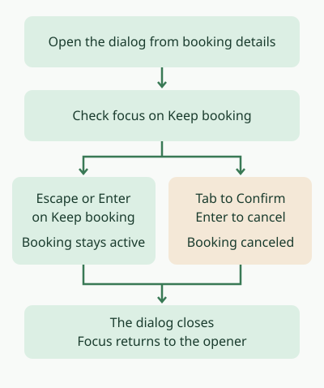

---
{
  "kind": "post",
  "publishedAt": "2026-11-20T14:30:22.276435+00:00",
  "updatedAt": "2026-11-20T14:30:22.276435+00:00",
  "reviewedAt": "2026-11-20",
  "reviewStatus": "source-audited",
  "reviewScope": "Translated from the published Korean edition. Source structure, code, commands, recorded output, and diagram flow checked.",
  "reviewSources": [
    "https://github.com/anthropics/skills",
    "https://github.com/openai/plugins/tree/main/plugins/figma",
    "https://github.com/openai/plugins/tree/main/plugins/product-design",
    "https://github.com/vercel-labs/agent-skills",
    "https://www.w3.org/WAI/ARIA/apg/patterns/dialog-modal/",
    "https://www.w3.org/TR/WCAG22/"
  ],
  "language": "en",
  "translationKey": "2026-11-20-ui-ux-design-agent-skills",
  "routeSlug": "2026-11-20-ui-ux-design-agent-skills",
  "title": "UI/UX design with Claude Code and Codex — user flows, Figma, and accessibility skills",
  "description": "Design user flows, Figma design systems, interface copy, and accessibility with Claude Code and Codex. Verify keyboard and focus behavior in a booking cancellation dialog with Playwright.",
  "categories": [
    "ai"
  ],
  "tags": [
    "claude-code",
    "codex",
    "agent-skills",
    "figma",
    "ui-ux",
    "accessibility",
    "playwright"
  ]
}
---

**Before drawing a screen, decide what users need to accomplish and where they can back out.** In a booking cancellation flow, users need to understand what canceling will do and be able to keep or cancel the booking. Define what the dialog says, where initial focus lands, and where it returns after closing so that implementation and testing use the same criteria.

This guide expands on the UI/UX stage of the [website-building guide](/ko/posts/2026-11-19-website-building-agent-skills/). It takes a booking cancellation flow from planning to browser verification, drawing on sources I checked on November 20, 2026, including public Claude Code and Codex skills and resources from Figma, Vercel, and W3C.

## Choose skills based on what you need to produce

| Deliverable | Skill or workflow | What to review |
| --- | --- | --- |
| User flow and screen states | Project-specific `frontend-architecture-design` guidelines | Check that entry, confirmation, exit, processing, success, and failure are defined. With user research in hand, distinguish observations from hypotheses. |
| Prototype for review | Codex [Product Design plugin](https://github.com/openai/plugins/tree/main/plugins/product-design) | Make a prototype that shows the state transitions. Check that users can keep the booking or confirm cancellation. |
| Visual direction and UI code | Claude Code's [`frontend-design`](https://github.com/anthropics/skills/tree/main/skills/frontend-design) | Define the visual hierarchy of the heading, description, and action buttons. Check that long headings and narrow viewports preserve the meaning and order. |
| Assembling Figma screens | Figma plugin's [`figma-generate-design`](https://github.com/openai/plugins/tree/main/plugins/figma/skills/figma-generate-design) | Reuse button and dialog instances from the existing library and make a frame for each state. Verify that the component and variable bindings stay intact. |
| Design system library | Figma plugin's [`figma-generate-library`](https://github.com/openai/plugins/tree/main/plugins/figma/skills/figma-generate-library) | Create or update Figma variables and libraries from design tokens and components in code. Compare variant and variable bindings with the names in the code. |
| Implementation from approved Figma screens | Figma plugin's [`figma-design-to-code`](https://github.com/openai/plugins/tree/main/plugins/figma/skills/figma-design-to-code) | Read the target frame and implement it using the existing UI code. Compare the screens, then check keyboard interaction and failure states separately. |
| UI copy | Project-specific UX writing guidelines such as `cms-ux-writing` | Use verbs that describe what clicking the button will do. State the result of each action clearly, as in “Keep booking” and “Confirm cancellation.” |
| Interface review | Vercel's [`web-design-guidelines`](https://github.com/vercel-labs/agent-skills/tree/main/skills/web-design-guidelines) and browser checks | Identify potential accessibility and UI problems in code, then check keyboard order, focus movement, and layout at different viewport sizes in the browser. |

The two project-specific guidelines show how a team can turn its screen design and copy rules into reusable skills. If someone can review the booking flow, show the prototype first, incorporate feedback into the state table, then hand it off for implementation. If the Figma frames and code components are already agreed on, you can start with implementation and accessibility review.

In Claude Code, Anthropic includes `frontend-design` in the official marketplace's `example-skills` bundle. Using Figma skills in Codex requires the Figma tools connected through the plugin and access to the file. For work that creates screens or components in Figma, apply the plugin's `figma-use` guidelines alongside the relevant creation skill. Provide the target frame link when reading a design for implementation. For new frames, provide a file that can be edited and the library to reuse. [Anthropic installation instructions](https://github.com/anthropics/skills#claude-code) · [Figma plugin for Codex](https://github.com/openai/plugins/tree/main/plugins/figma)

If you have brand guidelines, supply the actual logos, colors, and fonts, plus examples of prohibited use. Applying Anthropic's `brand-guidelines` by name alone can bring Anthropic colors and typography into your team's work. Its default material is for Anthropic's brand. [`brand-guidelines` source](https://github.com/anthropics/skills/tree/main/skills/brand-guidelines)

## Hand off the booking cancellation flow to design and engineering

Before drawing the screen, capture user actions and outcomes in a table. This is a design example. Check the actual service policy before writing refund rules or cancellation fees.

| User action or server status | What happens on screen |
| --- | --- |
| Select “Open cancellation options” in the booking details | The dialog opens and moves focus to “Keep booking.” |
| Choose “Keep booking” or press Escape | The dialog closes and the booking stays in place. Focus returns to the button that opened it. |
| Select “Confirm cancellation” | In production, submit the request and show a processing state. Prevent duplicate processing if the same request is repeated. |
| The server reports success | Set the booking status to “Booking canceled” and announce the result. |
| The server reports failure | Preserve the booking status and explain the failure and available next actions. |

For a dialog that confirms a difficult-to-reverse action, it can be appropriate to focus the least destructive option initially. On close, usually return focus to the control that opened the dialog. If it no longer exists, choose an element that lets the user continue the workflow. [W3C modal dialog pattern](https://www.w3.org/WAI/ARIA/apg/patterns/dialog-modal/)

Give the implementation agent the desired behavior and acceptance criteria.

**Example prompt** Design a cancellation dialog in the booking details. Reuse the existing dialog and buttons. Move initial focus to “Keep booking”. When Escape closes the dialog, keep the booking status and return focus to “Open cancellation options”. After submitting the cancellation request, represent processing, success, and failure separately. On failure, show the next action for retrying or getting help. Map the frames to the states so we can review the screen and state table before implementation.

## Exercise — check dialog focus and both outcomes

Test the first two rows and the UI change after confirming cancellation in the browser. In this exercise, confirmation only changes state inside the page. Server requests, failure handling, and duplicate-submission prevention are separate checks for production. The example keeps the original Korean labels.



Prepare Node.js 22 and Chrome. In a new working directory, run `npm init -y` and `npm install --save-dev playwright-core@1.64.1`. Save the code as `dialog-check.mjs` and run `node dialog-check.mjs`. If Chrome is installed in a different location, set `CHROME_PATH`. [Playwright launch options](https://playwright.dev/docs/api/class-browsertype#browser-type-launch)

```js
import assert from 'node:assert/strict';
import { chromium } from 'playwright-core';

const browser = await chromium.launch({
  executablePath: process.env.CHROME_PATH
    ?? '/Applications/Google Chrome.app/Contents/MacOS/Google Chrome',
});

try {
  const page = await browser.newPage({ viewport: { width: 360, height: 700 } });
  page.setDefaultTimeout(2000);
  await page.setContent(`
    <button id="open">취소 옵션 열기</button>
    <p role="status">예약 유지 중</p>
    <dialog aria-labelledby="title" aria-describedby="description">
      <h2 id="title">예약을 취소할까요?</h2>
      <p id="description">확정하면 예약 상태가 취소됨으로 바뀝니다.</p>
      <form method="dialog">
        <button value="keep" autofocus>예약 유지</button>
        <button value="cancel">예약 취소 확정</button>
      </form>
    </dialog>
    <script>
      const trigger = document.querySelector('#open');
      const dialog = document.querySelector('dialog');
      const status = document.querySelector('[role="status"]');

      trigger.addEventListener('click', () => {
        dialog.returnValue = '';
        dialog.showModal();
      });
      dialog.addEventListener('close', () => {
        if (dialog.returnValue === 'cancel') {
          status.textContent = '예약 취소됨';
        }
      });
    </script>
  `);

  const trigger = page.getByRole('button', { name: '취소 옵션 열기' });
  const dialog = page.getByRole('dialog', { name: '예약을 취소할까요?' });
  const status = page.getByRole('status');
  const focused = () => page.evaluate(
    () => document.activeElement?.textContent?.trim(),
  );

  for (const close of ['Escape', '예약 유지']) {
    await trigger.focus();
    await page.keyboard.press('Enter');
    await dialog.waitFor({ state: 'visible' });
    assert.equal(await focused(), '예약 유지', '초기 포커스');
    await page.keyboard.press(close === 'Escape' ? 'Escape' : 'Enter');
    await dialog.waitFor({ state: 'hidden' });
    assert.equal(await status.textContent(), '예약 유지 중');
    assert.equal(await focused(), '취소 옵션 열기', '닫은 뒤 포커스');
    console.log(`PASS ${close}: 예약 유지 및 포커스 복귀`);
  }

  await page.keyboard.press('Enter');
  await dialog.waitFor({ state: 'visible' });
  assert.equal(await focused(), '예약 유지', '초기 포커스');
  await page.keyboard.press('Tab');
  assert.equal(await focused(), '예약 취소 확정', '확정 버튼 포커스');
  await page.keyboard.press('Enter');
  await page.waitForFunction(
    () => document.querySelector('[role="status"]').textContent === '예약 취소됨',
  );
  await dialog.waitFor({ state: 'hidden' });
  assert.equal(await focused(), '취소 옵션 열기', '확정 뒤 포커스');
  console.log('PASS 예약 취소 확정: 상태 변경 및 포커스 복귀');
} finally {
  await browser.close();
}
```

This is the actual output from Chrome on macOS.

```text
PASS Escape: 예약 유지 및 포커스 복귀
PASS 예약 유지: 예약 유지 및 포커스 복귀
PASS 예약 취소 확정: 상태 변경 및 포커스 복귀
```

Moving `autofocus` to “Confirm cancellation” in the control experiment caused the initial focus check to fail. The exercise verified the dialog's accessible name, keyboard behavior, initial focus, and focus and status after closing. In the real interface, also check that the keyboard focus indicator is visible, that buttons and descriptions are legible with larger text, and that assistive technology announces status messages. [WCAG 2.2](https://www.w3.org/TR/WCAG22/)
