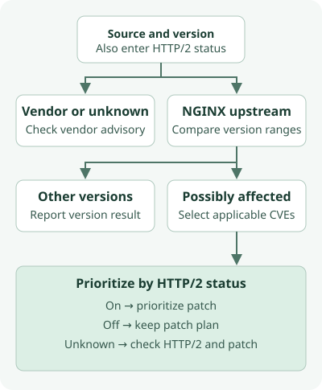

---
{
  "kind": "post",
  "publishedAt": "2026-11-21T00:33:41.886468+00:00",
  "updatedAt": "2026-11-21T00:33:41.886468+00:00",
  "reviewedAt": "2026-11-21",
  "reviewStatus": "source-audited",
  "reviewScope": "Translated from the published Korean guide. Compared version ranges, commands, recorded output and diagram flow with the source.",
  "reviewSources": [
    "https://nginx.org/en/security_advisories.html",
    "https://my.f5.com/s/article/K000164058",
    "https://nginx.org/news.html",
    "https://my.f5.com/s/article/K000163926",
    "https://my.f5.com/s/article/K000163928",
    "https://cert.europa.eu/publications/security-advisories/2026-022",
    "https://ubuntu.com/security/notices/USN-9159-1",
    "https://access.redhat.com/security/vulnerabilities/RHSB-2026-019"
  ],
  "language": "en",
  "translationKey": "2026-11-21-nginx4shell-http2",
  "routeSlug": "2026-11-21-nginx4shell-http2",
  "title": "Nginx4Shell response guide — NGINX HTTP/2 affected versions and patches",
  "description": "Check the conditions, fixed releases, and temporary mitigation for NGINX HTTP/2 vulnerabilities CVE-2026-123007 and CVE-2026-123633. Use the Python example to prioritize patching.",
  "categories": [
    "security"
  ],
  "tags": [
    "nginx",
    "http2",
    "patch-management",
    "cve-2026-123007",
    "cve-2026-123633"
  ]
}
---

**Start by checking which NGINX listeners accept HTTP/2.** Disclosed on November 18, 2026, CVE-2026-123007 and CVE-2026-123633 can corrupt memory during HTTP/2 processing. Depending on the conditions, a worker may crash or remote code may execute with worker privileges. The fixed NGINX Open Source releases are stable **1.30.7** and mainline **1.31.9**. Check the vendor's fixed releases for distribution packages, NGINX Plus, and Ingress products. [NGINX security advisories](https://nginx.org/en/security_advisories.html) · [F5 November 18 security update](https://my.f5.com/s/article/K000164058)

## Which deployments are affected?

**Nginx4Shell** is a search alias used in this guide. Record both CVE IDs separately in change tickets and asset inventories so you can match each product to its advisory and patch status.

| CVE | Conditions and impact | Affected NGINX Open Source versions |
| --- | --- | --- |
| CVE-2026-123007 | Memory corruption can occur when NGINX processes client HTTP/2 traffic. Check servers that only serve static content if they also have HTTP/2 enabled. | 1.9.5–1.30.6 and 1.31.0–1.31.8 |
| CVE-2026-123633 | NGINX can access freed memory under certain conditions when forwarding client HTTP/2 requests to an upstream. Check HTTP/2 reverse proxies first. | 1.19.7–1.30.6 and 1.31.0–1.31.8 |

For both vulnerabilities, 1.30.7 is the fixed stable release. Although its number is higher than 1.30.7, **1.31.8 is still affected**. This update also includes fixes for HTTP/3, the DNS resolver, and the mail proxy. Keep preparing the product patch while using HTTP/2 configuration changes as a temporary mitigation. [NGINX release announcements](https://nginx.org/news.html) · [F5 CVE-2026-123007](https://my.f5.com/s/article/K000163926) · [F5 CVE-2026-123633](https://my.f5.com/s/article/K000163928) · [CERT-EU advisory](https://cert.europa.eu/publications/security-advisories/2026-022)

## Identify the running product and HTTP/2 path

1. **Identify the source of the running binary.** On a VM, check the executable and package used by the service. In a container, check the running image and its digest. Run `nginx -V` in that environment to see the version and build options. Some distributions, including Ubuntu 24.04 LTS, backport fixes to an existing version. The Ubuntu advisory lists `1.24.0-2ubuntu7.20` as the fixed package for this release. [NGINX command-line options](https://nginx.org/en/docs/switches.html) · [Ubuntu USN-9159-1](https://ubuntu.com/security/notices/USN-9159-1)
2. **Check the inbound hop from the client or front proxy to NGINX.** A browser can use HTTP/2 to reach a CDN while the CDN uses a different protocol to reach the NGINX origin. Inspect the running service's configuration with `nginx -T`, checking the `http` and `server` blocks, included files, and syntax in use. The full output can contain internal addresses and secrets, so inspect it in an authorized environment. [NGINX HTTP/2 module documentation](https://nginx.org/en/docs/http/ngx_http_v2_module.html)
3. **Patch affected instances that accept external requests first.** After deployment, confirm that the running processes use the new binary or image. Run the configuration check `nginx -t` and verify normal HTTP requests, upstream health, error rates, and worker restarts. In a cluster, check for replicas still running the old image. [CERT-EU advisory](https://cert.europa.eu/publications/security-advisories/2026-022)

If you cannot update immediately, disabling HTTP/2 on affected listeners can reduce exposure to both CVEs. Use `http2 off;` with the current syntax. For older syntax, remove the `http2` option from `listen`. Check paths that depend on HTTP/2, such as gRPC, before the change. Afterward, verify real connections to those listeners and normal service requests. [NGINX HTTP/2 configuration documentation](https://nginx.org/en/docs/http/ngx_http_v2_module.html) · [Red Hat mitigation guide](https://access.redhat.com/security/vulnerabilities/RHSB-2026-019)

## Exercise — turn your findings into patch priorities

The example takes the **product source, version, and HTTP/2 status** that you verified. It runs on Python 3.10 or later using only the standard library. Use the results of the preceding checks to prioritize patches.



Save the script as `nginx_http2_triage.py`. Use `upstream` only for Open Source builds distributed by the NGINX project. Use `vendor` for packages with backported fixes or vendor images. Set the relevant input to `unknown` if you have yet to verify the product source or listener configuration.

```python
import argparse
import re


def upstream_version(value: str) -> tuple[int, int, int]:
    if not re.fullmatch(r"[0-9]{1,4}\.[0-9]{1,4}\.[0-9]{1,4}", value):
        raise argparse.ArgumentTypeError("use an upstream version such as 1.30.7")
    major, minor, patch = map(int, value.split("."))
    return major, minor, patch


def triage(origin: str, value: str, http2: str) -> str:
    if origin != "upstream":
        return "CHECK_VENDOR_ADVISORY"

    version = upstream_version(value)
    if version[0] != 1 or version > (1, 31, 9):
        return "CHECK_CURRENT_ADVISORY"
    if (1, 30, 7) <= version < (1, 31, 0) or version == (1, 31, 9):
        return "UPSTREAM_FIX_VERSION"

    affected = [
        cve
        for cve, first_version in (
            ("CVE-2026-123007", (1, 9, 5)),
            ("CVE-2026-123633", (1, 19, 7)),
        )
        if version >= first_version
    ]
    if not affected:
        return "OUTSIDE_LISTED_RANGES"

    action = {
        "on": "PRIORITIZE_PATCH",
        "off": "PATCH_STILL_REQUIRED",
        "unknown": "VERIFY_HTTP2_AND_PATCH",
    }[http2]
    return f"{action} {' '.join(affected)}"


def main() -> None:
    parser = argparse.ArgumentParser()
    parser.add_argument("origin", choices=("upstream", "vendor", "unknown"))
    parser.add_argument("version")
    parser.add_argument("http2", choices=("on", "off", "unknown"))
    args = parser.parse_args()
    try:
        print(triage(args.origin, args.version, args.http2))
    except argparse.ArgumentTypeError as error:
        parser.error(str(error))


if __name__ == "__main__":
    main()
```

```bash
python3 nginx_http2_triage.py upstream 1.31.8 on
python3 nginx_http2_triage.py upstream 1.30.7 on
python3 nginx_http2_triage.py upstream 1.19.6 unknown
python3 nginx_http2_triage.py vendor 1.24.0-2ubuntu7.20 on
```

The commands above produced the following output on Python 3.13.0.

```text
PRIORITIZE_PATCH CVE-2026-123007 CVE-2026-123633
UPSTREAM_FIX_VERSION
VERIFY_HTTP2_AND_PATCH CVE-2026-123007
CHECK_VENDOR_ADVISORY
```

The CVE list shows **potential exposure based on the version**. Check the actual listener configuration to determine whether the upstream condition for CVE-2026-123633 applies. The example classifies operator inputs using published version ranges. Checking the production configuration and patch status remains an operator task.
