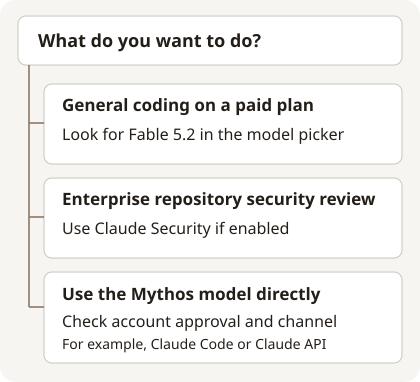

---
{
  "kind": "post",
  "publishedAt": "2026-11-22T16:41:21+09:00",
  "updatedAt": "2026-11-22T16:41:21+09:00",
  "reviewedAt": "2026-11-22",
  "reviewStatus": "source-audited",
  "reviewScope": "Checked Anthropic’s public documentation, shell syntax, and both localized diagram layouts. Authenticated Claude behavior was not tested.",
  "reviewSources": [
    "https://www.anthropic.com/claude-fable-and-mythos-5-2#availability",
    "https://support.claude.com/en/articles/15425695-covered-models",
    "https://support.claude.com/en/articles/14604842-cyber-verification-program",
    "https://www.anthropic.com/project/glasswing",
    "https://www.anthropic.com/claude/mythos",
    "https://www.anthropic.com/claude-fable-and-mythos-5-2",
    "https://support.claude.com/en/articles/14661296-use-claude-security",
    "https://claude.com/product/claude-security",
    "https://code.claude.com/docs/en/model-config",
    "https://support.claude.com/en/articles/15424964-claude-fable-models-on-your-plan",
    "https://platform.claude.com/docs/en/api/models/retrieve",
    "https://platform.claude.com/docs/en/models/fable-5-2/migration-guide"
  ],
  "language": "en",
  "translationKey": "2026-11-22-claude-mythos-availability",
  "routeSlug": "2026-11-22-claude-mythos-availability",
  "title": "Where can you use Claude Mythos 5.2? Claude Security, Claude Code, and the API",
  "description": "Compare direct Mythos 5.2 access, Enterprise code scans in Claude Security, and Fable 5.2 availability on paid Claude plans.",
  "categories": [
    "ai"
  ],
  "tags": [
    "claude",
    "claude-mythos",
    "claude-fable",
    "claude-security",
    "claude-code"
  ]
}
---

**Direct access to Claude Mythos 5.2 requires approval through an Anthropic verification program.** Approved individuals on eligible plans can get Defense Access through the Cyber Verification Program (CVP). With Claude Enterprise, an organization can enable Claude Security, which uses Mythos 5.2 for code scans. Fable 5.2 is generally available on paid Claude plans, with usage credit requirements that vary by plan or seat. This guide reflects the public documentation as of November 22, 2026. [Anthropic’s 5.2 announcement](https://www.anthropic.com/claude-fable-and-mythos-5-2#availability) · [Claude Help Center on covered models](https://support.claude.com/en/articles/15425695-covered-models) · [Cyber Verification Program](https://support.claude.com/en/articles/14604842-cyber-verification-program)

## Which option is available to you?



| What you want to do | Where to look | What access requires |
| --- | --- | --- |
| Use a 5.2 model for coding or writing | The model picker in Claude on the web, desktop, or mobile, or in Claude Code | Paid plans can use Fable 5.2. Usage credits depend on the plan and seat. |
| Use Mythos to review a company repository for security issues | Claude Security in Claude on the web | Enterprise public beta. Your organization must enable the feature, and you need a seat that includes Claude Code. |
| Use Mythos directly as a model in Claude Code or the Claude API | Your account’s model permissions or the workspace you use for the API | Verification program approval is required. Individuals on eligible plans can apply for Defense Access. |

**Mythos Preview** was the research preview Anthropic gave to organizations participating in Project Glasswing in April 2026. Anthropic introduced **Mythos 5.2** on November 9. Check the date and model version when comparing reports about Mythos availability. [Project Glasswing announcement](https://www.anthropic.com/project/glasswing) · [Claude Mythos model page](https://www.anthropic.com/claude/mythos)

## Where Enterprise uses Mythos

**Claude Security uses Mythos 5.2 for repository scans.** A team can use it to flag a missing authorization check in an internal web service, then review the evidence and proposed fix. Anthropic offers Claude Security to Enterprise customers outside the Cyber Verification Program as well. Each user needs a seat that includes Claude Code, and seat-based Enterprise plans also require usage credits to be enabled. An organization owner with a seat that includes Claude Code enables the feature under `Organization settings → Claude Security`. [Anthropic’s launch announcement](https://www.anthropic.com/claude-fable-and-mythos-5-2) · [Claude Security requirements](https://support.claude.com/en/articles/14661296-use-claude-security)

You can open a finding in Claude Code to work on a fix. **The scan and the Claude Code session have separate model permissions.** The scan uses Mythos, and the Claude Code session uses the models available to your account. That’s why an Enterprise user can see Claude Security while the regular chat picker may still lack Mythos. [Claude Security product page](https://claude.com/product/claude-security) · [Claude Code model configuration](https://code.claude.com/docs/en/model-config)

## Finding Fable 5.2 on an individual plan

According to Anthropic, Fable 5.2 and Mythos 5.2 share the same underlying model. Fable has additional safeguards for cybersecurity and life sciences. On an individual paid plan, you can use Fable 5.2 for general development work such as understanding a repository or planning a refactor. Pro and some standard seats require usage credits from the start. [Anthropic’s model announcement](https://www.anthropic.com/claude-fable-and-mythos-5-2) · [Fable availability by plan](https://support.claude.com/en/articles/15424964-claude-fable-models-on-your-plan)

On the web, desktop, or mobile, look for `Fable 5.2` in the model picker. If you use Claude Code in a terminal, first check that it’s on version **2.1.321** or later. Then open `/model` in a session to see which models you can select. [Claude plan help](https://support.claude.com/en/articles/15424964-claude-fable-models-on-your-plan) · [Claude Code model configuration](https://code.claude.com/docs/en/model-config)

```sh
claude --version
```

On the Claude API, you can check the Fable model ID with a metadata request. The example uses a shell with `curl` and an API key for the relevant workspace already set in `ANTHROPIC_API_KEY`. A successful response should contain the `id` value `claude-fable-5-2`. The request format was checked against the official reference and the shell syntax was checked locally. Authenticated Claude behavior, including the metadata response and model selection, was not tested. [Claude API model lookup reference](https://platform.claude.com/docs/en/api/models/retrieve)

```sh
curl --fail-with-body --silent --show-error \
  'https://api.anthropic.com/v1/models/claude-fable-5-2' \
  -H 'anthropic-version: 2026-10-21' \
  -H "Authorization: Bearer ${ANTHROPIC_API_KEY}"
```

## Checking direct Mythos access

The Cyber Verification Program Help Center says individuals such as independent security researchers and open-source maintainers can apply for **Defense Access** on eligible plans such as Pro, Max, and Ultra. That tier includes Mythos 5.2 for approved participants. A paid subscription alone does not grant access. Anthropic has a separate verification program for life sciences research. [Cyber Verification Program Help Center](https://support.claude.com/en/articles/14604842-cyber-verification-program) · [Anthropic’s availability announcement](https://www.anthropic.com/claude-fable-and-mythos-5-2#availability)

The Claude API documentation lists `claude-mythos-5-2` as the Mythos 5.2 model ID. Availability depends on the access granted to your account or organization and on the channel you use. Claude and Claude Console access are managed separately, and Console permissions apply to the assigned workspace. Organizations using a cloud provider should also check the linked cloud account and the provider’s support. [Claude API model guide](https://platform.claude.com/docs/en/models/fable-5-2/migration-guide) · [Claude Help Center on plans, workspaces, and cloud accounts](https://support.claude.com/en/articles/14604842-cyber-verification-program)
