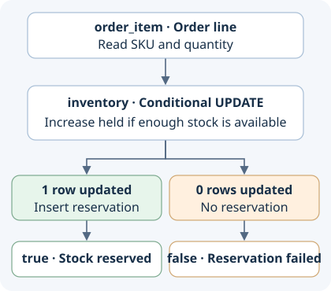

---
{
  "kind": "post",
  "publishedAt": "2026-11-22T22:23:59+09:00",
  "updatedAt": "2026-11-22T22:23:59+09:00",
  "reviewedAt": "2026-11-22",
  "reviewStatus": "source-audited",
  "reviewScope": "Checked the PostgreSQL documentation on constraints, transactions, and indexes and the Stripe webhook documentation. Verified reservation contention, price snapshot retention, and rollback on duplicate reservation in PostgreSQL 17.12. Payment provider integration, races involving expiry, and production load require separate tests.",
  "reviewSources": [
    "https://www.postgresql.org/docs/17/ddl-constraints.html#DDL-CONSTRAINTS-CHECK-CONSTRAINTS",
    "https://www.postgresql.org/docs/17/ddl-constraints.html#DDL-CONSTRAINTS-UNIQUE-CONSTRAINTS",
    "https://docs.stripe.com/webhooks#handle-duplicate-events",
    "https://www.postgresql.org/docs/17/transaction-iso.html#XACT-READ-COMMITTED",
    "https://www.postgresql.org/docs/17/indexes-multicolumn.html",
    "https://www.postgresql.org/docs/17/indexes-partial.html"
  ],
  "translationKey": "2026-11-22-commerce-database-design",
  "routeSlug": "2026-11-22-commerce-database-design",
  "categories": [
    "architecture"
  ],
  "tags": [
    "ecommerce",
    "postgresql",
    "inventory",
    "payments"
  ],
  "language": "en",
  "title": "Commerce Database Design for SKUs, Orders, Inventory, and Payments",
  "description": "Model SKUs, order price snapshots, inventory reservations, and payment attempts with PostgreSQL tables, then test two sessions competing for the last unit of stock."
}
---

**A commerce database needs to preserve current catalog terms, the amounts agreed at checkout, the stock held for each order, and the payment provider’s results.** Yesterday’s order total must still be correct after tomorrow’s price change. When only one unit is in stock today, just one of two concurrent orders should be able to reserve it. The PostgreSQL example shows which tables and constraints support both requirements.

This guide builds on [the previous article’s last-unit example](/en/posts/2026-11-22-commerce-system-design-last-unit-of-stock/). It assumes one merchant selling physical goods, one warehouse, and payments in Korean won (KRW). Inventory and orders share a database. Returns after shipment and settlement have their own business models.

## Start with what you need to record for one purchase

| Question | Tables to read or write | Keys and values |
| --- | --- | --- |
| What does the black keyboard cost now? | `product` → `sku` | Product ID, sellable SKU, current price |
| Why did we charge KRW 43,000 for yesterday’s order? | `orders` → `order_item` | Order ID, agreed quantity, unit price, discount, and shipping fee |
| Which order secured the last unit? | `inventory`, `stock_reservation` | Physical stock per SKU and a reservation per order line |
| How do we find the same payment after losing the provider’s response? | `payment_attempt`, `payment_event` | Payment attempt per order, provider transaction ID, event ID |

In this example, a `product` is a catalog listing and a `sku` is a variant customers can order, such as the black keyboard. An order line references the SKU and **stores a snapshot of the item name, option name, and unit price at checkout**. One unit at KRW 42,000, a KRW 2,000 discount, and KRW 3,000 shipping give a total of KRW 43,000. The order can show that total directly. The application keeps order lines immutable after creation because they are the basis for both the agreed amounts and the reserved quantities. Take a SKU used in a transaction off sale by marking it as unsellable. Preserve the rows historical orders reference and avoid cascading deletes on those relationships.

## Express the model with PostgreSQL keys and constraints

Run the DDL below once in an empty practice database. The example assigns IDs explicitly and stores amounts as whole won. It assumes that checkout combines duplicate cart entries for the same SKU into one order line, so `(order_id, sku_id)` identifies both an order line and its reservation.

```sql
CREATE TABLE product (
    id bigint PRIMARY KEY,
    name text NOT NULL
);

CREATE TABLE sku (
    id bigint PRIMARY KEY,
    product_id bigint NOT NULL REFERENCES product(id),
    code text NOT NULL UNIQUE,
    option_name text NOT NULL,
    current_price_krw bigint NOT NULL CHECK (current_price_krw >= 0),
    sellable boolean NOT NULL
);

CREATE TABLE inventory (
    sku_id bigint PRIMARY KEY REFERENCES sku(id),
    on_hand integer NOT NULL CHECK (on_hand >= 0),
    held integer NOT NULL CHECK (held >= 0),
    allocated integer NOT NULL CHECK (allocated >= 0),
    CHECK (held <= on_hand - allocated)
);

CREATE TABLE orders (
    id bigint PRIMARY KEY,
    customer_id bigint NOT NULL,
    request_key text NOT NULL,
    request_hash text NOT NULL,
    status text NOT NULL CHECK (status IN ('PENDING_PAYMENT', 'CONFIRMED', 'CANCELLED')),
    total_krw bigint NOT NULL CHECK (total_krw >= 0),
    shipping_krw bigint NOT NULL CHECK (shipping_krw >= 0),
    created_at timestamptz NOT NULL DEFAULT now(),
    UNIQUE (customer_id, request_key)
);

CREATE TABLE order_item (
    order_id bigint REFERENCES orders(id),
    sku_id bigint REFERENCES sku(id),
    item_name text NOT NULL,
    option_name text NOT NULL,
    quantity integer NOT NULL CHECK (quantity > 0),
    unit_price_krw bigint NOT NULL CHECK (unit_price_krw >= 0),
    discount_krw bigint NOT NULL CHECK (discount_krw >= 0),
    CHECK (discount_krw <= quantity * unit_price_krw::numeric),
    PRIMARY KEY (order_id, sku_id)
);

CREATE TABLE stock_reservation (
    order_id bigint,
    sku_id bigint REFERENCES inventory(sku_id),
    state text NOT NULL CHECK (state IN ('HELD', 'ALLOCATED', 'RELEASED', 'SHIPPED')),
    expires_at timestamptz NOT NULL,
    PRIMARY KEY (order_id, sku_id),
    FOREIGN KEY (order_id, sku_id) REFERENCES order_item(order_id, sku_id)
);

CREATE TABLE payment_attempt (
    id bigint PRIMARY KEY,
    order_id bigint NOT NULL REFERENCES orders(id),
    attempt_no integer NOT NULL CHECK (attempt_no > 0),
    provider text NOT NULL,
    merchant_account text NOT NULL,
    provider_request_key text NOT NULL,
    provider_payment_id text,
    amount_krw bigint NOT NULL CHECK (amount_krw >= 0),
    state text NOT NULL CHECK (state IN
        ('PENDING', 'UNKNOWN', 'PAID', 'CLOSED_UNPAID', 'REFUND_PENDING', 'REFUNDED')),
    UNIQUE (order_id, attempt_no),
    UNIQUE (provider, merchant_account, provider_request_key),
    UNIQUE (provider, merchant_account, provider_payment_id)
);

CREATE TABLE payment_event (
    provider text,
    merchant_account text,
    event_id text,
    received_at timestamptz NOT NULL DEFAULT now(),
    PRIMARY KEY (provider, merchant_account, event_id)
);

CREATE INDEX orders_customer_history
    ON orders (customer_id, created_at DESC, id DESC);

CREATE INDEX reservation_expiry
    ON stock_reservation (expires_at, order_id, sku_id)
    WHERE state = 'HELD';
```

The `CHECK` constraint enforces `held + allocated ≤ on_hand` for each inventory row. Checking that the order total matches the order lines, or that the quantities of held reservations add up to `held`, requires reading multiple rows. Write the totals and reservations in the order creation transaction, and regularly reconcile the stored totals and counters with their underlying records. [PostgreSQL documentation on CHECK constraints](https://www.postgresql.org/docs/17/ddl-constraints.html#DDL-CONSTRAINTS-CHECK-CONSTRAINTS)

When the same customer resends a `request_key`, look up the existing order. If the stored `request_hash` differs, treat that as a conflict from reusing the key. The provider transaction ID can be unknown when the request is made, so allow `NULL` initially. Once set, the external ID is unique within the provider and merchant account. The `payment_event` key deduplicates received events. The same successful outcome can arrive under different event IDs, so also protect fulfillment requests with a unique key per order and guarded state transitions. [PostgreSQL documentation on UNIQUE constraints](https://www.postgresql.org/docs/17/ddl-constraints.html#DDL-CONSTRAINTS-UNIQUE-CONSTRAINTS) · [Stripe’s guidance on duplicate webhooks](https://docs.stripe.com/webhooks#handle-duplicate-events)

## Reserve the last unit with a conditional UPDATE



Available stock is `on_hand - allocated - held`. Whatever quantity the storefront showed earlier, checkout **checks availability and increments the held quantity in the same UPDATE**. The function inserts a reservation only if the update affects a row. If a SQL error causes the insert to fail, the same statement rolls back the increase in `held`.

```sql
CREATE FUNCTION reserve_stock(p_order_id bigint, p_sku_id bigint,
                              p_expires_at timestamptz)
RETURNS boolean
LANGUAGE sql
AS $$
    WITH held_stock AS (
        UPDATE inventory AS i
           SET held = i.held + line.quantity
          FROM order_item AS line
         WHERE line.order_id = p_order_id
           AND line.sku_id = p_sku_id
           AND i.sku_id = line.sku_id
           AND i.on_hand - i.allocated - i.held >= line.quantity
         RETURNING i.sku_id
    ), reservation AS (
        INSERT INTO stock_reservation (order_id, sku_id, state, expires_at)
        SELECT p_order_id, sku_id, 'HELD', p_expires_at
        FROM held_stock
        RETURNING 1
    )
    SELECT EXISTS (SELECT 1 FROM reservation);
$$;
```

At checkout, create the order and its lines, reserve every SKU, and record the initial payment attempt and the work to publish in one database transaction. If the function returns `false` for any item, the caller rolls back the entire transaction. When reserving multiple SKUs, acquire locks in a consistent order, such as ascending SKU ID. When a checkout request is retried, the caller checks the order’s unique key and skips the function for an already reserved order. Adding `ON CONFLICT DO NOTHING` to the reservation insert could let the counter increase without a matching reservation.

Call the payment provider after the local commit. Once payment is confirmed, move the reservation to `ALLOCATED` and transfer the quantity from `held` to `allocated`. Releasing a hold decreases `held` only. Shipping decreases both `on_hand` and `allocated`. To prevent double deductions, implement these transitions by locking the reservation and inventory rows in the same transaction and checking the expected prior state.

## Have two sessions compete for the last unit

After running the DDL and creating the function, load the following data into the practice database. The two order lines are created in advance to isolate the reservation race.

```sql
INSERT INTO product VALUES (1, 'Keyboard');
INSERT INTO sku VALUES (101, 1, 'KB-BLK', 'Black', 42000, true);
INSERT INTO inventory VALUES (101, 1, 0, 0);

INSERT INTO orders (id, customer_id, request_key, request_hash,
                    status, total_krw, shipping_krw)
VALUES (41, 1001, 'checkout-a', 'fixture-a', 'PENDING_PAYMENT', 43000, 3000),
       (42, 1002, 'checkout-b', 'fixture-b', 'PENDING_PAYMENT', 43000, 3000);

INSERT INTO order_item
VALUES (41, 101, 'Keyboard', 'Black', 1, 42000, 2000),
       (42, 101, 'Keyboard', 'Black', 1, 42000, 2000);
```

Open two `psql` sessions connected to the same database. Run the following in session **A**. It returns `true` and leaves the transaction open.

```sql
BEGIN ISOLATION LEVEL READ COMMITTED;
SELECT reserve_stock(41, 101, now() + interval '10 minutes') AS reserved;
```

While A’s transaction is open, run the following in session **B**. Its `SELECT` waits as it tries to update the same inventory row.

```sql
BEGIN ISOLATION LEVEL READ COMMITTED;
SELECT reserve_stock(42, 101, now() + interval '10 minutes') AS reserved;
```

Run `COMMIT;` in A. Once the lock is released, B reevaluates the `WHERE` condition against the updated row. With zero units available, B returns `false`. Run `ROLLBACK;` in B to end the exercise. [PostgreSQL documentation on Read Committed isolation](https://www.postgresql.org/docs/17/transaction-iso.html#XACT-READ-COMMITTED)

```sql
SELECT sku_id, on_hand, held, allocated FROM inventory;
SELECT order_id, sku_id, state FROM stock_reservation ORDER BY order_id;
```

The example ran with two simultaneous database connections on PostgreSQL 17.12. A committed after `pg_stat_activity` showed that B was waiting on a lock. A returned `true` and B returned `false`. The final `on_hand / held / allocated` values in `inventory` were `1 / 1 / 0`, with **one `HELD` reservation for order 41**.

Changing the catalog price to KRW 45,000 left order 41’s unit price at KRW 42,000 and its total at KRW 43,000. After adding one unit to inventory, calling the reservation function again for order 41 raised a unique constraint violation and left `held` at 1. The exercise verified contention between the two connections and the SQL constraints. Payment provider calls, races involving reservation expiry, and production load require separate tests.

## Choose indexes from the queries the application runs

A customer’s order history uses a query shaped like `WHERE customer_id = … ORDER BY created_at DESC, id DESC LIMIT …`. The composite index in the DDL matches the customer filter and sort order. The reservation cleanup job uses `WHERE state = 'HELD' AND expires_at <= now()`, so a partial index excludes reservations in other states. The expiry index finds candidates. The job acquires locks and checks the payment state before deciding whether to release each reservation. [PostgreSQL documentation on multicolumn indexes](https://www.postgresql.org/docs/17/indexes-multicolumn.html) · [PostgreSQL documentation on partial indexes](https://www.postgresql.org/docs/17/indexes-partial.html)
