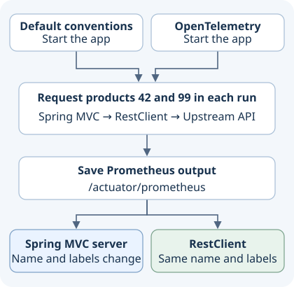

---
{
  "kind": "post",
  "publishedAt": "2026-11-22T09:57:06+09:00",
  "updatedAt": "2026-11-22T09:57:06+09:00",
  "reviewedAt": "2026-11-22",
  "reviewStatus": "source-audited",
  "reviewScope": "Checked official Spring Boot documentation and compared Korean and English code and diagram flows. Verified Spring MVC and RestClient series from two real Tomcat runs on Spring Boot 4.2.0, JDK 21.0.1 and Maven 3.9.11 with a local Python HTTP upstream. Checked both queries with promtool 3.5.0.",
  "reviewSources": [
    "https://github.com/spring-projects/spring-boot/wiki/Spring-Boot-4.2-Release-Notes#semantic-conventions",
    "https://docs.spring.io/spring-boot/reference/actuator/metrics.html#actuator.metrics.supported.http-clients",
    "https://docs.spring.io/spring-boot/reference/actuator/observability.html#actuator.observability.semantic-conventions",
    "https://prometheus.io/docs/prometheus/latest/querying/basics/",
    "https://prometheus.io/docs/prometheus/latest/querying/functions/#rate"
  ],
  "translationKey": "2026-11-22-spring-boot-4-2-otel-http-metrics",
  "routeSlug": "2026-11-22-spring-boot-4-2-otel-http-metrics",
  "categories": [
    "springboot"
  ],
  "tags": [
    "spring-boot",
    "opentelemetry",
    "prometheus",
    "micrometer",
    "restclient"
  ],
  "language": "en",
  "title": "How OpenTelemetry Conventions Change HTTP Metrics in Spring Boot 4.2",
  "description": "Compare Spring MVC and RestClient Prometheus metrics in Spring Boot 4.2.0 and update a 404 query for OpenTelemetry conventions."
}
---

**When you enable OpenTelemetry observation conventions in Spring Boot 4.2.0, the Spring MVC server's Prometheus metric changes from `http_server_requests_seconds_count` to `http_server_request_duration_seconds_count`.** The label you use to find 404s also changes from `status` to `http_response_status_code`. In the same app, the `RestClient` calls to an upstream API kept their existing metric name and labels. Check inbound and outbound metrics separately when updating dashboards and alerts. [Spring Boot 4.2 release notes](https://github.com/spring-projects/spring-boot/wiki/Spring-Boot-4.2-Release-Notes#semantic-conventions)

## Run the same two requests under both configurations

Use the [product lookup example from the previous guide](/en/posts/2026-11-22-spring-boot-4-2-restclient-migration/). When the app receives `GET /products/{id}`, it uses `RestClient` to call `GET /items/{id}` on the upstream API. In this exercise, ID `42` returns `200` with the product name `Keyboard`, and ID `99` returns a `404` with an empty body.



The diagram follows the two runs. Each run makes the same requests and saves a separate Prometheus capture for comparison.

Use Spring Boot 4.2.0 and JDK 21. Copy `pom.xml` and `src/main/java/example/CatalogApplication.java` from the previous guide. Remove the `spring-boot-starter-webmvc-test` dependency, which this exercise does not use, and add the two dependencies below to the Maven dependency list. `CatalogApplication.java` already injects the Boot-configured `RestClient.Builder`. [Spring Boot HTTP client metrics documentation](https://docs.spring.io/spring-boot/reference/actuator/metrics.html#actuator.metrics.supported.http-clients)

```xml
<dependency>
    <groupId>org.springframework.boot</groupId>
    <artifactId>spring-boot-starter-actuator</artifactId>
</dependency>
<dependency>
    <groupId>io.micrometer</groupId>
    <artifactId>micrometer-registry-prometheus</artifactId>
</dependency>
```

To package the app as an executable JAR, add this configuration under `<project>` in `pom.xml`.

```xml
<build>
    <plugins>
        <plugin>
            <groupId>org.springframework.boot</groupId>
            <artifactId>spring-boot-maven-plugin</artifactId>
        </plugin>
    </plugins>
</build>
```

In one terminal, start a local server to act as the upstream API. It serves the file at `/items/42` and returns 404 for `/items/99` because that file is absent. Use a local development environment with both ports free.

```sh
upstream_dir=$(mktemp -d)
mkdir -p "$upstream_dir/items"
printf '%s' Keyboard > "$upstream_dir/items/42"
python3 -m http.server 18081 --bind 127.0.0.1 --directory "$upstream_dir"
```

In another terminal, build the app from the Maven project root and start it with the default conventions. Expose the Actuator endpoint you will scrape and bind the app to the loopback address.

```sh
mvn package

java -jar target/restclient-migration-1.0.0.jar \
  --server.address=127.0.0.1 \
  --server.port=18080 \
  --catalog.base-url=http://127.0.0.1:18081 \
  --management.endpoints.web.exposure.include=health,prometheus
```

Once the app starts, run these requests from a third terminal. Check both responses, then save the Prometheus output, which includes the `_count` series for cumulative request counts.

```sh
curl -sS -i http://127.0.0.1:18080/products/42
curl -sS -i http://127.0.0.1:18080/products/99
curl -fsS http://127.0.0.1:18080/actuator/prometheus > default.prom
```

Stop the app and restart it with the same `java -jar` command, adding `--management.observations.conventions=open-telemetry`. Run all three requests again and save the last response as `open-telemetry.prom`. Starting a fresh process resets the counters from the first run.

```sh
grep -E '^http_(server|client).*_count\{.*(/products/|/items/)' \
  default.prom open-telemetry.prom
```

## What changed in the captured metrics

I ran both configurations with JDK 21.0.1, Maven 3.9.11, Spring Boot 4.2.0, and embedded Tomcat. Each run made one request that returned `200` and one that returned `404`. All four responses matched the expected status and body.

| MVC server metric | Default conventions | OpenTelemetry conventions |
| --- | --- | --- |
| Prometheus request count | `http_server_requests_seconds_count` | `http_server_request_duration_seconds_count` |
| HTTP method label | `method` | `http_request_method` |
| Response status label | `status` | `http_response_status_code` |
| Route label | `uri` | `http_route` |
| Route value in this example | `/products/{id}` | `/products/{id}` |

The route label contains the route template with `{id}`. The excerpt below shows the captured 404 series with only the labels used in the queries. The server-side 404 count was `1` in each run.

```text
http_server_requests_seconds_count{status="404",uri="/products/{id}"} 1
http_server_request_duration_seconds_count{http_response_status_code="404",http_route="/products/{id}"} 1
```

In the same captures, both configurations recorded outbound requests in `http_client_requests_seconds_count`, with `method="GET"`, `uri="/items/{id}"`, and either `status="200"` or `status="404"`. This result applies to the combination of Boot auto-configuration and `RestClient.Builder` used in this example. The exercise reads metrics from Micrometer's Prometheus registry. Choosing an observation convention and choosing how to export the data are separate settings. [Spring Boot observability documentation](https://docs.spring.io/spring-boot/reference/actuator/observability.html#actuator.observability.semantic-conventions)

## Update the 404 query

A Grafana panel using the default conventions could query the cumulative 404 count for this route as follows.

```text
sum(http_server_requests_seconds_count{uri="/products/{id}",status="404"})
```

With OpenTelemetry conventions, change the metric name and both labels.

```text
sum(http_server_request_duration_seconds_count{http_route="/products/{id}",http_response_status_code="404"})
```

I tested the queries with the captured series using `promtool` from Prometheus 3.5.0. Each query returned `1` with the matching convention and an empty result with the other convention.

These queries compare cumulative counts for a single app. If a production panel already shows requests per second over a recent window, keep its existing calculation, such as `rate(...[5m])`, and update the metric selector inside it. While Prometheus is scraping both old and new versions, query by deployment target to see which targets still report each name. [Prometheus query basics](https://prometheus.io/docs/prometheus/latest/querying/basics/) · [Prometheus `rate()` documentation](https://prometheus.io/docs/prometheus/latest/querying/functions/#rate)

If you set the server metric name with `management.observations.http.server.requests.name`, check any panels and alerts that reference the custom name first. This setting has no effect under OpenTelemetry conventions. To follow an individual request from metrics to logs and traces, see [Correlating Logs and Traces in Grafana LGTM](/en/posts/2026-11-02-grafana-lgtm-log-trace/). [Spring Boot 4.2 release notes](https://github.com/spring-projects/spring-boot/wiki/Spring-Boot-4.2-Release-Notes#semantic-conventions)
