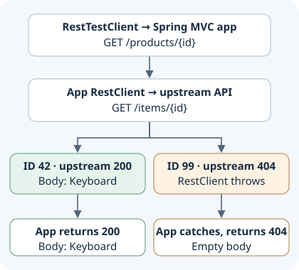

---
{
  "kind": "post",
  "publishedAt": "2026-11-21T16:35:26+00:00",
  "updatedAt": "2026-11-21T16:35:26+00:00",
  "reviewedAt": "2026-11-22",
  "reviewStatus": "source-audited",
  "reviewScope": "Checked Spring Boot 4.2 deprecations and HTTP status handling against official documentation. Compared Korean and English code and diagram branches. Executed three tests on Boot 4.2.0, JDK 21.0.1 and Maven 3.9.11 with real Tomcat and a local JDK HttpServer.",
  "reviewSources": [
    "https://github.com/spring-projects/spring-boot/wiki/Spring-Boot-4.2-Release-Notes#deprecation-of-testresttemplate-support",
    "https://docs.spring.io/spring-framework/reference/integration/rest-clients.html",
    "https://docs.spring.io/spring-boot/api/java/org/springframework/boot/resttestclient/TestRestTemplate.html",
    "https://docs.spring.io/spring-boot/reference/testing/spring-boot-applications.html#testing.spring-boot-applications.with-running-server"
  ],
  "translationKey": "2026-11-22-spring-boot-4-2-restclient-migration",
  "routeSlug": "2026-11-22-spring-boot-4-2-restclient-migration",
  "categories": [
    "springboot"
  ],
  "tags": [
    "spring-boot",
    "resttemplate",
    "testresttemplate",
    "restclient",
    "resttestclient",
    "http-client"
  ],
  "language": "en",
  "title": "Migrating RestTemplate and TestRestTemplate in Spring Boot 4.2",
  "description": "Move to RestClient and RestTestClient in Spring Boot 4.2 and verify 200 and 404 responses against a live server."
}
---

**Use `RestClient` for calls to external APIs and `RestTestClient` for tests that send requests to your application and assert its responses.** Spring Boot 4.2 deprecates the auto-configuration and builder for `RestTemplate`, along with `TestRestTemplate` support. When migrating, carry over error assertions as well as success cases. If an existing test checked for HTTP 404, keep that status assertion in the new test. [Spring Boot 4.2 release notes](https://github.com/spring-projects/spring-boot/wiki/Spring-Boot-4.2-Release-Notes#deprecation-of-testresttemplate-support)

## Which APIs replace the existing ones?

| Existing code | Replacement | Behavior to check |
| --- | --- | --- |
| `RestTemplateBuilder` and `getForObject()` | `RestClient.Builder` and `get().uri().retrieve().body()` | Base URL, request headers, and handling of 4xx and 5xx responses |
| `RestTemplateCustomizer` | `RestClientCustomizer` | Interceptors, timeouts, and request factory |
| `@AutoConfigureTestRestTemplate` and `TestRestTemplate` | `@AutoConfigureRestTestClient` and `RestTestClient` | How the live server starts, status codes, and response bodies |

By default, `RestClient.retrieve()` raises an exception for 4xx and 5xx responses, as does a default `RestTemplate`. `TestRestTemplate` returns the response so your test can inspect those status codes. With `RestTestClient`, use `expectStatus()` after `exchange()` to keep the assertion. If the existing client used a custom error handler, express the same status rules with `defaultStatusHandler()` or a per-request `onStatus()`. [Spring Framework REST clients reference](https://docs.spring.io/spring-framework/reference/integration/rest-clients.html) · [TestRestTemplate API](https://docs.spring.io/spring-boot/api/java/org/springframework/boot/resttestclient/TestRestTemplate.html)

## Test both HTTP boundaries with a product lookup API



For product ID `42`, the upstream API returns the name `Keyboard`. All other IDs get a 404. The diagram follows the two integration tests that send requests through the app. The tests start a local HTTP server in place of the upstream API.

### `pom.xml`

The example uses Spring Boot 4.2.0 and JDK 21. The MVC test starter includes the `RestTestClient` auto-configuration module.

```xml
<project xmlns="http://maven.apache.org/POM/4.0.0">
    <modelVersion>4.0.0</modelVersion>
    <parent>
        <groupId>org.springframework.boot</groupId>
        <artifactId>spring-boot-starter-parent</artifactId>
        <version>4.2.0</version>
    </parent>
    <groupId>example</groupId>
    <artifactId>restclient-migration</artifactId>
    <version>1.0.0</version>
    <properties>
        <java.version>21</java.version>
    </properties>
    <dependencies>
        <dependency>
            <groupId>org.springframework.boot</groupId>
            <artifactId>spring-boot-starter-webmvc</artifactId>
        </dependency>
        <dependency>
            <groupId>org.springframework.boot</groupId>
            <artifactId>spring-boot-starter-restclient</artifactId>
        </dependency>
        <dependency>
            <groupId>org.springframework.boot</groupId>
            <artifactId>spring-boot-starter-webmvc-test</artifactId>
            <scope>test</scope>
        </dependency>
    </dependencies>
</project>
```

### `src/main/java/example/CatalogApplication.java`

If the existing call was `restTemplate.getForObject("/items/{id}", String.class, id)`, keep its URI template and response type in the new call. Inject the builder configured by Boot and set the upstream base URL. In this example, the controller maps the upstream 404 for a missing product to a 404 from the app.

```java
package example;

import org.springframework.beans.factory.annotation.Value;
import org.springframework.boot.SpringApplication;
import org.springframework.boot.autoconfigure.SpringBootApplication;
import org.springframework.http.ResponseEntity;
import org.springframework.stereotype.Service;
import org.springframework.web.bind.annotation.GetMapping;
import org.springframework.web.bind.annotation.PathVariable;
import org.springframework.web.bind.annotation.RestController;
import org.springframework.web.client.HttpClientErrorException;
import org.springframework.web.client.RestClient;

@SpringBootApplication
public class CatalogApplication {
    public static void main(String[] args) {
        SpringApplication.run(CatalogApplication.class, args);
    }
}

@Service
class CatalogClient {
    private final RestClient http;

    CatalogClient(RestClient.Builder builder, @Value("${catalog.base-url}") String baseUrl) {
        this.http = builder.baseUrl(baseUrl).build();
    }

    String findName(long id) {
        return http.get()
            .uri("/items/{id}", id)
            .retrieve()
            .body(String.class);
    }
}

@RestController
class ProductController {
    private final CatalogClient catalog;

    ProductController(CatalogClient catalog) {
        this.catalog = catalog;
    }

    @GetMapping("/products/{id}")
    ResponseEntity<String> product(@PathVariable("id") long id) {
        try {
            return ResponseEntity.ok(catalog.findName(id));
        } catch (HttpClientErrorException.NotFound ex) {
            return ResponseEntity.notFound().build();
        }
    }
}
```

### `src/test/java/example/CatalogApplicationTests.java`

Keep `RANDOM_PORT` to send HTTP requests to a live embedded server. The `RestTestClient` injected by Boot resolves relative paths against that server's address. If the previous test used `getForEntity("/products/99", String.class).getStatusCode()` to check for a 404, assert the same status with `exchange().expectStatus().isNotFound()`. [Spring Boot documentation on testing with a running server](https://docs.spring.io/spring-boot/reference/testing/spring-boot-applications.html#testing.spring-boot-applications.with-running-server)

```java
package example;

import java.io.IOException;
import java.io.UncheckedIOException;
import java.net.InetSocketAddress;
import java.nio.charset.StandardCharsets;

import com.sun.net.httpserver.HttpServer;
import org.junit.jupiter.api.AfterAll;
import org.junit.jupiter.api.Test;
import org.springframework.beans.factory.annotation.Autowired;
import org.springframework.boot.resttestclient.autoconfigure.AutoConfigureRestTestClient;
import org.springframework.boot.test.context.SpringBootTest;
import org.springframework.test.context.DynamicPropertyRegistry;
import org.springframework.test.context.DynamicPropertySource;
import org.springframework.test.web.servlet.client.RestTestClient;
import org.springframework.web.client.HttpClientErrorException;

import static org.assertj.core.api.Assertions.assertThatThrownBy;

@SpringBootTest(webEnvironment = SpringBootTest.WebEnvironment.RANDOM_PORT)
@AutoConfigureRestTestClient
class CatalogApplicationTests {
    private static final HttpServer upstream = startUpstream();

    @Autowired
    private RestTestClient app;

    @Autowired
    private CatalogClient catalog;

    @DynamicPropertySource
    static void configureUpstream(DynamicPropertyRegistry properties) {
        properties.add("catalog.base-url",
            () -> "http://127.0.0.1:" + upstream.getAddress().getPort());
    }

    @AfterAll
    static void stopUpstream() {
        upstream.stop(0);
    }

    @Test
    void returnsProductName() {
        app.get().uri("/products/42").exchange()
            .expectStatus().isOk()
            .expectBody(String.class).isEqualTo("Keyboard");
    }

    @Test
    void returnsNotFoundForMissingProduct() {
        app.get().uri("/products/99").exchange()
            .expectStatus().isNotFound()
            .expectBody().isEmpty();
    }

    @Test
    void turnsUpstream404IntoAnException() {
        assertThatThrownBy(() -> catalog.findName(99))
            .isInstanceOf(HttpClientErrorException.NotFound.class);
    }

    private static HttpServer startUpstream() {
        try {
            HttpServer server = HttpServer.create(new InetSocketAddress("127.0.0.1", 0), 0);
            server.createContext("/items/", exchange -> {
                try (exchange) {
                    if (exchange.getRequestURI().getPath().equals("/items/42")) {
                        byte[] body = "Keyboard".getBytes(StandardCharsets.UTF_8);
                        exchange.getResponseHeaders().set("Content-Type", "text/plain; charset=UTF-8");
                        exchange.sendResponseHeaders(200, body.length);
                        exchange.getResponseBody().write(body);
                    } else {
                        exchange.sendResponseHeaders(404, -1);
                    }
                }
            });
            server.start();
            return server;
        } catch (IOException ex) {
            throw new UncheckedIOException(ex);
        }
    }
}
```

## Run the tests

Save the three files and run the following command from the project root.

```sh
mvn test
```

The run used JDK 21.0.1 and Maven 3.9.11. Embedded Tomcat and the local HTTP server standing in for the upstream API both ran on random ports. All three tests passed.

| What the test checks | Observed result |
| --- | --- |
| `GET /products/42` | `200 OK` with `Keyboard` in the body |
| `GET /products/99` | `404 Not Found` with an empty body |
| `catalog.findName(99)` | Throws `HttpClientErrorException.NotFound` |

```text
Tests run: 3, Failures: 0, Errors: 0, Skipped: 0
BUILD SUCCESS
```

Before migrating a project, list the statuses and bodies your existing tests assert. For example, a client that turns an upstream 404 into an empty result and a controller that sends its own 404 have separate contracts. Test each boundary so you can see where behavior changes. For a comparison of synchronous and reactive calls, see [WebClient versus RestClient](/en/posts/2026-10-31-webclient-restclient-comparison/).
