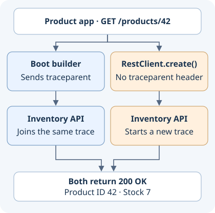

---
{
  "kind": "post",
  "publishedAt": "2026-11-22T10:48:22+09:00",
  "updatedAt": "2026-11-22T10:48:22+09:00",
  "reviewedAt": "2026-11-22",
  "reviewStatus": "source-audited",
  "reviewScope": "Checked the Spring Boot tracing documentation, W3C Trace Context and the Tempo API, and compared the code and diagrams across both languages. Verified HTTP responses and span relationships on Spring Boot 4.2.0, JDK 21.0.1, Maven 3.9.11 and Tempo 2.9.0.",
  "reviewSources": [
    "https://docs.spring.io/spring-boot/4.2/reference/actuator/tracing.html#actuator.micrometer-tracing.propagating-traces",
    "https://www.w3.org/TR/trace-context/#traceparent-header",
    "https://docs.spring.io/spring-boot/4.2/reference/actuator/tracing.html#actuator.micrometer-tracing.sampling",
    "https://grafana.com/docs/tempo/latest/api_docs/#query"
  ],
  "translationKey": "2026-11-22-spring-boot-4-2-restclient-traceparent",
  "routeSlug": "2026-11-22-spring-boot-4-2-restclient-traceparent",
  "categories": [
    "springboot"
  ],
  "tags": [
    "spring-boot",
    "restclient",
    "opentelemetry",
    "micrometer",
    "tempo",
    "distributed-tracing"
  ],
  "language": "en",
  "title": "Verify RestClient traceparent Propagation in Spring Boot 4.2",
  "description": "Compare traceparent propagation and span relationships in Tempo for two RestClient creation methods in Spring Boot 4.2.0."
}
---

**Use the `RestClient.Builder` that Spring Boot injects to follow a product lookup and its inventory call in one trace.** In this example, the client built with `RestClient.create()` looks up the same product and also returns HTTP 200. The inventory API receives no `traceparent` header and starts a separate trace. Compare the HTTP responses and the spans stored in Tempo to find where the trace context stops propagating. [Spring Boot trace propagation documentation](https://docs.spring.io/spring-boot/4.2/reference/actuator/tracing.html#actuator.micrometer-tracing.propagating-traces)

This exercise builds on the product lookup in the [RestClient migration guide](/en/posts/2026-11-22-spring-boot-4-2-restclient-migration/). The [HTTP metrics guide](/en/posts/2026-11-22-spring-boot-4-2-otel-http-metrics/) counts requests. Here, you follow the path of a single request.

## The header that connects product and inventory lookups

`traceparent` is the W3C standard HTTP header for propagating trace context. The header in this exercise has the form `00-<trace-id>-<parent-id>-<trace-flags>`. The `trace-id` identifies the whole trace. The `parent-id` identifies the sender’s HTTP client span so the receiving service can use it as the parent of its server span. [W3C Trace Context specification](https://www.w3.org/TR/trace-context/#traceparent-header)



The diagram shows the two client paths for product 42. Both return the same stock value. The `traceparent` header determines whether the inventory server span joins the product trace in this example.

## Run the same JAR as two apps

You’ll need JDK 21, Maven, Docker, `curl`, and `jq`. The exercise uses local ports `13200`, `14318`, `18180`, and `18181`. Create the following files in an empty directory. Run the same JAR twice, once with the service name `product` and once with `inventory`. The example includes the current trace IDs and the received header in the response so you can inspect them.

### `pom.xml`

```xml
<project xmlns="http://maven.apache.org/POM/4.0.0">
    <modelVersion>4.0.0</modelVersion>
    <parent>
        <groupId>org.springframework.boot</groupId>
        <artifactId>spring-boot-starter-parent</artifactId>
        <version>4.2.0</version>
    </parent>
    <groupId>example</groupId>
    <artifactId>trace-propagation</artifactId>
    <version>1.0.0</version>
    <properties>
        <java.version>21</java.version>
    </properties>
    <dependencies>
        <dependency>
            <groupId>org.springframework.boot</groupId>
            <artifactId>spring-boot-starter-webmvc</artifactId>
        </dependency>
        <dependency>
            <groupId>org.springframework.boot</groupId>
            <artifactId>spring-boot-starter-restclient</artifactId>
        </dependency>
        <dependency>
            <groupId>org.springframework.boot</groupId>
            <artifactId>spring-boot-starter-opentelemetry</artifactId>
        </dependency>
    </dependencies>
    <build>
        <plugins>
            <plugin>
                <groupId>org.springframework.boot</groupId>
                <artifactId>spring-boot-maven-plugin</artifactId>
            </plugin>
        </plugins>
    </build>
</project>
```

### `src/main/java/example/TraceApplication.java`

```java
package example;

import io.micrometer.tracing.Tracer;
import org.springframework.beans.factory.annotation.Value;
import org.springframework.boot.SpringApplication;
import org.springframework.boot.autoconfigure.SpringBootApplication;
import org.springframework.web.bind.annotation.GetMapping;
import org.springframework.web.bind.annotation.PathVariable;
import org.springframework.web.bind.annotation.RequestHeader;
import org.springframework.web.bind.annotation.RequestParam;
import org.springframework.web.bind.annotation.RestController;
import org.springframework.web.client.RestClient;

@SpringBootApplication
public class TraceApplication {
    public static void main(String[] args) {
        SpringApplication.run(TraceApplication.class, args);
    }
}

@RestController
class ProductController {
    private final RestClient bootClient;
    private final RestClient directClient;
    private final Tracer tracer;

    ProductController(RestClient.Builder builder, Tracer tracer,
            @Value("${inventory.base-url}") String inventoryUrl) {
        this.bootClient = builder.baseUrl(inventoryUrl).build();
        this.directClient = RestClient.create(inventoryUrl);
        this.tracer = tracer;
    }

    @GetMapping("/products/{id}")
    ProductReply product(@PathVariable("id") long id,
            @RequestParam("instrumented") boolean instrumented) {
        RestClient client = instrumented ? bootClient : directClient;
        InventoryReply inventory = client.get().uri("/items/{id}", id)
            .retrieve().body(InventoryReply.class);
        return new ProductReply(tracer.currentSpan().context().traceId(), inventory);
    }
}

@RestController
class InventoryController {
    private final Tracer tracer;

    InventoryController(Tracer tracer) {
        this.tracer = tracer;
    }

    @GetMapping("/items/{id}")
    InventoryReply item(@PathVariable("id") long id,
            @RequestHeader(name = "traceparent", required = false) String traceparent) {
        return new InventoryReply(id, 7, traceparent, tracer.currentSpan().context().traceId());
    }
}

record ProductReply(String productTraceId, InventoryReply inventory) {}
record InventoryReply(long id, int stock, String traceparent, String inventoryTraceId) {}
```

### `src/main/resources/application.properties`

```properties
server.address=127.0.0.1
inventory.base-url=http://127.0.0.1:18181
management.tracing.sampling.probability=1.0
management.opentelemetry.tracing.export.otlp.endpoint=http://127.0.0.1:14318/v1/traces
management.otlp.metrics.export.enabled=false
```

The sampling probability of `1.0` records all requests in this exercise. The apps export only traces over OTLP. Start by checking the HTTP response for the header so you can diagnose missing spans in Tempo separately from propagation. [Spring Boot sampling documentation](https://docs.spring.io/spring-boot/4.2/reference/actuator/tracing.html#actuator.micrometer-tracing.sampling)

### `tempo.yaml`

This config lets Tempo receive spans over OTLP HTTP and write them to local storage. The query API and receiver ports are exposed only on the host’s loopback address.

```yaml
server:
  http_listen_port: 3200

distributor:
  receivers:
    otlp:
      protocols:
        http:
          endpoint: 0.0.0.0:4318

storage:
  trace:
    backend: local
    wal:
      path: /tmp/tempo/wal
    local:
      path: /tmp/tempo/blocks
```

Start Tempo and the apps from the project root. Start Tempo in the first terminal.

```sh
docker run --rm --name traceparent-tempo \
  -p 127.0.0.1:13200:3200 -p 127.0.0.1:14318:4318 \
  --mount "type=bind,source=$PWD/tempo.yaml,target=/etc/tempo.yaml,readonly" \
  grafana/tempo:2.9.0 -config.file=/etc/tempo.yaml
```

In a separate terminal, confirm that `curl -fsS http://127.0.0.1:13200/ready` succeeds, then build with Maven. Run the two `java` commands in separate terminals.

```sh
mvn package

java -jar target/trace-propagation-1.0.0.jar \
  --spring.application.name=inventory --server.port=18181

java -jar target/trace-propagation-1.0.0.jar \
  --spring.application.name=product --server.port=18180
```

## Compare headers and trace IDs in the responses

Once both apps have started, look up the same product twice. Change only `instrumented` to select the client.

```sh
curl -fsS 'http://127.0.0.1:18180/products/42?instrumented=true' -o boot.json
curl -fsS 'http://127.0.0.1:18180/products/42?instrumented=false' -o direct.json

jq '{id: .inventory.id, stock: .inventory.stock,
     headerReceived: (.inventory.traceparent != null),
     sameTrace: (.productTraceId == .inventory.inventoryTraceId)}' boot.json direct.json
jq -r .inventory.traceparent boot.json
```

Both requests returned HTTP 200. With the Boot builder, both apps had the same trace ID, and the `traceparent` header received by the inventory API contained that ID. With the directly created client, the inventory API reported `traceparent` as `null` and the two apps had different trace IDs.

| Client creation | Product ID and stock | Header received | Trace IDs across apps |
| --- | --- | --- | --- |
| Boot-injected `RestClient.Builder` | 42 and 7 | Yes | Same |
| `RestClient.create()` | 42 and 7 | No | Different |

## Check the spans in Tempo

Query Tempo with the trace IDs from the responses. Span export can take a few seconds. If a trace is missing, wait briefly and run the query again. [Grafana Tempo API for querying traces by ID](https://grafana.com/docs/tempo/latest/api_docs/#query)

```sh
show_spans() {
  curl -fsS "http://127.0.0.1:13200/api/traces/$1" | jq -r '
    (.batches // .resourceSpans)[] as $batch
    | ($batch.resource.attributes[]
       | select(.key == "service.name").value.stringValue) as $service
    | $batch.scopeSpans[].spans[]
    | [$service, .kind, .name, .spanId, (.parentSpanId // "-")] | @tsv'
}

show_spans "$(jq -r .productTraceId boot.json)"
show_spans "$(jq -r .productTraceId direct.json)"
show_spans "$(jq -r .inventory.inventoryTraceId direct.json)"
```

The example ran on Spring Boot 4.2.0, JDK 21.0.1, Maven 3.9.11, and Tempo 2.9.0. The Tempo API returned the following spans for the three trace IDs from the two requests.

| Trace ID queried | Spans observed in Tempo |
| --- | --- |
| Request using the Boot builder | Product server → product HTTP client → inventory server |
| Product app on the direct-client request | One root product server span |
| Inventory app on the direct-client request | One root inventory server span |

On the Boot builder path, the inventory server’s `parentSpanId` in Tempo matched the product HTTP client’s `spanId`. The Tempo API response in this run encoded span IDs in Base64, while `traceparent` uses hexadecimal. Decoding the client span ID from Base64 and rendering the bytes in hexadecimal gave the same value as the header’s `parent-id`.

If requests succeed but a trace stops at a service boundary, check whether the receiving service gets `traceparent`. If the header is missing, check that the caller uses Boot’s configured builder. If the trace ID propagates and spans are missing from Tempo, check sampling and OTLP export settings. You can then use the same trace ID to find logs by following [Connect logs and traces in Grafana LGTM](/en/posts/2026-11-02-grafana-lgtm-log-trace/).
