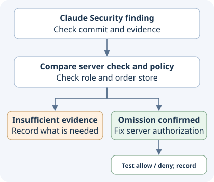

**When you receive a Claude Security finding, first check the reviewed commit and evidence files.** Then write down the rule the application must enforce and test both allowed and denied cases. This guide follows a fictional commerce policy: only a refund manager from the same store may request a refund.

Anthropic says Claude Security in Claude Enterprise scans repositories using models including Mythos 5.2. This example reviews and fixes one defensive finding in an authorized repository. The [Mythos availability guide](../2026-11-22-claude-mythos-availability/) describes account availability. [Anthropic model announcement](https://www.anthropic.com/claude-fable-and-mythos-5-2) · [Claude Security help](https://support.claude.com/en/articles/14661296-use-claude-security)



## Choose evidence for a fix

A Claude Security finding includes severity, file and line locations, the branch and commit of the evidence, and suggested remediation. First open the cited files at the **same commit**. If the current branch has changed, separately check whether the same rule is missing there. [Claude Security findings](https://support.claude.com/en/articles/14661296-use-claude-security)

| Check | Question for this example |
| --- | --- |
| Scanned version and location | Which commit's refund request service and authorization check does the report concern? |
| Actual business policy | Is a read-only operator barred from requesting refunds even within the same store? |
| Scope of existing checks | Independently of button visibility, does the server refund request path check both role and store? |
| Evidence needed for a decision | If the shared authorization policy cannot be inspected, which files or settings are still needed? |

For example, if a report says “review refund request authorization,” first check whether a shared authorization check already applies to that path. If you cannot read the shared policy, record the evidence needed in the finding. If the omission is confirmed, identify the server authorization check and related tests as the fix. [Authorization design for commerce administration](../2026-11-23-commerce-admin-screen/)

## Give the fixing tool the policy and completion criteria

Claude Security's **Fix** lets you continue the fix in Claude Code. Without Claude Code in the cloud, copy the provided prompt into your own Claude Code. The session uses a model available to the account. The following fictional request is for use after the reviewer has checked the files and policy evidence; replace paths and commits for your repository. [Fixing a finding](https://support.claude.com/en/articles/14661296-use-claude-security) · [Claude Security](https://claude.com/product/claude-security)

```text
Check server authorization for refund requests in the reviewed commit
and attached files.

Business policy
- Only a refund manager from the same store may request a refund.
- Read access is separate from permission to request refunds.
- Read the user's role and store from authenticated server context.

First check whether a shared authorization rule already applies and name
the evidence files. If an omission is confirmed, make the smallest change
at the existing authorization check. Add regression tests that allow the
same-store manager and deny a read-only user, a different-store manager,
and an unauthenticated request. Report the files checked, changes, tests
run and their results, and anything still unverified.
```

Completion means **the permitted scope matches the existing policy**. A role check alone could let another store's manager through; a store check alone would not exclude a read-only user. Read the changes and verify that the server compares the authenticated user context with the store of the order read from the repository.

## Check both allowed and denied paths

The following code independently checks only the authorization decision after the fix. It assumes authentication and order lookup have finished and the server passes `actor` and `order`. Actual refund execution and payment provider communication are outside this function's scope.

```javascript
import assert from "node:assert/strict";

function canRequestRefund(actor, order) {
  return actor !== null &&
    actor.role === "REFUND_MANAGER" &&
    actor.storeId === order.storeId;
}

const order = { storeId: "store-a" };
const manager = { role: "REFUND_MANAGER", storeId: "store-a" };

const cases = [
  ["same-store refund manager", manager, true],
  ["read-only operator", { ...manager, role: "VIEWER" }, false],
  ["different-store refund manager", { ...manager, storeId: "store-b" }, false],
  ["unauthenticated request", null, false]
];

for (const [label, actor, expected] of cases) {
  assert.equal(canRequestRefund(actor, order), expected, label);
  console.log(`PASS ${label}`);
}
```

Saved as `refund-policy.mjs` and run with `node refund-policy.mjs`, all four decisions matched their expectations on Node.js 22.17.0:

```text
PASS same-store refund manager
PASS read-only operator
PASS different-store refund manager
PASS unauthenticated request
```

In a real repository, also check that the refund request path uses this authorization decision. Use integration tests to check that denied requests register no refund work and allowed requests retain the existing flow. When closing the finding, record the fixing commit or PR, tests run, and outstanding work. If the report is judged incorrect, also record the evidence, such as an existing shared check. [Tracking Claude Security findings](https://support.claude.com/en/articles/14661296-use-claude-security)

The finding in this article is a synthetic example. No actual repository was scanned with Claude Security and no Mythos response was collected; the result above is a local authorization function test. No authenticated model run, actual refund action, or payment integration was tested.
