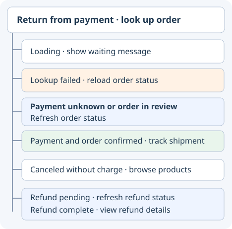

---
{
  "kind": "post",
  "publishedAt": "2026-11-23T00:00:00+09:00",
  "updatedAt": "2026-11-23T00:00:00+09:00",
  "reviewedAt": "2026-11-23",
  "reviewStatus": "source-audited",
  "reviewScope": "Cross-checked the preceding commerce guides and W3C guidance, and verified nine inputs on Node.js 22.17.0 for the example that maps order states to messages and actions.",
  "reviewSources": [
    "https://youdozi.github.io/en/posts/2026-11-23-commerce-admin-screen/",
    "https://youdozi.github.io/en/posts/2026-11-22-commerce-system-design-last-unit-of-stock/",
    "https://youdozi.github.io/en/posts/2026-11-22-commerce-database-design/",
    "https://www.w3.org/WAI/WCAG22/Understanding/error-prevention-legal-financial-data.html",
    "https://www.w3.org/WAI/WCAG22/Understanding/status-messages.html"
  ],
  "translationKey": "2026-11-23-commerce-storefront-design",
  "routeSlug": "2026-11-23-commerce-storefront-design",
  "categories": [
    "architecture"
  ],
  "tags": [
    "ecommerce",
    "storefront",
    "checkout",
    "order-management",
    "payments"
  ],
  "language": "en",
  "title": "Commerce Storefront Design — From Product Selection to Payment Confirmation",
  "description": "Decide what buyers can see and do from product listings to order details, and use the server’s order and payment states to guide them when they return from checkout."
}
---

**When a buyer returns from payment to a blank screen, their first question is whether they were charged.** Show a screen that lets them check the result for the existing order. From the product page to order history, pair the facts each screen can confirm with an action the buyer can take.

The [commerce admin screen guide](/en/posts/2026-11-23-commerce-admin-screen/) follows an operator looking up an order with an unconfirmed payment. Here we look at the same situation from the buyer’s side. Assume a store run by one merchant that sells physical goods in Korean won and ships them to buyers. Buyers order through an account. The discount and shipping policies are illustrative.

## What does the buyer decide on each screen?

| Screen | What to show first | What the buyer can do next |
| --- | --- | --- |
| Product listings and search | Product names and photos, prices buyers can compare, and active filters | Narrow the results or open a product page |
| Product details | The selected variant’s price and availability, plus shipping terms | Choose a variant and quantity, then add it to the cart |
| Cart | Each item’s variant, quantity, and amount, the estimated total, and any items that block checkout | Edit quantities and items, then proceed to checkout |
| Checkout | Shipping address, shipping fee, discounts, final amount, and where to make changes | Review the terms and request payment |
| Order details | Order number, payment, shipping, and refund statuses, plus a history of changes | Check the outcome or track the shipment, depending on the current status |

If a listing says “From ₩39,000,” show the actual price as soon as the buyer selects a variant on the product page. Identify sold-out variants in text. If a search returns no results, show the active filters and let buyers clear them. If the search fails to load, offer a retry.

Use the same policy as the [commerce guide on stock reservations](/en/posts/2026-11-22-commerce-system-design-last-unit-of-stock/). The product page shows stock as of the lookup. The cart holds the buyer’s selections. The server reserves stock when it creates the order. If someone else reserves the last unit first, mark the affected item and variant in the cart and keep the remaining items and the shipping address the buyer entered.

## Let buyers review and make changes before paying

Let buyers review and edit their variants, quantities, and shipping address alongside the final total. Label the button with the actual action, such as **“Pay ₩43,000.”** WCAG’s guidance on preventing errors in financial transactions describes giving users a way to review and correct the details before submitting. [W3C guidance on error prevention for financial transactions](https://www.w3.org/WAI/WCAG22/Understanding/error-prevention-legal-financial-data.html)

If a keyboard cost ₩39,000 when the buyer added it and now costs ₩42,000 at checkout, name the affected item. For example, “The price of the black keyboard changed from ₩39,000 to ₩42,000.” Show the new total after recalculating discounts and shipping, and let the buyer confirm that amount before requesting payment. When creating the order, the server checks the quote the buyer confirmed against the amount it will charge and records the transaction terms. [How the commerce database preserves order amounts](/en/posts/2026-11-22-commerce-database-design/)

On mobile, place links for editing the shipping address and items next to the corresponding details, and keep the final amount close to the payment button. If the button is fixed at the bottom, make sure the buyer can scroll far enough to read the last field and any error messages. Updates that can leave focus in place, such as a change in the cart total or a payment check result, can also be announced by assistive technology. For example, add `role="status"` to the region where the result text updates. [W3C guidance on status messages](https://www.w3.org/WAI/WCAG22/Understanding/status-messages.html)

## Check the payment outcome on the server



When the buyer returns from the payment page, look up the existing order on the server. If the order creation response is lost after the buyer clicks Pay, use the same order request key to check whether the order was already accepted. Briefly disabling the button can reduce repeated clicks. The request key and a server-side uniqueness check prevent duplicate orders. The order details and status APIs also check whether the current buyer has permission to access the order.

| State verified by the server | Message and action for the buyer |
| --- | --- |
| The order status lookup failed | “We couldn’t load your order status.” → **Reload order status** |
| The order exists and the payment outcome is unknown | “We’re checking the payment result.” → **Refresh order status** |
| Payment completed, order under review | “Your payment went through. We’re checking your order.” → **Refresh order status** |
| Payment and order confirmed | “We’ve received your order.” → **Track shipment** |
| Cancellation confirmed without a charge | “Your order was canceled. You weren’t charged.” → **Browse products** |
| Payment confirmed after cancellation, refund pending | “We’re processing your refund.” → **Refresh refund status** |
| Refund confirmed | “Your refund is complete.” → **View refund details** |

Show whether the order is being prepared, is in transit, or has been delivered based on the actual fulfillment state. Show a cancellation or return button only after checking that the request is allowed in the current state and that the user has permission. Track progress after the request is accepted. Show the refund completion message once the server confirms the result.

## Map server states to messages and actions

The example takes order and payment states already read from the server and maps them to a heading and the next action. A network error and an unknown payment outcome are separate inputs. Undefined state combinations never display success. The example uses the Korean UI strings. The table above gives their English equivalents. Save the code as `order-view.mjs` and run `node order-view.mjs`.

```javascript
const labels = {
  loading: ["주문 상태를 불러오는 중입니다.", null],
  unavailable: ["주문 상태를 불러오지 못했습니다.", "주문 상태 다시 불러오기"],
  pending: ["결제 결과를 확인 중입니다.", "주문 상태 새로고침"],
  paidReview: ["결제는 완료됐고 주문을 확인 중입니다.", "주문 상태 새로고침"],
  confirmed: ["주문이 접수됐습니다.", "배송 상태 보기"],
  closed: ["주문이 취소됐으며 결제된 금액이 없습니다.", "상품 다시 보기"],
  refundPending: ["환불을 처리 중입니다.", "환불 상태 새로고침"],
  refunded: ["환불이 완료됐습니다.", "환불 내역 보기"]
};

function orderView(snapshot) {
  if (snapshot.kind === "loading") return labels.loading;
  if (snapshot.kind === "unavailable") return labels.unavailable;

  const { order, payment } = snapshot;
  if (order === "CANCELLED" && payment === "REFUND_PENDING") {
    return labels.refundPending;
  }
  if (order === "CANCELLED" && payment === "REFUNDED") {
    return labels.refunded;
  }
  if (order === "CANCELLED" && payment === "CLOSED_UNPAID") {
    return labels.closed;
  }
  if (order === "CONFIRMED" && payment === "PAID") {
    return labels.confirmed;
  }
  if (order === "PENDING_PAYMENT" && payment === "PAID") {
    return labels.paidReview;
  }
  if (order === "PENDING_PAYMENT" &&
      (payment === "PENDING" || payment === "UNKNOWN")) {
    return labels.pending;
  }
  return labels.unavailable;
}

const verified = (order, payment) => ({ kind: "loaded", order, payment });
const cases = [
  [{ kind: "loading" }, "loading"],
  [{ kind: "unavailable" }, "unavailable"],
  [verified("PENDING_PAYMENT", "UNKNOWN"), "pending"],
  [verified("PENDING_PAYMENT", "PAID"), "paidReview"],
  [verified("CONFIRMED", "PAID"), "confirmed"],
  [verified("CANCELLED", "CLOSED_UNPAID"), "closed"],
  [verified("CANCELLED", "REFUND_PENDING"), "refundPending"],
  [verified("CANCELLED", "REFUNDED"), "refunded"],
  [verified("CONFIRMED", "UNKNOWN"), "unavailable"]
];

for (const [input, key] of cases) {
  if (orderView(input) !== labels[key]) throw new Error(key);
  console.log("PASS", key);
}
```

All nine inputs passed on Node.js 22.17.0. A failed lookup, an unknown payment outcome, a cancellation without a charge, and a pending refund each returned the expected message and action. The run covered the function that maps states to UI messages and actions. Mobile usability, assistive technology behavior, and live payment integration are checks for the implemented screens.
