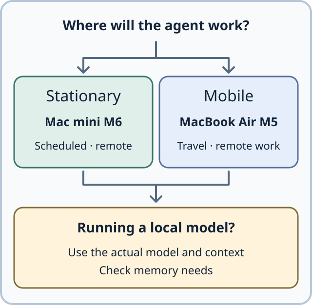

---
{
  "kind": "post",
  "publishedAt": "2026-11-23T14:25:00Z",
  "reviewedAt": "2026-11-23",
  "reviewStatus": "source-audited",
  "reviewScope": "Apple Korea specifications and prices checked; diagnostic commands executed on macOS; hardware and model performance not measured.",
  "reviewSources": ["https://www.apple.com/kr/mac-mini/specs/", "https://www.apple.com/kr/macbook-air/specs/", "https://www.apple.com/kr/newsroom/2026/09/the-new-mac-mini-and-mac-studio-are-available-today/"],
  "language": "en",
  "translationKey": "2026-11-23-mac-for-ai-agents",
  "routeSlug": "2026-11-23-mac-for-ai-agents",
  "title": "MacBook or Mac mini for AI agents: which should you buy?",
  "description": "Compare the Mac mini and MacBook Air by where your AI agents work and how much memory they need.",
  "categories": ["tips"],
  "tags": ["macos", "ai-agents", "hardware"]
}
---

If you already have a laptop and want AI agents to run browser tests or scheduled jobs, I recommend the **Mac mini M6**. If you want the same development environment on commutes and trips and prefer one computer, the **13-inch MacBook Air M5** is a better fit. If you plan to run models yourself with a tool such as Ollama, first check the memory needed for your chosen model and context. For a stationary machine requiring more than 32GB, consider the **48GB and 64GB Mac mini M5 Pro** configurations. [Apple Mac mini specifications](https://www.apple.com/kr/mac-mini/specs/) · [Apple MacBook Air specifications](https://www.apple.com/kr/macbook-air/specs/)



## Where agents and models run

Consider running Claude Code or Codex in your Mac's terminal with a cloud model. A remote service generates model responses, while builds and tests the agent runs on your Mac use its CPU, memory, and storage. Your needs differ between asking one agent for a code review and running Docker, tests, and browsers in two working folders at once. With a cloud model, choose specifications based on the work that actually overlaps on your Mac.

With local inference, the model also uses your Mac's memory. Even with the same model, requirements vary with the precision used to store weights and the length of input supplied at once. A short conversation may work, yet responses can slow when you add long code and logs and open a browser. Before buying, if possible, check response latency and memory pressure with the **actual model, quantization, and context length** you intend to use. [Ollama context length documentation](https://docs.ollama.com/context-length)

## Configurations by usage

| Main workload | My choice | Check before buying |
| --- | --- | --- |
| Coding with a cloud model at a fixed desk and occasional tests | Mac mini M6 16GB | Check whether the base 256GB is enough. If you keep build caches and Docker images regularly, compare configurations starting at 512GB. |
| Working in cafés and offices | 13-inch MacBook Air M5 16GB · 512GB | If containers and browser tests frequently overlap, first consider 24GB. |
| Running containers and tests concurrently across several working folders | Mac mini M6 for stationary use, or MacBook Air M5 for mobile use, with 24–32GB | Check the number of concurrent services and memory pressure. Also check the memory allocated to Docker Desktop's virtual machine. |
| Running local models daily and needing more than 32GB | Mac mini M5 Pro 48GB · 64GB for stationary use | Account for a browser and IDE running after the model is loaded. If you also need the same model away from home, determine the required capacity and compare MacBook Pro configurations with that capacity. |

16GB, 24GB, and 32GB are starting points based on workload. Actual needs vary with build methods and container counts. [Docker Desktop resource settings](https://docs.docker.com/desktop/settings-and-maintenance/settings/#resources)

### Starting prices in the Apple Korea store

These are regular starting prices for base configurations checked on November 23, 2026.

| Model | Base memory · SSD | Starting price |
| --- | --- | ---: |
| Mac mini M6 | 16GB · 256GB | KRW 1,499,000 |
| 13-inch MacBook Air M5 | 16GB · 512GB | KRW 2,190,000 |
| Mac mini M5 Pro | 24GB · 512GB | KRW 2,990,000 |

The starting prices of the two 16GB base models differ by KRW 691,000. The MacBook Air includes a display, keyboard, and battery, and its base SSD is larger. If you already have a monitor and input devices, the Mac mini has a larger price advantage. If you plan to add SSD space or memory, compare the desired configurations in the shopping cart. [Apple Korea store](https://www.apple.com/kr/shop/buy-mac) · [Mac mini launch prices](https://www.apple.com/kr/newsroom/2026/09/the-new-mac-mini-and-mac-studio-are-available-today/) · [Mac mini specifications](https://www.apple.com/kr/mac-mini/specs/) · [MacBook Air specifications](https://www.apple.com/kr/macbook-air/specs/)

## Check your current Mac before buying

1. Use the commands below to check memory and free space on the volume containing your home folder.
2. Open your agent and IDE as usual and run the build, Docker, and browser workloads that most often overlap. Check memory pressure and swap usage in **Activity Monitor → Memory**.
3. If memory pressure repeatedly rises and apps also respond slowly, compare configurations with more memory. If the problem occurs only while containers run, also check the allocation limit in Docker Desktop. [Apple Activity Monitor guide](https://support.apple.com/guide/activity-monitor/view-memory-usage-actmntr1004/mac) · [Docker Desktop resource settings](https://docs.docker.com/desktop/settings-and-maintenance/settings/#resources)

```sh
sw_vers -productVersion
sysctl -n hw.memsize | awk '{ printf "Unified memory: %.0f GiB\n", $1 / 1073741824 }'
df -h "$HOME" | awk 'NR == 2 { print "Free storage:", $4 }'
```

Even with enough memory and disk, a machine for scheduled jobs needs another check. After work, run a scheduled job once with the screen off and check its log. If jobs must run after sleep or reboot, check both conditions again. If you already have a MacBook, this check can help you decide whether you need a dedicated Mac mini. [Using a MacBook as a personal server](https://youdozi.github.io/en/posts/2026-11-23-macbook-personal-server/)

I checked specifications and prices against Apple's Korean pages and ran the three commands above on macOS. I did not measure build performance between machines or local model response times.
