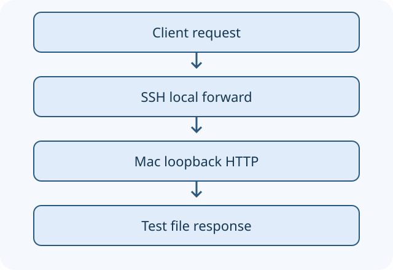

---
{
  "kind": "post",
  "publishedAt": "2026-11-23T09:45:00Z",
  "updatedAt": "2026-11-23T09:54:05Z",
  "reviewedAt": "2026-11-23",
  "reviewStatus": "source-audited",
  "reviewScope": "Official documentation self-review; loopback HTTP checked locally; SSH and tunnel not tested.",
  "reviewSources": [
    "https://support.apple.com/guide/mac-help/allow-a-remote-computer-to-access-your-mac-mchlp1066/mac",
    "https://docs.python.org/3/library/http.server.html",
    "https://man.openbsd.org/ssh"
  ],
  "language": "en",
  "translationKey": "2026-11-23-macbook-personal-server",
  "routeSlug": "2026-11-23-macbook-personal-server",
  "title": "Use a MacBook as a Personal Server on a Private Network",
  "description": "Test a loopback HTTP service through an SSH tunnel and understand Mac availability limits.",
  "categories": [
    "tips"
  ],
  "tags": [
    "macos",
    "ssh",
    "home-server"
  ]
}
---

A MacBook can serve a short development demo to another computer on a trusted private network without exposing an HTTP port on the network. Start a temporary HTTP server on the Mac's loopback interface, then reach it through an SSH local forward. This is a test, not a setup for an always-available public service.



The diagram summarizes the request and response; authentication and cleanup are shown below.

## Prepare access

Use two computers on a private network you control. A shared or public network may contain untrusted devices; a private address alone is not an access-control boundary. Do not forward router ports. Use a separate standard macOS account for this task and grant it only the files it needs. On the Mac, open System Settings → General → Sharing → Remote Login, enable it and choose “Only these users” to allow that account. Leave full disk access for remote users off unless separately needed. The Remote Login panel shows the Mac's SSH address. Settings can differ with macOS version or device management. [Apple: Remote Login](https://support.apple.com/guide/mac-help/allow-a-remote-computer-to-access-your-mac-mchlp1066/mac)

On the client, create a dedicated key, choosing a passphrase and a new filename when prompted:

```sh
ssh-keygen -t ed25519 -f ~/.ssh/macbook_demo
```

Copy the single public-key line from `~/.ssh/macbook_demo.pub` to the Mac through a trusted channel. While logged in locally as the allowed Mac account, run the commands below, paste that public-key line and press Ctrl-D on a new line. This appends to `~/.ssh/authorized_keys` and preserves existing entries. Never copy the private key.

```sh
umask 077
mkdir -p ~/.ssh
chmod 700 ~/.ssh
cat >> ~/.ssh/authorized_keys
chmod 600 ~/.ssh/authorized_keys
```

 See [OpenSSH authorized keys](https://man.openbsd.org/sshd#AUTHORIZED_KEYS_FILE_FORMAT) and [ssh-keygen](https://man.openbsd.org/ssh-keygen).

On the Mac, find the host key fingerprint through a local terminal:

```sh
ssh-keygen -lf /etc/ssh/ssh_host_ed25519_key.pub
```

On the client, connect using the allowed account and the address shown in Remote Login; `demo` and `192.168.1.20` below are examples, not values to copy unchanged. Before accepting the first connection, compare the displayed ED25519 fingerprint with the one read on the Mac. If it differs, stop and investigate. A changed host-key warning also requires investigation, not automatic acceptance. [OpenSSH host verification](https://man.openbsd.org/ssh#VERIFYING_HOST_KEYS)

```sh
ssh -i ~/.ssh/macbook_demo -o HostKeyAlgorithms=ssh-ed25519 demo@192.168.1.20
```

Verify that the login succeeds, then type `exit`. The account's password may still work: adding a key does not itself disable password authentication.

## Start a test and forward it

On the Mac, in a terminal logged in as the allowed account, create an empty temporary directory, add one harmless file, and start Python 3.7+. The server only binds to the Mac's IPv4 loopback address. Keep this terminal open.

```sh
sample_dir=$(mktemp -d)
printf 'home server test\n' > "$sample_dir/index.html"
python3 -m http.server 8000 --bind 127.0.0.1 --directory "$sample_dir"
```

If port 8000 is already in use, stop and choose an unused port in both the server and forwarding commands. Python's simple HTTP server is for testing, not production; it follows symlinks, so use only the empty test directory and harmless file. [Python http.server](https://docs.python.org/3/library/http.server.html)

On the client, establish the tunnel in a second terminal and keep it open:

```sh
ssh -N -o ExitOnForwardFailure=yes -i ~/.ssh/macbook_demo -L 127.0.0.1:18000:127.0.0.1:8000 demo@192.168.1.20
```

In another client terminal, run:

```sh
curl http://127.0.0.1:18000/
```

Expected output is `home server test`. The client connects to its own port 18000; SSH carries the request to the Mac, where it connects to the Mac's loopback port 8000. If the tunnel fails, check the address, allowlist, fingerprint and key before retrying. If the tunnel starts but curl fails, check that the Python process is still running and both ports match. `ExitOnForwardFailure` confirms creation of the local listener, not that the target HTTP server is reachable. [OpenSSH forwarding](https://man.openbsd.org/ssh#L)

Stop the SSH tunnel with Ctrl-C in its terminal. Stop Python with Ctrl-C in the Mac terminal, then remove only the sample directory created above:

```sh
rm "$sample_dir/index.html"
rmdir "$sample_dir"
```

Remove the example public-key line and disable Remote Login if they were created only for this exercise. Preserve any pre-existing keys and access settings.

## Availability and next steps

The display turning off and the Mac sleeping are different states. Closing a laptop display normally puts it to sleep; do not assume a closed lid, network wake, or a power change will keep this test running. After a restart with FileVault, plan for a person to unlock the Mac if necessary. Apple documents SSH FileVault unlocking under specific conditions on Apple silicon with macOS 26 or later; do not assume those conditions apply. [Apple: sleep](https://support.apple.com/guide/mac-help/put-your-mac-to-sleep-or-wake-it-mh10330/mac) · [Apple: FileVault](https://support.apple.com/guide/security/managing-filevault-sec8447f5049/web)

For a one-time demo, stop the process when finished. For files, consider macOS File Sharing and its access controls. A long-running service needs a separate launchd configuration, updates, backups and recovery plan; dedicated hardware may be a better fit. For access away from home, a private VPN is an option to evaluate separately; it does not remove the need to secure the Mac and service.

The loopback HTTP response was checked locally with a temporary file and process; the SSH connection and tunnel are documented reader steps, not a tested connection to this Mac.
