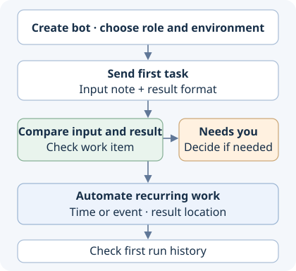

**If you are making your first Orca Bot, start with one task whose result you can check before scheduling recurring work.** For example, give it a short technical note and ask for a blog title and outline. If the result has the desired format, refine the bot's role and add recurring work. This guide follows that process with a bot that prepares blog drafts.

An Orca Bot is a unit of work with a name, purpose and memory. Choose the computer and an agent, such as Claude Code or Codex, on which it will run. Install and sign in to the agent on that computer. The first exercise stays inside Orca. To call the bot from Slack, GitHub or Linear, or run it on events from those services, add the necessary connections. [Orca Bots quickstart](https://orca.dev/docs/bots) · [Orca bot connectors](https://orca.dev/docs/bots/connectors)



## Create a bot and send its first request

In Orca's **Bots** sidebar, select **+ → New bot → Start from scratch**. Choose a name and write its role in one sentence in **Who it is and what it does**. The example name is `Blog Draft`, and its purpose is “turn development notes into technical blog drafts.” Check the execution computer and agent below the name, then select **Create**. If Bots is not visible in the sidebar, check **Settings → Bots → Enable bots**. [Create a bot](https://orca.dev/docs/bots)

In the bot's chat, provide both the input and the desired format as below. This note is fictional practice material.

```text
Prepare a technical blog draft from the following practice note.

Note
- A Java service calls an external API.
- Tests checked a successful response and a 404 response.
- Production latency was not measured.

Suggest one title, one introductory paragraph, and three headings.
Do not add versions or performance figures absent from the note.
At the end, list anything that needs checking before writing the body.
Show the result in this chat.
```

When you receive the result, check that it retains the limited claim that the 404 response was checked. If it adds a version or throughput claim, remove it or ask for evidence. Success for the first request means a title, introduction and headings grounded in the note, not a draft ready to publish.

## Separate rules for future chats from current work

| Where to look | Suitable content | Blog bot example |
| --- | --- | --- |
| `SOUL.md` | Ongoing role and working practices | Verify evidence against official documentation and wait for a separate publication request |
| `MEMORY.md` | Facts and preferences to recall in future chats | Readers are Java developers and prefer runnable examples |
| Work item in **Home** | Current progress, attached results and decisions awaiting approval | A new draft is awaiting review |

The two Markdown files are in the bot folder. You can give it a recurring instruction such as “Distinguish results you ran yourself from expected results in future examples,” then check whether it follows that instruction in later work. To check whether current work has finished, open the bot's work item. If a decision is needed, check the question's subject and consequences in **Needs you** and respond. [Using Orca Bots](https://orca.dev/docs/bots) · [Bot memory and access](https://orca.dev/docs/bots/security)

When asked to change code in a repository, the bot can hand the work to a worker in a separate Git worktree. Open the worker's workspace in the sidebar to inspect the files and tests, and review the actual changes if a PR is created. [Bot workers](https://orca.dev/docs/bots) · [Orca worktree guide](../2026-11-12-orca-worktree-guide/)

## Set the trigger and result location for recurring work

If the first task is satisfactory, ask in the bot chat as follows. This example reads public documentation and only gathers article ideas.

```text
Every Monday at 9:00 a.m. Korea time, select up to three technical
article ideas from official Spring Boot releases announced in the
previous seven days. For each candidate, include the announcement date,
official link, and a question to explore in an exercise.
If there were no announcements, say so.
Make the result available to me in Orca; do not publish it to the blog.
Also tell me which conversation the automation will leave its result in.
```

Once the automation is created, check its **time zone, trigger and result destination** in the bot panel. If it should react to an event such as a new GitHub PR instead of a time, first check that the connector is connected and supports that event. If the computer running the bot is asleep or offline, it cannot work immediately as scheduled, so check the automation's run history for the first result. [Orca automations](https://orca.dev/docs/bots) · [Orca connectors](https://orca.dev/docs/bots/connectors)

On macOS with the CLI installed, these commands list bot names and available events. Replace the name on the second line with your bot's name.

```sh
orca bot list
orca automations trigger-options --bot 'Blog Draft'
```

The two read-only commands were checked with an existing bot using **Orca CLI 1.4.271** in the writing environment. For a bot without a GitHub connection, the results indicated that GitHub events could not start that bot. The example name and note are fictional; no new bot or automation was created or run for this article. For CLI guidance matching your version, read `orca skills get orca-cli --reference bots`.
