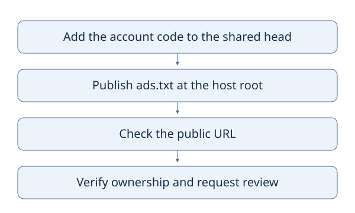

If you run a technical blog at `username.github.io`, Google AdSense is a reasonable place to start. Carbon Ads and EthicalAds are also candidates for sites with a steady developer audience. Before applying, check whether you can publish `https://username.github.io/ads.txt`, especially if your project address looks like `username.github.io/blog/`.

GitHub does not generally prohibit advertising on content-oriented sites. GitHub Pages does restrict use as free hosting for an online business, e-commerce, or commercial SaaS. Read both policies when adding ads to a technical blog. [GitHub advertising policy](https://docs.github.com/en/site-policy/acceptable-use-policies/github-acceptable-use-policies#10-advertising-on-github) · [GitHub Pages limits](https://docs.github.com/en/pages/getting-started-with-github-pages/github-pages-limits)

## Which advertising service?

| Service | Suitable sites | Apply |
| --- | --- | --- |
| **Google AdSense** | A personal blog adding its first ads, with a choice of automatic or manual placement | [Start AdSense](https://adsense.google.com/start/) |
| **Carbon Ads** | Articles, documentation, and tools read by developers and designers. Applications start at 10,000 monthly pageviews; other ad networks are not allowed alongside Carbon. | [Apply to Carbon Ads](https://www.carbonads.net/join?_hsmi=83378591) |
| **EthicalAds** | Developer-focused sites with at least 50,000 monthly pageviews and room for a single ad outside the reading flow | [EthicalAds publisher guide](https://www.ethicalads.io/publisher-guide/) |

Choose a placement first. For a blog with many code examples, one manually placed AdSense ad below the article is a useful starting point to inspect on mobile. AdSense offers **ad units**, whose positions you choose, and **Auto ads**, whose positions Google chooses. EthicalAds has its own placement rules: its ad should be above the fold on desktop and mobile, or disabled on mobile if that is not possible. [AdSense ad settings](https://support.google.com/adsense/answer/7037624)



The diagram summarizes the setup and review steps; ad delivery is checked separately.

## 1. Sign up for AdSense and add your site

Sign up with a Google account and enter your payment country and payment information. Under **Sites → New site**, add `https://username.github.io`. The Public Suffix List includes `github.io`, and AdSense says subdomains on platforms in that list can be added as sites. Ownership verification and site review follow. [Create an AdSense account](https://support.google.com/adsense/answer/7402253) · [AdSense site criteria](https://support.google.com/adsense/answer/12170421) · [Public Suffix List](https://publicsuffix.org/list/public_suffix_list.dat)

Check the address: a GitHub Pages user site is at `username.github.io/`, while a project site is normally at `username.github.io/blog/`. An `ads.txt` file in the project deployment may land at `/blog/ads.txt`. Google starts at the host root `/ads.txt`, so publish it from the user site or at the root of a custom domain connected to the blog. [GitHub Pages site types](https://docs.github.com/en/pages/getting-started-with-github-pages/what-is-github-pages#types-of-github-pages-sites) · [Google ads.txt crawling](https://support.google.com/adsense/answer/7679060)

## 2. One script in the shared `<head>`, one root `ads.txt`

AdSense offers a code snippet, `ads.txt`, or a meta tag for ownership verification. If you choose the snippet, put the code provided by the dashboard in the shared layout's `<head>`. This example only shows the shape; use the code copied from your own account when deploying. [Connect your site](https://support.google.com/adsense/answer/7584263)

```html
<script async
  src="https://pagead2.googlesyndication.com/pagead/js/adsbygoogle.js?client=ca-pub-0000000000000000"
  crossorigin="anonymous"></script>
```

Copy the line supplied by the dashboard into `ads.txt`. The file identifies accounts authorized to sell your site's ad inventory. Preserve existing seller lines and add the new line.

```text
google.com, pub-0000000000000000, DIRECT, f08c47fec0942fa0
```

For an Astro user site, put the file at `public/ads.txt`; Astro copies files in `public/` into the build output. After deployment, check the public URL, not just the repository. [Astro `public/` directory](https://docs.astro.build/en/guides/images/#src-vs-public) · [Google ads.txt guide](https://support.google.com/adsense/answer/12171612)

```bash
curl -fsSL https://username.github.io/ads.txt
```

The expected output is the example seller line above. A real site should return its account publisher ID. The `username` address is illustrative, so this is not an observed command result.

For a multilingual blog on the same host, one root file is enough; separate `/ko/` and `/en/` files are unnecessary. Check that the shared loader appears once in the final HTML of a representative article in each language.

## 3. Check deployment, review, and ad delivery separately

After deploying the file and code, verify ownership in AdSense and request site review. Site **`Ready`** means the site is ready to show ads; ads.txt **`Authorized`** means Google found the publisher ID in the file. If the dashboard still shows `Not found` when the public URL works, check whether the change followed the last crawl. If the path and contents are correct, request another check with **Check for updates**. [Site status](https://support.google.com/adsense/answer/12170222) · [ads.txt status](https://support.google.com/adsense/answer/12171612)

Before enabling ads, describe information collected or shared for advertising and technologies such as cookies in your privacy policy. Serving personalized ads to visitors in the EEA, UK, and Switzerland requires a Google-certified consent management platform (CMP) integrated with the IAB Transparency and Consent Framework (TCF). The European regulations message in AdSense **Privacy & messaging** is one option. [Google publisher privacy policy](https://support.google.com/adsense/answer/10502938) · [Google CMP requirements](https://support.google.com/adsense/answer/13554116)

After review, inspect placement with the Auto ads preview or a manual ad unit. On a phone, check that ads do not cover the table of contents, code-copy buttons, or language menu. Do not click your own ads to test them; use previews and dashboard reports. [Auto ads preview](https://support.google.com/adsense/answer/9261307) · [Invalid traffic](https://support.google.com/adsense/answer/16737)

On `youdozi.github.io`, the public root `ads.txt` and one AdSense script in the Korean home page HTML were checked. This check covered the public file and HTML; account review status and actual ad delivery require separate verification. [Public ads.txt](https://youdozi.github.io/ads.txt) · [Korean home page](https://youdozi.github.io/ko/)
