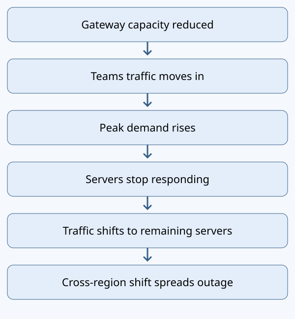

When a server stops responding, requests are routed to healthy servers. Normally this keeps users from noticing when a few servers fail. In the November 2026 Microsoft 365 outage, the same mechanism carried the outage to other regions: the receiving servers had the same defect, which surfaced there as their load increased. [Copy of the Microsoft post-incident report](https://www.365fanatic.com/wp-content/uploads/2026/11/postincidentreport-mo1550821.pdf)

Reduced gateway capacity, shifted Teams traffic and peak demand combine; rerouting then spreads load to servers with the same defect.

## Why did a defect introduced in July surface in November?

According to Microsoft's report, the defect was introduced in a Windows update for Microsoft 365 network gateways. It rolled out over several weeks starting in July, and no customer impact was observed for more than three months. On newer servers with more cores, however, more connection requests could be processed concurrently, increasing internal lock contention. The servers used in the load tests had fewer cores, and the test traffic also differed from the traffic during the outage. [Copy of the Microsoft post-incident report](https://www.365fanatic.com/wp-content/uploads/2026/11/postincidentreport-mo1550821.pdf)

On November 12, with some gateway capacity offline for routine work, Teams traffic moved onto gateways shared with Exchange Online. The service worked normally for a while. As North American usage approached its usual peak, servers began to stop responding, and automatic rerouting increased the load on each remaining server. Cross-region rerouting also sent requests to servers with the same defect. The report records **approximately 23 hours and 50 minutes of active customer impact**; delayed mail processing and stability monitoring continued afterward. [Copy of the Microsoft post-incident report](https://www.365fanatic.com/wp-content/uploads/2026/11/postincidentreport-mo1550821.pdf)

## Failover needs a receiving limit too

When designing failover, check **how much additional work the receiving side can handle now**. For example, if region A needs to shift 1,000 requests while region B has spare capacity for 300 in the same time interval, routing all of them may cause both regions to fail. One option is to admit critical requests first and bound the queue for work that can tolerate delay, or temporarily reject it. Deliberately accepting fewer requests during overload is called **load shedding**. [Microsoft Learn guide to throttling](https://learn.microsoft.com/en-us/azure/well-architected/design-guides/throttling)

The same principle applies to recovery. In this incident, servers received a backlog of reconnection requests as soon as they returned to service and stopped responding again. An operations team can gradually return requests to recovered instances while watching connection success rates, latency, and queues together. Load tests should combine **peak traffic, capacity reduced by routine work, failover, and reconnection** on the same generation of servers used in production. Testing each condition separately can miss problems that appear when they coincide, as they did here. [Copy of the Microsoft post-incident report](https://www.365fanatic.com/wp-content/uploads/2026/11/postincidentreport-mo1550821.pdf)

## Separate chats, one record of decisions

According to internal memos reviewed by Reuters, responders exchanged more than 11,000 messages across 11 Teams chat rooms. Diagnostic data was scattered across systems, making it difficult to see at a glance which hypotheses remained active and who decided on which action. Microsoft subsequently entered “Code Red,” prioritizing prevention and recovery improvements. The **worldwide recovery within one hour** reported by Reuters is an internal target for future incidents. [GeekNews introduction](https://news.hada.io/topic?id=37797) · [Reuters article republished](https://www.investing.com/news/stock-market-news/exclusivemicrosoft-declares-code-red-after-historic-outage-internal-memos-show-5048702)

Even with separate investigation channels, teams can maintain one shared incident document. At the top, put **current customer impact, confirmed facts, active hypotheses and owners, the latest action and its result, and the time of the next update**. For example, instead of just “server restart complete,” write “connection success briefly recovered after restart, then fell again as reconnection requests surged.” An incoming responder can use that line to decide whether to repeat the action immediately or first control incoming traffic. It is also useful to check whether access to the incident document shares dependencies with the service being recovered. [Google SRE on maintaining a live incident document](https://sre.google/sre-book/managing-incidents/#live-incident-state-document)

In the next incident exercise, start with **one region operating at reduced capacity during peak traffic**. Decide how many requests the remaining region can accept, which functions to reduce first, and how quickly to return requests to recovered servers. Set the end condition beyond servers being up: users should be able to use core functions again and the backlog should be shrinking. That makes the recovery target measurable.

Related reading · [Checking RestClient traceparent propagation in Spring Boot 4.2](https://youdozi.github.io/en/posts/2026-11-22-spring-boot-4-2-restclient-traceparent/)
