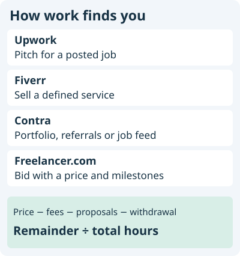

**If you're starting freelance development work from South Korea, look at Upwork to pitch for posted jobs, or Fiverr to sell the same well-defined service repeatedly.** Contra can be a good fit if you already have a client through a referral and need to arrange a contract and collect payment. Freelancer.com gives you another place to bid, but check the balance required to bid and the fee due when you accept a fixed-price award.

Take a failing Spring Boot test. If nobody knows what's causing the failure, read the brief and offer a paid investigation. If you regularly fix the same kind of test, you can list a service that specifies which test you'll fix and what you'll deliver. This comparison uses the platforms' own documentation, checked on November 25, 2026.

## Where do you find clients, and what does it cost?

| Platform | How you get work | Costs to watch |
| --- | --- | --- |
| Upwork | Send a proposal for an individual job | Service fee of 0–15% per contract. The number of Connects needed varies by posting. Purchased Connects cost $0.15 each. |
| Fiverr | List a service (Gig) with a scope and price and take orders | You earn 80% of the price of a completed order. |
| Contra | Find clients through a portfolio or Job Feed, or bring an existing client | Freelancer commission is 0%. Check platform and processing fees as well as withdrawal and currency conversion costs. |
| Freelancer.com | Bid with a price and delivery milestones | Standard fixed-price fee is the greater of 10% or $5. Standard hourly fee is 10%. The standard minimum balance to bid is $20. |

[Upwork service fee](https://support.upwork.com/hc/en-us/articles/211062538-Learn-about-the-Freelancer-Service-Fee) · [Upwork Connects](https://support.upwork.com/hc/en-us/articles/211062898-About-Connects-costs-uses-balances-and-expiration) · [Fiverr earnings](https://help.fiverr.com/hc/en-us/articles/9234443621137-Your-earnings-page) · [Contra fees](https://help.contra.com/en/articles/9322934-fees-overview) · [Freelancer.com fees](https://www.freelancer.com/feesandcharges)

### Upwork — propose a solution for each job

Choose a posting and propose a scope, schedule and price. If the cause is unclear, keep the first contract to a paid diagnosis: reproduce a failing test and deliver the cause and a repair plan. Even unsuccessful applications take time and may cost Connects. Before applying, check both the contract fee shown and the Connects required.

On a fixed-price contract, the client can fund milestones in advance. To qualify for payment protection, the milestone must be fully funded before work begins. Deliver what was agreed using **Submit Work for Payment**. Upwork charges $0.99 per **Direct to Local Bank** withdrawal to a Korean won account. Your bank may have its own fees and conditions. [Fixed-price payment protection](https://support.upwork.com/hc/en-us/articles/211063748-How-Fixed-Price-Payment-Protection-works-for-freelancers-on-Upwork) · [Local bank withdrawals](https://support.upwork.com/hc/en-us/articles/211063888-How-to-withdraw-earnings-with-Direct-to-Local-Bank)

### Fiverr — sell a repeatable service

Define something a client can order, such as fixing one failing Spring Boot test and delivering the patch and a command to reproduce the failure. List supported versions, revisions and required materials alongside the price so you can reuse the scope for each order. If another module might need changes, clarify the scope first or send a separate quote.

Clients can review the delivery on the order page and accept it or request revisions. Earnings generally clear 14 days after order completion, sooner for some levels and programs. Check regional availability and withdrawal minimums for your method, including bank transfer via Payoneer. [Orders and clearance](https://help.fiverr.com/hc/en-us/articles/360010639617-A-freelancer-s-guide-to-the-Fiverr-order-process) · [Fiverr payout methods](https://help.fiverr.com/hc/en-us/articles/360010530058-Withdrawing-your-earnings-managing-payout-methods)

### Contra — move from a portfolio to a contract

Show your portfolio to a referred client and handle the contract and payment in one place, or find new work through the Job Feed. Freelancer commission is 0%, but the free plan lists a platform fee of $15 on payments of $1–$499 and $29 on payments of $500 or more. Check the final charge for the payment method and plan. The fee schedule lists $2 for a local transfer to a Korean won account. Check currency conversion separately. [Contra overview](https://help.contra.com/en/articles/9322235-contra-overview) · [Applying to jobs](https://help.contra.com/en/articles/9322973-applying-to-jobs-on-contra) · [Payment and payout fees](https://help.contra.com/en/articles/9322934-fees-overview)

With a new client, compare escrow options in a **Project** with a defined scope. Contra can help resolve disputes over project funds still held in escrow. Standalone invoices and payment links fall outside that assistance. [Paid project types](https://help.contra.com/en/articles/9322763-paid-projects) · [Dispute assistance](https://help.contra.com/en/articles/11329360-contra-s-dispute-assistance)

### Freelancer.com — check costs before you bid and accept

Bid with your price and delivery milestones. The standard minimum available balance to bid is $20, though some projects or accounts may require more. On a standard fixed-price project, the fee is charged when you accept the award. On a $30 job, 10% is $3, so the $5 minimum applies and leaves $25 before withdrawal costs. [Fees and minimum balance](https://www.freelancer.com/feesandcharges)

Before starting your first job, check that the **Milestone Payment** for that stage is funded. Disputes are tied to that payment. Check which withdrawal options your account supports. South Korea is absent from the published Express Withdrawal country list, and the listed minimum for PayPal and Payoneer is $50 each. [Milestone payments](https://www.freelancer.com/support/payments/how-do-i-get-paid) · [Express Withdrawal countries](https://www.freelancer.com/support/freelancer/payments/express-withdrawals) · [Withdrawal methods and minimums](https://www.freelancer.com/support/payments/how-to-withdraw-funds)

## How much does the first contract pay per hour?

Subtracting the service fee alone overlooks time spent pitching and reviewing the work. Suppose delivery takes 6 hours, discussions and review take 1 hour, and you send 6 proposals at 20 minutes each to land a $300 contract. Assume Upwork shows a 10% fee for this contract. Include 12 purchased Connects per proposal and one withdrawal to a Korean won account.



This example uses only the Python 3 standard library. Save it as `estimate.py` and run `python3 estimate.py`. It excludes exchange rate differences and taxes.

```python
from decimal import Decimal

contract_usd = Decimal("300")
service_fee_rate = Decimal("0.10")
proposals = 6
connects_per_proposal = 12
connect_price_usd = Decimal("0.15")
withdrawal_usd = Decimal("0.99")

proposal_hours = Decimal(proposals * 20) / 60
delivery_hours = Decimal("6")
review_hours = Decimal("1")

proposal_cost = proposals * connects_per_proposal * connect_price_usd
remaining = contract_usd * (1 - service_fee_rate) - proposal_cost - withdrawal_usd
total_hours = proposal_hours + delivery_hours + review_hours

print(f"Costs deducted, before tax: ${remaining:.2f}")
print(f"Total hours: {total_hours:.1f}")
print(f"Per hour, before tax: ${remaining / total_hours:.2f}")
```

Running the example gives the following output.

```text
Costs deducted, before tax: $258.21
Total hours: 9.0
Per hour, before tax: $28.69
```

Even on the same $300 contract, rewriting proposals or handling extra revisions changes the hourly return. Start with a deliverable you can describe in a line, such as reproducing a failing test and supplying a patch. If asked to do a free trial on real client code or take payment outside the platform before contracting, show a public sample or propose paid diagnostic work on the platform. [Upwork's guide to scam warning signs](https://support.upwork.com/hc/en-us/articles/35088484250003-Recognize-red-flags-and-avoid-scams)
