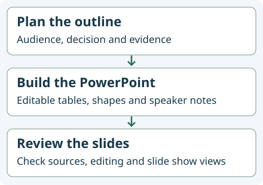

When you ask AI to prepare a presentation, start with **who will hear it and what decision they should make by the end**. “Make me a good-looking deck” can get you a cover and an agenda in seconds, yet the decision might only surface on the last slide. Settle on a title and supporting evidence for each slide, turn the outline into a .pptx, then open it in the app you'll present from. That's where it's easiest to spot what needs changing.



## Skills and tools for building a PowerPoint

| Skill or tool | When to use it | What to ask for |
|---|---|---|
| **ai-guide-writing** | Turning instructions or training material into a talk | Put the exercise steps, sample inputs, expected results and checks in order. |
| **tech-blog-writing** | Presenting a technical document or operations log | Pick out the claims and evidence, then divide the explanation between the slides and speaker notes. |
| **Anthropic's pptx skill** | Creating a PowerPoint or adapting an existing template in Claude Code | Create and edit .pptx files, extract slide content, inspect thumbnails and check the file structure. [Official skill](https://raw.githubusercontent.com/anthropics/skills/main/skills/pptx/SKILL.md) |
| **PptxGenJS** | Building similar weekly reports with a coding agent such as Codex | Regenerate an editable .pptx from JavaScript and input data. [Quick start](https://github.com/gitbrent/PptxGenJS#-quick-start-guide) |

ai-guide-writing and tech-blog-writing are writing skills available in the environment used for this guide. For the PowerPoint file itself, you can use the pptx skill in Claude Code or PptxGenJS. To install Anthropic's official skills in Claude Code, run the following lines in order. Once installed, you can ask for the pptx skill by name in your prompt. [Anthropic's installation instructions](https://github.com/anthropics/skills#claude-code)

```text
/plugin marketplace add anthropics/skills
/plugin install document-skills@anthropic-agent-skills
```

If you already work in PowerPoint, **Copilot** can draft a presentation from a prompt or reference files. If your company has a template, open it first. Availability depends on your subscription and organization settings. With **Gemini in Google Slides**, you can generate slides and download them as a .pptx. Google says that generating an entire presentation requires an eligible plan and is available on desktop in English. [Create a presentation with Copilot](https://support.microsoft.com/en-gb/powerpoint/copilot/create-a-new-presentation-with-copilot-in-powerpoint) · [Generate presentations in Google Slides](https://support.google.com/docs/answer/17111393) · [Download a PowerPoint file](https://support.google.com/a/users/answer/9310270)

## 1. Put the meeting decision in the outline prompt

In this fictional example, you're proposing **a pilot of automated pre-deployment checks** to a development team. You have 7 minutes and want approval for a 2-week pilot with one team. Giving the AI those constraints helps it lead with the decision at hand instead of the general benefits of automation.

```text
Outline a 7-minute talk for development leads and operations staff proposing
automated pre-deployment checks. Use 6 slides. The decision for this meeting
is whether to approve a 2-week pilot with one team.

<Source>
- People currently check environment variables and database migrations before deployment.
- The initial automated check only verifies that required environment variables
  are present and checks for missing migration files.
- It records diagnostic results only. It changes neither settings nor the database.
- During the pilot, record check duration, omissions found and false positives.
- Time saved and the reduction in the failure rate have not been measured yet.
</Source>

For each slide, give a title that states the point, up to 3 on-screen points,
speaker notes and the supporting item from the source.
Put the decision requested on the first slide and the criteria for evaluating
the pilot on the last. Don't invent numbers or name anyone as a confirmed owner.
```

When the outline comes back, **read just the titles in sequence**. The first should tell you what decision is needed, the middle ones should explain the current problem and the scope of the checks, and the last should say how you'll assess the pilot. A title like “We'll log check duration and false positives during the pilot” gives the talk a clearer direction than “Expected benefits of automation.”

## 2. Ask for an editable .pptx

If you plan to change text or diagrams later, **name the elements you need to edit** in the production prompt. If a whole slide is a single image, changing one sentence in PowerPoint may mean rebuilding the slide.

```text
Create a 16:9 PowerPoint named deployment-check-pilot.pptx
from the approved outline pasted below.

- Make titles, body text, tables and flowcharts individually editable in PowerPoint.
- Give each slide one main claim. Put longer explanations in the speaker notes.
- On the automated checks slide, use three shapes for
  “Deployment request → Check both items → Record results”.
- Where there are no numbers, use a table or flowchart instead of a chart.
- If a company template is attached, follow its title placement, fonts and colors.
- Don't present benefits or rollout dates absent from the source as settled facts.

<Approved outline>
Paste the slide outline reviewed in step 1 here.
</Approved outline>
```

For a recurring weekly report built with a coding agent, add **“Use PptxGenJS and include build-deck.js and slides.json so I can run it again.”** Next week you can swap in new data and regenerate the same layout. Keep data tables and charts as PowerPoint objects where possible and add separate images only for illustrations. That makes later edits easier. [PptxGenJS text objects](https://gitbrent.github.io/PptxGenJS/docs/api-text.html)

## 3. Ask the reviewer for slide numbers and evidence for each edit

Give the reviewer the finished file **along with the approved outline and the original source**. If a slide says “We reduced the deployment failure rate,” the source tells you whether that's a result or something you still plan to measure.

```text
Review the finished PPTX against the approved outline and the original source.
For each issue, give the slide number, evidence and replacement wording.

1. Flag unsupported numbers, unconfirmed dates and exaggerated benefits.
2. If you can render the slides, check for Korean font substitution, line breaks,
   clipped text and overlapping shapes.
3. Identify speaker notes that repeat the text on screen.
4. Looking only at the last slide, say what decision the audience needs to make.

Mark anything you couldn't check directly as “unverified”.
```

Open the file in the PowerPoint app you'll present from and check **both editing and slide show modes**. In editing view, try changing a number in a table and some text inside a shape. In slide show view, check that the titles and main points are readable from the back of the room. If you exported from Google Slides, check Korean fonts and line breaks again. The prompts illustrate a fictional case. The descriptions of what each product can generate are based on its official documentation.

Related reading · [10 recommended Claude Code and Codex skills and how to use them](../2026-11-18-claude-code-codex-skills-top-10/)
