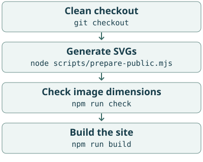

The news draft workflow stopped with `ENOENT`. Of the 4 failures we investigated, 3 occurred when Astro tried to read image dimensions from existing posts. On a clean checkout, the SVGs those posts referenced had yet to be generated. A local copy left over from a previous build could let the same check pass. [Failed candidate check](https://github.com/youdozi/youdozi.github.io/actions/runs/45548722494)

## Run the same check before and after generating the SVGs

In a separate directory at the failing commit, `npm run check` exited with code 1. After `node scripts/prepare-public.mjs` prepared the public assets in that directory, the same check exited with code 0. The build prepares assets too, but CI ran the check first.



To reproduce the CI sequence, use Node.js 24 and Python 3.11 in the repository root. Install dependencies with `npm ci`, then run the commands below. Each step must succeed before the next starts. [Fix in the pull request](https://github.com/youdozi/youdozi.github.io/pull/198) · [PR build result](https://github.com/youdozi/youdozi.github.io/actions/runs/45734945701)

```sh
node scripts/prepare-public.mjs &&
  npm run check &&
  npm run build
```

## A separate failure during generation

In another run, Gemini returned HTTP 503 during generation. The fix waits 1 second before the first retry and 2 seconds before the second, using the same model. All requests in the run share those two retries. [Failed generation run](https://github.com/youdozi/youdozi.github.io/actions/runs/45098322259)

For a dry run in Korean and English using an official Spring article, we mocked only the model responses for generation and review. We checked quotations against the actual article, checked links and validated the content against both the Python and Astro schemas. The dry run wrote nothing to the drafts or queue. Live Gemini availability remained untested.

When a check passes locally, start with the command that first reads the missing file on a clean checkout. Comparing that point with the step that creates the file can explain how a full build succeeds while an earlier check fails.
