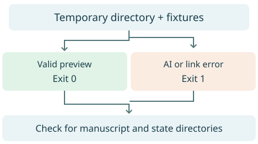

A draft can pass schema validation and still leave an entry in the publication queue. A dry-run test needs two assertions. Did the input produce the expected exit code? Do the manuscript, queue and state files match what was there before the run?

## Test a successful preview and a failed check

Run this command from the repository root with Python 3. Both tests use temporary directories and fixtures for the feed, draft generation and link checks. They run without network access or a model API key.

```sh
PYTHONPATH=scripts python3 -B -m unittest \
  test_bilingual_digest.PublicationTests.test_preview_validates_without_writing_content_or_state \
  test_bilingual_digest.PublicationTests.test_ai_or_link_failures_do_not_write
```



The first test passes `--dry-run --force` and checks for exit code 0 and `generated=false`. The second passes `--check-links`, injects an AI error and a link error in separate cases, and checks for exit code 1 each time. Both tests fail if `src` or `.pipeline` appears under the temporary root. Running the command above reported `Ran 2 tests` and `OK`.

## What the local run checked against the Spring article

A separate local run used one [article from the Spring AI team](https://spring.io/blog/2026/11/24/spring-ai-tool-call-confirmation-park-resume). The isolated test harness passed `--dry-run --force --max-items 1 --check-links` and supplied fixtures for just the Gemini generation and review responses. Running the CLI with those flags alone does not inject the fixtures.

The source returned HTTP 200. The run checked the links, matched 4 quotations across the Korean and English drafts against the live article, and validated the content against both the Python and Astro schemas. It emitted `generated=false`. A separate before-and-after comparison found identical paths and contents for all 3,333 manuscript, queue and state files. Live Gemini availability and output quality remained untested. [Local run record](https://github.com/youdozi/youdozi.github.io/pull/198)

## Limit permissions for a PR validation job

In the PR’s regular CI run, the required `build / build` check passed and `deploy` was skipped. The local run record above contains the evidence from the live Spring article. [PR check results](https://github.com/youdozi/youdozi.github.io/actions/runs/45734945701) · [Why Astro failed on a clean checkout (in Korean)](https://youdozi.github.io/ko/posts/2026-11-26-astro-clean-checkout/)

For a separate validation job, grant checkout only `contents: read` and leave out publication credentials. A read-only repository token still allows the process to modify its local checkout, so compare the manuscript, queue and state files before and after the run. [GitHub’s guide to job tokens](https://docs.github.com/en/actions/concepts/security/github_token)
