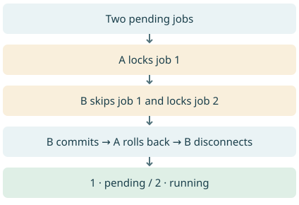

While A holds a lock on the first job, B can use `SKIP LOCKED` to claim the next one. If B dies just after committing its claim, the job stays `running`. Row locks let workers divide the work. The queue needs a separate record of when another worker can take over.

## Claim one job in each session

Connect session A to an empty practice database and run the setup in autocommit mode. Connect session B to the same database. Use the default isolation level, `READ COMMITTED`, in both sessions.

```sql
CREATE TABLE queue_demo (
  id bigint GENERATED ALWAYS AS IDENTITY PRIMARY KEY,
  status text NOT NULL DEFAULT 'pending'
);
INSERT INTO queue_demo (status) VALUES ('pending'), ('pending');
```

Run the following block in A first and leave the transaction open. Now run the same block in B. Keep both transactions open until you have seen both returned rows.

```sql
BEGIN;
WITH next_job AS (
  SELECT id FROM queue_demo
  WHERE status = 'pending'
  ORDER BY id
  LIMIT 1
  FOR UPDATE SKIP LOCKED
)
UPDATE queue_demo AS job
SET status = 'running'
FROM next_job
WHERE job.id = next_job.id
RETURNING job.id, job.status;
```



`ORDER BY id` sets the order in which workers consider candidates. B can commit first, so jobs can finish out of order. PostgreSQL documents this use of row locking for multiple consumers competing for rows in a queue table. [PostgreSQL SELECT locking clause](https://www.postgresql.org/docs/current/sql-select.html#SQL-FOR-UPDATE-SHARE)

## Disconnect after committing a claim

Run `COMMIT;` in B, then `ROLLBACK;` in A. Close B’s connection and query the remaining state from A.

```sql
SELECT id, status FROM queue_demo ORDER BY id;
```

I ran this with two connections to an isolated local PostgreSQL 17.12 instance. A’s claim returned `(1, running)` and B’s returned `(2, running)`. The final query returned these rows.

```text
id | status
1  | pending
2  | running
```

A’s rollback undid the status change. B’s commit released its lock and made its change durable. The next worker looks for `pending` rows, so it will still pass over job 2.

## Hand an expired claim to another worker

In a production queue, record a deadline and a fresh attempt ID and increment the attempt count in the short claim transaction. Do the work after commit. A recovery worker locks an expired running job and rechecks its state. If attempts remain, it assigns a new attempt ID and deadline. At the limit, mark the job as failed for investigation.

A late worker marks a job complete only when the job ID, running status and its own attempt ID still match. After a handoff this updates no rows. But a worker can send an email and die before recording completion. Reuse the same idempotency key for that email on every retry and have the mail service deduplicate sends by that key. The attempt ID changes on handoff. The send key stays the same.
